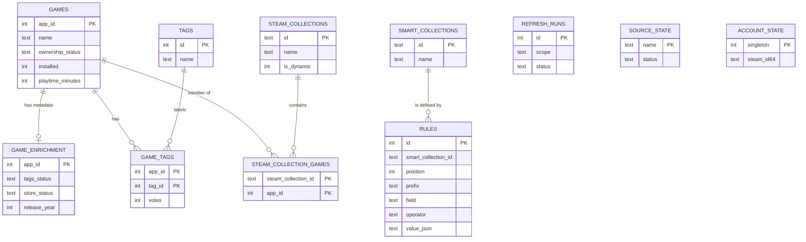

# game-cat v1: data model and HTTP API

Status: draft for [#3](https://github.com/fran2889/game-cat/issues/3), ready to fold into the
v1 spec ([#8](https://github.com/fran2889/game-cat/issues/8)).

This section defines the persistent model and the HTTP contract for game-cat v1. It does **not**
define the rule grammar, the rule evaluator, the run contract, or the UI. Those belong to
[#4](https://github.com/fran2889/game-cat/issues/4), [#6](https://github.com/fran2889/game-cat/issues/6),
and [#7](https://github.com/fran2889/game-cat/issues/7). Rule objects are transported and stored
here, but their `field`, `operator`, and `value` semantics are owned by #4.

Related contracts:

- [Steam local library: file formats and discovery](https://github.com/fran2889/game-cat/blob/research/steam-local-library/docs/research/steam-local-library.md)
- [Steam metadata sources: the v1 enrichment contract](https://github.com/fran2889/game-cat/blob/research/metadata-sources/docs/research/metadata-sources.md)
- [Steam dynamic collections: `filterSpec`](https://github.com/fran2889/game-cat/blob/research/steam-filterspec/docs/research/steam-filterspec.md)
- [Architecture decision: Steam Web API for the full library roster](../adr/0001-steam-web-api-for-library-ownership.md)

The three research notes live on `research/*` branches; their summaries and accepted decisions
are also pinned in [#2](https://github.com/fran2889/game-cat/issues/2),
[#5](https://github.com/fran2889/game-cat/issues/5), and
[#14](https://github.com/fran2889/game-cat/issues/14). If a branch is deleted after the notes are
folded into the spec, the issue comment remains the stable reference.

## 1. Decisions

The decisions below were settled on #3 on 2026-11-13.

| Topic                     | Decision                                                                                                                                                                                                                                                                                                |
| ------------------------- | ------------------------------------------------------------------------------------------------------------------------------------------------------------------------------------------------------------------------------------------------------------------------------------------------------- |
| Library roster            | The MVP requires the **full owned game list**. Ownership comes from the Steam Web API (`IPlayerService/GetOwnedGames`). Local Steam files remain the source of truth for installed state, playtime, and Steam Collections. The stored Library is the union, with an explicit ownership status per Game. |
| Account binding           | One Steam account per data directory. The database records the SteamID64 on the first account-scoped refresh and refuses to open or use it under a different account. Switching accounts requires a new data directory; v1 has no in-place reset.                                                       |
| Smart Collection identity | Opaque UUIDv4 text IDs. Names are unique case-insensitively.                                                                                                                                                                                                                                            |
| Rule persistence          | Ordered rows. A PATCH replaces the whole Rules array atomically. `value` is opaque JSON to this layer.                                                                                                                                                                                                  |
| Enrichment storage        | A separate `game_enrichment` row per Game, with raw payloads and per-source status. Tags are normalized into `tags` and `game_tags`.                                                                                                                                                                    |
| HTTP conventions          | `/api` prefix, consistent envelope, camelCase fields, ISO-8601 UTC timestamps, integer minutes, `page`/`pageSize`, one error shape. No API version segment in v1.                                                                                                                                       |
| Refresh                   | Asynchronous runs, an aggregate status endpoint, and deduplication of a running refresh.                                                                                                                                                                                                                |
| Migrations                | `schema_migrations`, forward-only numbered migrations, a pre-migration backup, and a hard refusal to open a newer schema.                                                                                                                                                                               |
| Library search            | Game name only. Tag/genre/developer matching belongs to Rules.                                                                                                                                                                                                                                          |

## 2. Sources of truth

| Data                                | Source                                                                                                       | Notes                                                                                                                                                                       |
| ----------------------------------- | ------------------------------------------------------------------------------------------------------------ | --------------------------------------------------------------------------------------------------------------------------------------------------------------------------- |
| Ownership roster                    | Steam Web API `IPlayerService/GetOwnedGames/v1`                                                              | Requires a user Web API key and the selected account's SteamID64. One request per ownership refresh.                                                                        |
| Installed state, install path, size | `appmanifest_<appid>.acf` in every library                                                                   | `installed` is derived with the `StateFlags`/install-dir/depot test from the local-library note.                                                                            |
| Playtime, last played               | `localconfig.vdf`, plus `appmanifest.LastPlayed`                                                             | Minutes and Unix seconds; never stored as float hours.                                                                                                                      |
| Steam Collections                   | `userdata/<account-id>/config/cloudstorage/cloud-storage-namespace-1.json` plus the `.modified.json` overlay | Read-only mirror. If the overlay exists, merge it over the base by key, preferring the overlay entry. Dynamic collections are stored as opaque metadata, not as membership. |
| Tags                                | SteamSpy `appdetails`                                                                                        | Tag names with per-Game vote counts.                                                                                                                                        |
| Canonical metadata                  | Steam storefront `appdetails`                                                                                | Name, type, developers, publishers, genres, categories, release data, Metacritic, platforms.                                                                                |
| game-cat state                      | SQLite                                                                                                       | Smart Collections, Rules, refresh history, source health, account binding.                                                                                                  |

### 2.1 The Library is a union

`games` contains one row for every App ID seen in any of:

1. the GetOwnedGames response;
2. an `appmanifest_*.acf`;
3. `localconfig.vdf`'s `apps` block;
4. a Steam Collection's static membership.

The union is deliberate. A full ownership roster is the primary roster, but local files can
reveal Games the API omits (delisted Games, family-shared installs, an API outage). game-cat
must not drop a Game because one source is missing.

Each Game carries one of three ownership values:

| `ownership_status` | Meaning                                                                                                                                                                                                                                                                  |
| ------------------ | ------------------------------------------------------------------------------------------------------------------------------------------------------------------------------------------------------------------------------------------------------------------------ |
| `owned`            | Present in the most recent **conclusive** GetOwnedGames response. An empty response is inconclusive and does not change ownership.                                                                                                                                       |
| `local_only`       | Not present in the latest successful response, but has local evidence: an install, an entry in `localconfig.vdf`, or Steam Collection membership. Before the first successful ownership refresh, this applies to installed Games and Games present in `localconfig.vdf`. |
| `unknown`          | No ownership refresh has succeeded yet and the only evidence is Steam Collection membership. After the first successful ownership refresh, a collection-only row absent from the response becomes `local_only`.                                                          |

If the Web API is unavailable, `local_only` and `unknown` Games remain browsable, and
`GET /api/status` says why the roster may be incomplete. game-cat never claims a full Library
when ownership refresh has not succeeded.

### 2.2 Field precedence

| Field           | Precedence                                                                                                                                                                              |
| --------------- | --------------------------------------------------------------------------------------------------------------------------------------------------------------------------------------- |
| Display name    | Storefront `name` → GetOwnedGames `name` → `appmanifest.name` → SteamSpy `name` → `Game <appid>`                                                                                        |
| Playtime        | `localconfig.Playtime` when present; otherwise GetOwnedGames `playtime_forever`; `0` when neither exists                                                                                |
| Recent playtime | `localconfig.Playtime2wks` when present; otherwise GetOwnedGames `playtime_2weeks`; `NULL` when neither exists                                                                          |
| Last played     | `max(appmanifest.LastPlayed, localconfig.LastPlayed)`, `NULL` when neither exists                                                                                                       |
| Installed       | Local manifest only. `1` when a manifest is present, `0` when a successful scan finds none, `NULL` before any successful scan. A failed or unavailable scan leaves prior values intact. |
| Tags            | SteamSpy only. No fallback; an empty or missing tag payload is recorded as `missing`, not `ok`.                                                                                         |
| Release year    | Parsed storefront `release_date`; `NULL` when unparseable. The raw string is retained.                                                                                                  |

Storefront enrichment must never hide or delete a Game. Local scan must never overwrite a
storefront name with a stale local name.

Name updates by source:

| Source                | May replace `name` when current `name_source` is |
| --------------------- | ------------------------------------------------ |
| Local scan            | `placeholder`, `steamspy`                        |
| Ownership refresh     | `placeholder`, `local`, `steamspy`               |
| SteamSpy enrichment   | `placeholder`                                    |
| Storefront enrichment | any value except `storefront`                    |

The winning write sets `name_source` to its own source. Any write that changes `name` also
recomputes `name_key`. An empty or missing incoming name never changes `name`.

## 3. Domain model



## 4. SQLite schema

### 4.1 Connection settings

The process opens one SQLite database per game-cat data directory. The path, file permissions,
and backup location are part of the run contract (#7); the schema assumes a single local file.

At every connection:

```sql
PRAGMA journal_mode = WAL;
PRAGMA foreign_keys = ON;
PRAGMA busy_timeout = 5000;
PRAGMA synchronous = NORMAL;
```

WAL lets reads continue while a background refresh writes. Writes are serialized by the
application; v1 has no second writer process. `foreign_keys = ON` is mandatory because the
schema relies on `ON DELETE CASCADE`.

### 4.2 Migration table

The migration runner owns this table and creates it before applying numbered migrations:

```sql
CREATE TABLE IF NOT EXISTS schema_migrations (
    version    INTEGER PRIMARY KEY,
    name       TEXT    NOT NULL,
    applied_at INTEGER NOT NULL
);
```

`version` is a monotonically increasing integer starting at 1. `name` is the migration file's
slug. `applied_at` is Unix seconds. The runner also sets `PRAGMA user_version` to the highest
applied version for quick diagnostics; `schema_migrations` is authoritative.

### 4.3 Migration 0001

```sql
-- One Steam account per data directory.
CREATE TABLE account_state (
    singleton  INTEGER PRIMARY KEY CHECK (singleton = 1),
    steam_id64 TEXT    NOT NULL CHECK (length(steam_id64) > 0),
    bound_at   INTEGER NOT NULL
);

-- Games: identity, ownership, and local Steam state.
CREATE TABLE games (
    app_id                        INTEGER PRIMARY KEY,
    name                          TEXT    NOT NULL,
    name_key                      TEXT    NOT NULL,
    name_source                   TEXT    NOT NULL DEFAULT 'placeholder'
                                          CHECK (name_source IN ('placeholder', 'local', 'steam_web_api', 'steamspy', 'storefront')),
    ownership_status              TEXT    NOT NULL DEFAULT 'unknown'
                                          CHECK (ownership_status IN ('owned', 'local_only', 'unknown')),
    installed                     INTEGER          CHECK (installed IN (0, 1) OR installed IS NULL),
    library_path                  TEXT,
    install_dir                   TEXT,
    size_on_disk_bytes            INTEGER          CHECK (size_on_disk_bytes IS NULL OR size_on_disk_bytes >= 0),
    state_flags                   INTEGER,
    local_playtime_minutes        INTEGER          CHECK (local_playtime_minutes IS NULL OR local_playtime_minutes >= 0),
    api_playtime_minutes          INTEGER          CHECK (api_playtime_minutes IS NULL OR api_playtime_minutes >= 0),
    playtime_minutes              INTEGER NOT NULL DEFAULT 0
                                          CHECK (playtime_minutes >= 0),
    local_playtime_2weeks_minutes INTEGER          CHECK (local_playtime_2weeks_minutes IS NULL OR local_playtime_2weeks_minutes >= 0),
    api_playtime_2weeks_minutes   INTEGER          CHECK (api_playtime_2weeks_minutes IS NULL OR api_playtime_2weeks_minutes >= 0),
    playtime_2weeks_minutes       INTEGER          CHECK (playtime_2weeks_minutes IS NULL OR playtime_2weeks_minutes >= 0),
    manifest_last_played_at       INTEGER          CHECK (manifest_last_played_at IS NULL OR manifest_last_played_at >= 0),
    localconfig_last_played_at    INTEGER          CHECK (localconfig_last_played_at IS NULL OR localconfig_last_played_at >= 0),
    last_updated_at               INTEGER          CHECK (last_updated_at IS NULL OR last_updated_at >= 0),
    source_mask                   INTEGER NOT NULL DEFAULT 0 CHECK (source_mask >= 0),
    first_seen_at                 INTEGER NOT NULL,
    last_seen_at                  INTEGER NOT NULL
);

-- External metadata, one row per Game that has been enriched at least once.
CREATE TABLE game_enrichment (
    app_id              INTEGER PRIMARY KEY REFERENCES games(app_id) ON DELETE CASCADE,
    steamspy_name       TEXT,
    type                TEXT,
    developers_json     TEXT NOT NULL DEFAULT '[]' CHECK (json_valid(developers_json)),
    publishers_json     TEXT NOT NULL DEFAULT '[]' CHECK (json_valid(publishers_json)),
    genres_json         TEXT NOT NULL DEFAULT '[]' CHECK (json_valid(genres_json)),
    categories_json     TEXT NOT NULL DEFAULT '[]' CHECK (json_valid(categories_json)),
    platforms_json      TEXT NOT NULL DEFAULT '{}' CHECK (json_valid(platforms_json)),
    release_date_raw    TEXT,
    release_year        INTEGER,
    metacritic_score    INTEGER,
    tags_status         TEXT NOT NULL DEFAULT 'missing'
                                 CHECK (tags_status IN ('ok', 'missing', 'stale', 'error')),
    tags_fetched_at     INTEGER,
    tags_error          TEXT,
    store_status        TEXT NOT NULL DEFAULT 'missing'
                                 CHECK (store_status IN ('ok', 'unavailable', 'missing', 'stale', 'error')),
    store_fetched_at    INTEGER,
    store_error         TEXT,
    raw_steamspy_json   TEXT,
    raw_store_json      TEXT,
    updated_at          INTEGER NOT NULL
);

-- Tag vocabulary and per-Game vote counts.
CREATE TABLE tags (
    id       INTEGER PRIMARY KEY,
    name     TEXT NOT NULL,
    name_key TEXT NOT NULL UNIQUE
);

CREATE TABLE game_tags (
    app_id INTEGER NOT NULL REFERENCES games(app_id) ON DELETE CASCADE,
    tag_id INTEGER NOT NULL REFERENCES tags(id) ON DELETE CASCADE,
    votes  INTEGER NOT NULL CHECK (votes >= 0),
    PRIMARY KEY (app_id, tag_id)
);

-- Read-only mirror of Steam Collections.
CREATE TABLE steam_collections (
    id               TEXT PRIMARY KEY,
    name             TEXT NOT NULL,
    kind             TEXT NOT NULL CHECK (kind IN ('favorite', 'hidden', 'user', 'tag', 'system', 'other')),
    is_dynamic       INTEGER NOT NULL DEFAULT 0 CHECK (is_dynamic IN (0, 1)),
    filter_spec_json TEXT CHECK (filter_spec_json IS NULL OR json_valid(filter_spec_json)),
    raw_value_json   TEXT NOT NULL CHECK (json_valid(raw_value_json)),
    imported_at      INTEGER NOT NULL
);

CREATE TABLE steam_collection_games (
    steam_collection_id TEXT NOT NULL REFERENCES steam_collections(id) ON DELETE CASCADE,
    app_id              INTEGER NOT NULL REFERENCES games(app_id) ON DELETE CASCADE,
    PRIMARY KEY (steam_collection_id, app_id)
);

-- game-cat-owned Smart Collections.
CREATE TABLE smart_collections (
    id         TEXT PRIMARY KEY,
    name       TEXT NOT NULL,
    name_key   TEXT NOT NULL UNIQUE,
    created_at INTEGER NOT NULL,
    updated_at INTEGER NOT NULL
);

CREATE TABLE rules (
    id                  INTEGER PRIMARY KEY AUTOINCREMENT,
    smart_collection_id TEXT NOT NULL REFERENCES smart_collections(id) ON DELETE CASCADE,
    position            INTEGER NOT NULL CHECK (position >= 0),
    prefix              TEXT NOT NULL CHECK (prefix IN ('AND', 'OR', 'NOT')),
    field               TEXT NOT NULL CHECK (length(trim(field)) > 0),
    operator            TEXT NOT NULL CHECK (length(trim(operator)) > 0),
    value_json          TEXT NOT NULL CHECK (json_valid(value_json)),
    UNIQUE (smart_collection_id, position)
);

-- Refresh history and source health.
CREATE TABLE refresh_runs (
    id            INTEGER PRIMARY KEY AUTOINCREMENT,
    scope         TEXT NOT NULL CHECK (scope IN ('library', 'ownership', 'enrichment', 'all')),
    status        TEXT NOT NULL CHECK (status IN ('queued', 'running', 'succeeded', 'partial', 'failed')),
    steam_id64    TEXT,
    started_at    INTEGER NOT NULL,
    finished_at   INTEGER,
    total         INTEGER CHECK (total IS NULL OR total >= 0),
    done          INTEGER NOT NULL DEFAULT 0 CHECK (done >= 0),
    app_ids_json  TEXT CHECK (app_ids_json IS NULL OR json_valid(app_ids_json)),
    error_code    TEXT,
    error_message TEXT,
    stats_json    TEXT CHECK (stats_json IS NULL OR json_valid(stats_json))
);

CREATE TABLE source_state (
    name            TEXT PRIMARY KEY
                    CHECK (name IN ('steam_local', 'steam_web_api', 'steamspy', 'storefront')),
    status          TEXT NOT NULL
                    CHECK (status IN ('unknown', 'ok', 'partial', 'empty', 'stale',
                                      'not_configured', 'invalid_key', 'rate_limited',
                                      'blocked', 'offline', 'error')),
    last_success_at INTEGER,
    last_attempt_at INTEGER,
    retry_after_at  INTEGER,
    last_error      TEXT
);

-- Query surface used by the list and detail endpoints. It also exposes raw local fields for
-- diagnostics and future Fields.
CREATE VIEW v_games AS
SELECT
    g.app_id,
    g.name,
    g.name_key,
    g.name_source,
    g.ownership_status,
    g.installed,
    g.library_path,
    g.install_dir,
    g.size_on_disk_bytes,
    g.state_flags,
    g.local_playtime_minutes,
    g.api_playtime_minutes,
    g.playtime_minutes,
    g.local_playtime_2weeks_minutes,
    g.api_playtime_2weeks_minutes,
    g.playtime_2weeks_minutes,
    g.last_updated_at,
    g.source_mask,
    g.first_seen_at,
    g.last_seen_at,
    CASE
        WHEN COALESCE(g.manifest_last_played_at, 0) = 0
         AND COALESCE(g.localconfig_last_played_at, 0) = 0 THEN NULL
        ELSE MAX(COALESCE(g.manifest_last_played_at, 0),
                 COALESCE(g.localconfig_last_played_at, 0))
    END AS last_played_at,
    e.type,
    COALESCE(e.developers_json, '[]') AS developers_json,
    COALESCE(e.publishers_json, '[]') AS publishers_json,
    COALESCE(e.genres_json, '[]')     AS genres_json,
    COALESCE(e.categories_json, '[]') AS categories_json,
    COALESCE(e.platforms_json, '{}')  AS platforms_json,
    e.release_date_raw,
    e.release_year,
    e.metacritic_score,
    COALESCE(e.tags_status, 'missing')  AS tags_status,
    e.tags_fetched_at,
    COALESCE(e.store_status, 'missing') AS store_status,
    e.store_fetched_at
FROM games g
LEFT JOIN game_enrichment e ON e.app_id = g.app_id;

CREATE INDEX idx_games_name             ON games(name_key);
CREATE INDEX idx_games_ownership        ON games(ownership_status);
CREATE INDEX idx_games_installed        ON games(installed);
CREATE INDEX idx_games_playtime         ON games(playtime_minutes DESC);
CREATE INDEX idx_game_tags_tag          ON game_tags(tag_id, votes DESC);
CREATE INDEX idx_steam_collection_games ON steam_collection_games(app_id);
CREATE INDEX idx_steam_collections_name ON steam_collections(name, id);
CREATE INDEX idx_refresh_runs_started   ON refresh_runs(started_at DESC);
CREATE INDEX idx_refresh_runs_running   ON refresh_runs(scope, status)
                                        WHERE status IN ('queued', 'running');
CREATE INDEX idx_enrichment_release     ON game_enrichment(release_year);
CREATE INDEX idx_enrichment_metacritic  ON game_enrichment(metacritic_score);
CREATE INDEX idx_enrichment_tags_status ON game_enrichment(tags_status);
CREATE INDEX idx_enrichment_store_status ON game_enrichment(store_status);
```

### 4.4 Table notes

#### Name keys

`games.name_key`, `tags.name_key`, and `smart_collections.name_key` use the same normalization:
`name.normalize('NFC').trim().toLowerCase()`. Recompute the key whenever the source name changes.
The key is for matching and sorting; `name` is the display form. SQLite's `NOCASE` is ASCII-only,
so it is not used for these rules.

#### `account_state`

- One row binds the data directory to the Steam account whose local files it reads. `steam_id64`
  is a string because a 64-bit integer loses precision in JavaScript.
- The row is inserted before the first `library`, `ownership`, or `all` refresh that writes, using
  the selected account. Before it exists, the database is unbound and the first account-scoped
  refresh claims it.
- If the selected account's SteamID64 differs from the bound value, startup fails with
  `DB_ACCOUNT_MISMATCH` and a refresh fails with `ACCOUNT_MISMATCH`. Neither path writes or
  deletes anything. Switching accounts requires a new data directory; v1 has no in-place account
  reset.
- `bound_at` is Unix seconds.

#### `games`

- `app_id` is Steam's App ID and is the only public Game identifier.
- `name` is the best-known display name. `name_key` is the shared normalized form (§4.4) and is
  recomputed by every write that changes `name`; it backs case-insensitive search and name
  sorting. `name_source` records which source won: `placeholder`, `local`, `steam_web_api`,
  `steamspy`, or `storefront`. Name updates follow the matrix in §2.2.
- `ownership_status` is `owned`, `local_only`, or `unknown` (§2.1).
- `installed` is tri-state: `1` installed, `0` not installed, `NULL` unknown. The rule engine
  must not treat `NULL` as `0` (see #4).
- `local_*` and `api_*` columns preserve provenance. `playtime_minutes` and
  `playtime_2weeks_minutes` are the resolved values used by Rules and sorting.
- `manifest_last_played_at` and `localconfig_last_played_at` are raw Unix seconds. The API exposes
  their maximum as `lastPlayedAt`; `NULL` means never or unknown.
- `last_updated_at` is the appmanifest content-update time, not last played. `NULL` means unknown.
- `library_path`, `install_dir`, `size_on_disk_bytes`, `state_flags`, `manifest_last_played_at`,
  and `last_updated_at` are parsed from the appmanifest. `local_playtime_minutes`,
  `local_playtime_2weeks_minutes`, and `localconfig_last_played_at` are parsed from
  `localconfig.vdf`. `v_games` exposes these raw local fields for diagnostics and future Fields;
  no v1 endpoint returns them.
- `source_mask` is a bit set: `1` = GetOwnedGames, `2` = appmanifest, `4` = localconfig,
  `8` = Steam Collection. "Local evidence" means `(source_mask & 14) != 0`.
- `first_seen_at` and `last_seen_at` are game-cat audit timestamps, not Steam timestamps.

#### `game_enrichment`

- A missing row means "not enriched yet"; readers must treat its statuses as `missing` and its
  metadata as unknown. `v_games` makes this explicit by coalescing a missing row to
  `tags_status = 'missing'`, `store_status = 'missing'`, empty JSON arrays, and `{}` platforms.
- `steamspy_name` is a display-name fallback only. SteamSpy names lag renames, so they lose to
  the storefront, the ownership API, and a local manifest name.
- JSON columns hold canonical arrays/objects. `genres_json` and `categories_json` are arrays of
  names (`["Action", "Adventure"]`); the raw storefront objects remain in `raw_store_json`.
- `release_date_raw` is the exact localized string. `release_year` is parsed and may be `NULL`.
- `tags_status` and `store_status` are independent. A Game can have tags and no storefront data,
  or vice versa.
- `tags_fetched_at` and `store_fetched_at` drive the TTLs in the metadata contract.
- `tags_error` and `store_error` are short diagnostics for logs; they are not exposed by the API.
- Raw payloads are kept for forward compatibility. They are never returned by the API.
- `tags_status` is one of: `ok` (the latest SteamSpy response contained at least one Tag),
  `missing` (no SteamSpy data, or a response with no Tags), `stale` (last-known-good data is
  older than the metadata contract's TTL, or the last attempt was rate-limited or offline), or
  `error` (the last fetch failed for another reason). A Game with no enrichment row is `missing`.
- `store_status` is one of: `ok` (the storefront returned usable metadata), `unavailable` (the
  storefront returned `success: false`, meaning delisted, region-blocked, or not a store product;
  keep the last-known-good metadata), `missing` (no storefront data has been fetched yet), `stale`
  (last-known-good data is older than the TTL, or the last attempt was rate-limited or offline),
  or `error` (the last fetch failed for another reason). A Game with no enrichment row is
  `missing`.

#### `tags` and `game_tags`

- Tag names are unique case-insensitively via `name_key`; the first spelling seen is preserved in
  `name`.
- `name_key` is the shared normalized form (§4.4).
- `votes` is the SteamSpy vote count for that Game/Tag pair.
- A Tag's `gameCount` is computed as `COUNT(DISTINCT game_tags.app_id)` at query time. Tags with
  no Games are excluded from the API.

#### `steam_collections` and `steam_collection_games`

- `id` is Steam's own key suffix (`favorite`, `hidden`, `uc-…`, `from-tag-…`, `type-…`).
- `kind` is derived from the id: `favorite`, `hidden`, `uc-*` → `user`, `from-tag-*` → `tag`,
  `type-*` → `system`, everything else → `other`. The `tag` kind is Steam's tag-derived collection
  kind; it is unrelated to a `tags` row (a SteamSpy Tag).
- `is_dynamic` is `1` when the stored inner object has a valid `filterSpec` with
  `nFormatVersion: 2`. Dynamic collections have **no** rows in `steam_collection_games`; their
  `added` array is manual pins, not membership. `raw_value_json` preserves `added`, `removed`,
  and any `filterSpec` for diagnostics.
- Static collections store their membership (`added`) in `steam_collection_games`. `removed` is
  preserved in `raw_value_json` but ignored for static collections, matching the Steam client.
  This follows the `filterSpec` research; the older local-library note's `added - removed` reading
  is superseded for `from-tag-*` collections, which the client treats as static snapshots.
- Steam Collection names are not unique; Steam permits duplicates. Do not add a unique
  constraint. Smart Collection and Steam Collection names are separate namespaces; a collision
  is allowed and the UI distinguishes them by type.

#### `smart_collections` and `rules`

- `id` is an opaque UUIDv4 string generated by the server.
- `name` is the display name: 1-80 Unicode code points after trimming, with no control
  characters. `name_key` is the shared normalized form (§4.4) and is unique. A rename that only
  changes case is allowed on the same row.
- `position` is zero-based and contiguous within a Smart Collection. The API exposes rules as an
  ordered array and does not expose `rules.id`.
- `prefix` is `AND`, `OR`, or `NOT`. This enum is fixed by the domain model, so the database
  enforces it.
- `field` and `operator` are opaque to this section. The API validates them against the rule
  grammar registry owned by #4; the database only enforces non-empty strings.
- `value_json` stores the exact JSON value supplied by the client. The type is defined by the
  grammar (#4); storage does not coerce it. List values (for example the multi-select Game
  field) round-trip as JSON arrays.
- Smart Collection membership is **never** materialized. There is no membership table.

#### `refresh_runs` and `source_state`

- A refresh run is a `refresh_runs` row. `scope` is `library`, `ownership`, `enrichment`, or `all`.
- `status` is `queued`, `running`, `succeeded`, `partial`, or `failed`.
- `steam_id64` records the account used for that run. When the database is bound it must match
  `account_state.steam_id64`; an `enrichment` run on an unbound database stores `NULL`. A
  mismatch fails the run with `ACCOUNT_MISMATCH` without writing. It is a string because a
  64-bit integer loses precision in JavaScript.
- `total` and `done` drive progress. `stats_json` holds small, non-secret counters and warnings.
- `app_ids_json` stores the normalized, ascending App ID list for an `enrichment` run, or `NULL`
  for "all Games". It is the deduplication key for a running enrichment run.
- `source_state` is one row per source. `last_error` is a short, user-safe message; never a raw
  response body or an API key.
- Status vocabularies:
  - `steam_local`: `unknown`, `ok`, `partial`, `error`.
  - `steam_web_api`: `unknown`, `not_configured`, `ok`, `partial`, `empty`, `invalid_key`,
    `rate_limited`, `error`.
  - `steamspy` and `storefront`: `unknown`, `ok`, `partial`, `stale`, `rate_limited`,
    `blocked`, `offline`, `error`.
- The four source rows are created on first start with `status = 'unknown'`;
  `steam_web_api` becomes `not_configured` when no key or SteamID64 is configured. They are
  never deleted.
- On server start, any row left `queued` or `running` is marked `failed` with
  `error_code = 'INTERRUPTED'`.

### 4.5 Stored versus computed

| Value                                               | Stored                                                          | Computed at read time                         |
| --------------------------------------------------- | --------------------------------------------------------------- | --------------------------------------------- |
| Game identity, display name, ownership status       | `games`                                                         | —                                             |
| Bound Steam account                                 | `account_state.steam_id64`                                      | —                                             |
| Normalized name keys                                | `games.name_key`, `tags.name_key`, `smart_collections.name_key` | — (recomputed on write)                       |
| Installed state, install paths, size                | `games`                                                         | —                                             |
| Resolved playtime and recent playtime               | `games`                                                         | —                                             |
| Raw local/API playtime provenance                   | `games`                                                         | —                                             |
| Last played                                         | raw `manifest_*` and `localconfig_*` columns                    | `MAX(...)` in `v_games`                       |
| Canonical metadata, raw payloads, per-source status | `game_enrichment`                                               | —                                             |
| Tag vocabulary and votes                            | `tags`, `game_tags`                                             | Tag `gameCount`                               |
| Genre, category, developer, and publisher pickers   | `game_enrichment` JSON arrays                                   | Distinct values and `gameCount`               |
| Steam Collection metadata and static membership     | `steam_collections`, `steam_collection_games`                   | Static `gameCount`                            |
| Steam Collection dynamic flag                       | `steam_collections.is_dynamic`                                  | — (derived from `filter_spec_json` at import) |
| Smart Collection names and ordered Rules            | `smart_collections`, `rules`                                    | —                                             |
| Smart Collection membership                         | —                                                               | Rule evaluation (#4)                          |
| Rule preview                                        | —                                                               | Rule evaluation (#4)                          |
| Library/installed/enrichment counts                 | —                                                               | `GET /api/status` aggregates                  |
| Playtime in hours                                   | —                                                               | UI formatting only                            |
| Dynamic Steam Collection membership                 | —                                                               | Never computed in v1                          |

`filter_spec_json`, raw SteamSpy/store payloads, `retry_after_at`, and `stats_json` are retained
for diagnostics and forward compatibility (v3 and future Fields). No v1 read path depends on
their contents.

## 5. HTTP API

### 5.1 Conventions

- Base path: `/api`. There is no `/v1` segment; v1 changes are additive. A breaking change
  requires a new app major and a new path.
- Requests and responses are `application/json; charset=utf-8`. POST/PATCH bodies must be JSON;
  other content types return `415`.
- Response fields are camelCase. Database columns are snake_case.
- Timestamps are ISO-8601 UTC strings with `Z` (for example `2026-11-13T17:48:04Z`). Unix seconds
  are converted at the API boundary. `null` means unknown, not epoch zero.
- Durations are integer minutes (`playtimeMinutes`). The UI formats hours; the API never returns
  float hours.
- `appId` is a JSON number. `steamId64` is a JSON string to avoid JavaScript precision loss.
- Smart Collection IDs and Steam Collection IDs are JSON strings. Clients treat them as opaque.
- List responses use:

```json
{
  "data": [],
  "pagination": {
    "page": 1,
    "pageSize": 60,
    "totalItems": 0,
    "totalPages": 0
  },
  "meta": {}
}
```

`page` is 1-based. `pageSize` defaults to 60 and is capped at 200. `totalPages` is
`ceil(totalItems / pageSize)`, or `0` when `totalItems` is `0`. A list with no matches returns
`200` and `data: []`, never `404`.

- Error responses use one shape:

```json
{
  "error": {
    "code": "VALIDATION_ERROR",
    "message": "Request body is invalid",
    "details": {
      "fieldErrors": {
        "name": "must be 1-80 characters"
      }
    },
    "requestId": "01J..."
  }
}
```

`details` is optional and its shape is code-specific. `requestId` is present on every error and
is also returned in the `X-Request-Id` response header. Internal error details and stack traces
never appear in a response.

- Sorting is explicit: `sort` selects a whitelisted field, `order` is `asc` or `desc`. Game-list
  endpoints use `appId ASC` as the stable final tiebreaker. Lists that are not Game lists use
  their documented tiebreaker. `NULL` values sort last in both directions.

### 5.2 Common objects

#### `GameSummary`

```json
{
  "appId": 730,
  "name": "Counter-Strike 2",
  "ownershipStatus": "owned",
  "installed": true,
  "playtimeMinutes": 3602,
  "lastPlayedAt": "2021-05-04T02:20:40Z",
  "releaseYear": 2012,
  "metacriticScore": null,
  "type": "game",
  "platforms": {
    "windows": true,
    "mac": false,
    "linux": true
  },
  "enrichment": {
    "tagsStatus": "ok",
    "storeStatus": "ok"
  }
}
```

`installed` is `true`, `false`, or `null`. `ownershipStatus` is `owned`, `local_only`, or
`unknown` (§2.1). `platforms` is `null` when storefront metadata is unknown. `type` is the
storefront `type` (`game`, `dlc`, `demo`, `application`, `tool`, …) or `null`. `enrichment`
exposes the per-Game source statuses so a client can find Games that need a targeted refresh.

#### `GameDetail`

`GameDetail` adds the detail fields to `GameSummary`:

```json
{
  "appId": 620,
  "name": "Portal 2",
  "ownershipStatus": "owned",
  "installed": true,
  "playtimeMinutes": 612,
  "lastPlayedAt": "2024-01-02T20:11:00Z",
  "releaseYear": 2011,
  "releaseDateRaw": "Apr 18, 2011",
  "metacriticScore": 95,
  "type": "game",
  "platforms": { "windows": true, "mac": true, "linux": true },
  "developers": ["Valve"],
  "publishers": ["Valve"],
  "genres": ["Action", "Adventure"],
  "categories": ["Single-player", "Multi-player", "Co-op", "Steam Achievements"],
  "tags": [
    { "name": "Puzzle", "votes": 31415 },
    { "name": "Co-op", "votes": 21000 }
  ],
  "steamCollections": [{ "id": "favorite", "name": "Favorites", "kind": "favorite" }],
  "sizeOnDiskBytes": 13200000000,
  "enrichment": {
    "tagsStatus": "ok",
    "storeStatus": "ok",
    "tagsFetchedAt": "2026-11-13T17:48:04Z",
    "storeFetchedAt": "2026-11-13T17:48:26Z"
  }
}
```

- `tags` is sorted by `votes` descending, then `name` ascending.
- `steamCollections` contains static Steam Collections only. Dynamic collections are not
  materialized; clients discover them through `GET /api/steam-collections`.
- `enrichment` reports per-source status but never raw payloads.

#### `Rule`

```json
{
  "prefix": "AND",
  "field": "tag",
  "operator": "has",
  "value": "Roguelike"
}
```

`prefix` is `AND`, `OR`, or `NOT`. `field`, `operator`, and `value` are owned by #4; this
section only requires that `value` be valid JSON, that the total rule count be at most 100, and
that each serialized `value` be at most 16 KiB. Those caps are transport guards, not grammar
semantics. The API must not invent operators or coerce values. The example's `tag`/`has` and
`playtime`/`lt` names are illustrative only; #4 defines the real vocabulary.

#### `SmartCollection`

```json
{
  "id": "2f0c9f7e-6a5e-4a5b-9f0e-3f5b0c7a1d22",
  "name": "Short co-op games",
  "rules": [
    { "prefix": "AND", "field": "tag", "operator": "has", "value": "Co-op" },
    { "prefix": "AND", "field": "playtime", "operator": "lt", "value": 600 }
  ],
  "createdAt": "2026-11-13T18:00:00Z",
  "updatedAt": "2026-11-13T18:05:00Z"
}
```

Smart Collection list items omit `rules` and include `ruleCount`:

```json
{
  "id": "2f0c9f7e-6a5e-4a5b-9f0e-3f5b0c7a1d22",
  "name": "Short co-op games",
  "ruleCount": 2,
  "createdAt": "2026-11-13T18:00:00Z",
  "updatedAt": "2026-11-13T18:05:00Z"
}
```

#### `SteamCollectionSummary`

```json
{
  "id": "from-tag-492",
  "name": "Indie",
  "kind": "tag",
  "isDynamic": false,
  "gameCount": 84
}
```

For a dynamic collection, `gameCount` is `null` and `isDynamic` is `true`.

#### `RefreshRun`

```json
{
  "id": "42",
  "scope": "enrichment",
  "status": "running",
  "startedAt": "2026-11-13T18:10:00Z",
  "finishedAt": null,
  "total": 1300,
  "done": 120,
  "appIds": null,
  "error": null
}
```

`id` is the decimal `refresh_runs.id` as a string. `appIds` is the normalized selection for an
`enrichment` run, or `null` for all Games/other scopes. `error` is
`{ "code": "...", "message": "..." }` or `null`. Progress is advisory: `total` may be `null`
while a phase is still discovering its size, and `done` is monotonically increasing.

#### `Status`

```json
{
  "app": {
    "version": "0.1.0",
    "dbSchemaVersion": 1
  },
  "steam": {
    "state": "ready",
    "root": "/home/fran/.local/share/Steam",
    "account": {
      "steamId64": "76561198000000000",
      "accountId": "39734272",
      "personaName": "Fran"
    }
  },
  "ownership": {
    "state": "ok",
    "gameCount": 1234,
    "lastSuccessAt": "2026-11-13T18:00:00Z",
    "lastAttemptAt": "2026-11-13T18:00:00Z",
    "error": null
  },
  "library": {
    "gameCount": 1300,
    "installedCount": 123,
    "lastScanAt": "2026-11-13T18:01:00Z",
    "lastScanStatus": "ok"
  },
  "enrichment": {
    "tags": { "ok": 1000, "missing": 200, "stale": 50, "error": 50 },
    "store": { "ok": 1000, "unavailable": 100, "missing": 100, "stale": 50, "error": 50 },
    "lastSuccessAt": "2026-11-13T18:20:00Z"
  },
  "sources": [
    {
      "name": "steam_local",
      "status": "ok",
      "lastSuccessAt": "2026-11-13T18:01:00Z",
      "lastAttemptAt": "2026-11-13T18:01:00Z",
      "retryAfterAt": null,
      "lastError": null
    }
  ],
  "activeRefresh": null,
  "lastRefresh": {
    "id": "42",
    "scope": "all",
    "status": "succeeded",
    "startedAt": "2026-11-13T18:00:00Z",
    "finishedAt": "2026-11-13T18:20:00Z",
    "total": 1300,
    "done": 1300,
    "error": null
  }
}
```

- `steam.state`: `ready`, `not_found`, `no_account`, or `error`.
- `steam.account` is `null` when no account is selected. `AccountName` from `loginusers.vdf` is
  deliberately never exposed.
- `ownership.state`: `ok`, `partial`, `empty`, `not_configured`, `invalid_key`,
  `rate_limited`, or `error`. `unknown` is used before the first attempt. `partial` means the
  response was shorter than `game_count`, so absent Games were not reconciled. `empty` means a
  successful response with zero Games; if local evidence exists, the UI warns that the profile
  may be private. `ownership.error` is `{ "code": "...", "message": "..." }` or `null`.
- `library.lastScanStatus`: `never`, `ok`, `partial`, or `failed`. `never` maps to
  `steam_local.status = "unknown"` before the first scan; `failed` maps to
  `steam_local.status = "error"`; `partial` maps to `partial`.
- Enrichment counts classify every Game; a Game with no enrichment row counts as `missing` for
  both sources.
- `sources` is ordered `steam_local`, `steam_web_api`, `steamspy`, `storefront`. The array always
  contains all four; the example shows one for brevity.

### 5.3 Endpoints

| Method   | Path                                | Purpose                                                                       |
| -------- | ----------------------------------- | ----------------------------------------------------------------------------- |
| `GET`    | `/api/status`                       | Application, Steam, ownership, library, enrichment, source, and refresh state |
| `GET`    | `/api/games`                        | Library listing and name search                                               |
| `GET`    | `/api/games/{appId}`                | Game detail                                                                   |
| `GET`    | `/api/tags`                         | Tag typeahead                                                                 |
| `GET`    | `/api/rule-values`                  | Existing genre, category, developer, and publisher values for Rule pickers    |
| `GET`    | `/api/steam-collections`            | Read-only Steam Collection list                                               |
| `POST`   | `/api/rules/preview`                | Evaluate an unsaved Rules array                                               |
| `GET`    | `/api/smart-collections`            | List Smart Collections                                                        |
| `POST`   | `/api/smart-collections`            | Create a Smart Collection                                                     |
| `GET`    | `/api/smart-collections/{id}`       | Get a Smart Collection                                                        |
| `PATCH`  | `/api/smart-collections/{id}`       | Rename and/or replace Rules                                                   |
| `DELETE` | `/api/smart-collections/{id}`       | Delete a Smart Collection                                                     |
| `GET`    | `/api/smart-collections/{id}/games` | Evaluate a saved Smart Collection                                             |
| `POST`   | `/api/refresh`                      | Start a refresh run                                                           |
| `GET`    | `/api/refresh/{id}`                 | Poll a refresh run                                                            |

The Tag and Steam Collection lists are inputs to the Rule editor. The saved Smart Collection games
endpoint is the read side of a Smart Collection; the preview endpoint evaluates an unsaved Rules
array.

#### `GET /api/status`

Response: `{ data: Status }`.

Returns `200` whenever the server is running, including when Steam is missing, the ownership
key is unconfigured, and the database is empty. The UI uses `steam.state`, `ownership.state`,
and `library.lastScanStatus` to choose the onboarding or degraded state.

Enrichment coverage is aggregate here; per-Game statuses are in `GameSummary`/`GameDetail`, and
`GET /api/games?tagsStatus=missing` (or `storeStatus=...`) finds Games that need a targeted
refresh.

#### `GET /api/games`

Query parameters:

| Name          | Type    | Default | Rules                                                                                       |
| ------------- | ------- | ------- | ------------------------------------------------------------------------------------------- |
| `search`      | string  | —       | Trimmed and normalized; case-insensitive substring of `games.name_key`; max 200 characters. |
| `sort`        | enum    | `name`  | `name`, `playtime`, `lastPlayed`, `releaseYear`, `metacritic`, `appId`.                     |
| `order`       | enum    | `asc`   | `asc` or `desc`.                                                                            |
| `installed`   | boolean | —       | `true` → installed = 1; `false` → installed = 0; omitted → any, including `null`.           |
| `tagsStatus`  | enum    | —       | `ok`, `missing`, `stale`, or `error`.                                                       |
| `storeStatus` | enum    | —       | `ok`, `unavailable`, `missing`, `stale`, or `error`.                                        |
| `page`        | integer | `1`     | `>= 1`.                                                                                     |
| `pageSize`    | integer | `60`    | `1..200`.                                                                                   |

Response: `{ data: GameSummary[], pagination, meta: { dataAsOf } }`.

`name` sorting uses `name_key`. Each `GameSummary` includes its enrichment statuses, so a
client can drive a targeted refresh without fetching every Game detail.

`dataAsOf` is the later of the last successful local scan, ownership refresh, and enrichment
completion, or `null` if none has succeeded. Search does not match tags, genres, developers, or
publishers. Substring search is a scan; the `name_key` index supports sorting and prefix/equality
lookups. FTS5 is deliberately deferred.

#### `GET /api/games/{appId}`

`appId` is a positive integer. Returns `{ data: GameDetail }` or `404 NOT_FOUND`.

#### `GET /api/tags`

Query parameters: `query` (max 80 characters), `page` (default 1), `pageSize` (default 20, max
100). The response is a normal paginated list:

```json
{
  "data": [
    { "name": "Roguelike", "gameCount": 42 },
    { "name": "Rogue-like", "gameCount": 3 }
  ],
  "pagination": {
    "page": 1,
    "pageSize": 20,
    "totalItems": 2,
    "totalPages": 1
  }
}
```

Returns Tags whose `name_key` contains the normalized `query`, ordered by `gameCount` descending,
then `name_key` ascending, then `id` ascending. The query is normalized the same way as
`name_key`. Only Tags with at least one Game are returned. This feeds the Rule value picker; the
library search box remains name-only.

#### `GET /api/rule-values`

Query parameters:

| Name       | Type    | Default | Rules                                                                  |
| ---------- | ------- | ------- | ---------------------------------------------------------------------- |
| `field`    | enum    | —       | Required: `genre`, `category`, `developer`, or `publisher`.            |
| `query`    | string  | —       | Trimmed and normalized; case-insensitive substring; max 80 characters. |
| `page`     | integer | `1`     | `>= 1`.                                                                |
| `pageSize` | integer | `20`    | `1..100`.                                                              |

Returns the distinct values already present in the matching `game_enrichment` JSON array, with
`gameCount` as the number of distinct Games:

```json
{
  "data": [
    { "value": "Action", "gameCount": 42 },
    { "value": "Adventure", "gameCount": 31 }
  ],
  "pagination": {
    "page": 1,
    "pageSize": 20,
    "totalItems": 2,
    "totalPages": 1
  }
}
```

Values are grouped by the §4.4 normalization; the lexicographically smallest spelling is the
display form. Only values with at least one Game are returned, ordered by `gameCount` descending,
then normalized value ascending. The endpoint is computed from `genres_json`, `categories_json`,
`developers_json`, or `publishers_json` at read time and adds no table. An unsupported `field`
returns `422 VALIDATION_ERROR` with `details.fieldErrors.field`. Tag values continue to use
`GET /api/tags`. #4 owns how these values map to Rule fields and operators; this endpoint only
feeds the picker.

#### `GET /api/steam-collections`

Returns `{ data: SteamCollectionSummary[], pagination }`. Query: `page` (default 1), `pageSize`
(default 60, max 200). Ordered by `name` ascending, then `id` ascending. No write endpoints exist
in v1.

#### `POST /api/rules/preview`

Body:

```json
{
  "rules": [{ "prefix": "AND", "field": "tag", "operator": "has", "value": "Roguelike" }],
  "page": 1,
  "pageSize": 60,
  "sort": "name",
  "order": "asc"
}
```

Returns `{ data: GameSummary[], pagination, meta: { dataAsOf } }`. `pagination.totalItems` is
the number of matching Games before paging. The request does not persist and does not require a
Smart Collection.

#### `GET /api/smart-collections`

Query: `page`, `pageSize`, `sort` (`name` or `updatedAt`), `order`. Defaults are `name` and
`asc`; `name` sorts on `name_key`.

Returns `{ data: SmartCollectionListItem[], pagination }`.

#### `POST /api/smart-collections`

Body: `{ "name": "...", "rules": [ Rule, ... ] }`. `name` is required; `rules` is optional and
defaults to `[]`. `rules` may be empty; #4 owns the meaning of an empty rule set.

Returns `201`, `Location: /api/smart-collections/{id}`, and `{ data: SmartCollection }`.

Errors: `422 VALIDATION_ERROR`, `409 NAME_CONFLICT`.

#### `GET /api/smart-collections/{id}`

Returns `{ data: SmartCollection }` or `404 NOT_FOUND`.

#### `PATCH /api/smart-collections/{id}`

Body may contain `name`, `rules`, or both. At least one is required.

When `rules` is present, the server validates the full array, deletes the existing rows, inserts
the new rows with contiguous positions, and updates `updated_at` in one transaction. A failure
leaves the old name and Rules untouched. Rule IDs are not stable across a replacement; clients
must use array position as the identity while editing.

Returns `{ data: SmartCollection }`.

Errors: `422 VALIDATION_ERROR`, `404 NOT_FOUND`, `409 NAME_CONFLICT`.

#### `DELETE /api/smart-collections/{id}`

Returns `204` with no body. Rules are deleted by cascade. Returns `404 NOT_FOUND` when the id is
unknown. A client retrying a successful delete should treat `404` as success.

#### `GET /api/smart-collections/{id}/games`

Query: `page`, `pageSize`, `sort`, `order` (same whitelist as `/api/games`).

Returns `{ data: GameSummary[], pagination, meta: { dataAsOf } }`, evaluating the stored Rules
against the current Library. If the collection has no matches, `data` is `[]` with
`totalItems: 0`. This is the read side of a saved Smart Collection; the preview endpoint is for
an unsaved Rules array.

#### `POST /api/refresh`

Body:

```json
{ "scope": "all" }
```

`scope` is `library`, `ownership`, `enrichment`, or `all`.

- `library`: re-read local Steam files.
- `ownership`: call GetOwnedGames.
- `enrichment`: refresh metadata for all Games, or only `appIds` when supplied.
- `all`: `library`, then `ownership`, then `enrichment`.

`appIds` is only valid with `enrichment`; it is an array of 1-5000 positive integers. Supplying
it with any other scope is `422 VALIDATION_ERROR`. A manual enrichment refresh bypasses the
normal TTL for the selected Games.

Returns `202` with `{ data: RefreshRun }` and `Location: /api/refresh/{id}`.

If `scope = ownership` and the Web API key or SteamID64 is not configured, return
`409 OWNERSHIP_NOT_CONFIGURED` with `details: { "missing": ["webApiKey"] }` or `["steamId64"]`.
If `scope = all` and ownership is not configured, run the local and enrichment phases, skip
ownership, and finish the run as `partial` with `error.code = "OWNERSHIP_NOT_CONFIGURED"`. Never
claim a full roster in that case.

Deduplication:

- If a run with the same scope and, for `enrichment`, the same normalized `appIds` selection is
  already `queued` or `running`, return `202` with that run and `meta: { "deduplicated": true }`.
  An omitted `appIds` means "all Games" and only deduplicates another all-Games request.
- If any other run is running — a different scope, or an `enrichment` run with a different
  selection — return `409 REFRESH_IN_PROGRESS` with
  `details: { "runId": "...", "scope": "..." }`. v1 has one refresh worker; it does not queue a
  second request.

#### `GET /api/refresh/{id}`

Returns `{ data: RefreshRun }` or `404 NOT_FOUND`.

### 5.4 Validation limits

| Field                      | Limit                                                      |
| -------------------------- | ---------------------------------------------------------- |
| Smart Collection name      | 1-80 Unicode code points after trim; no control characters |
| Rules per Smart Collection | 0-100                                                      |
| Rule `field` / `operator`  | 1-64 characters, non-blank                                 |
| Serialized Rule `value`    | 16 KiB                                                     |
| Request body               | 256 KiB                                                    |
| `search`                   | 200 characters                                             |
| Tag `query`                | 80 characters                                              |
| Tag `pageSize`             | 1-100                                                      |
| Rule value `query`         | 80 characters                                              |
| Rule value `pageSize`      | 1-100                                                      |
| `pageSize`                 | 1-200                                                      |
| Refresh `appIds`           | 1-5000                                                     |

Validation happens at the HTTP boundary. Internal code trusts the parsed values. Third-party
responses (Steam Web API, SteamSpy, storefront) are untrusted and are validated before storage.

### 5.5 Error codes

| HTTP  | Code                       | When                                                       |
| ----- | -------------------------- | ---------------------------------------------------------- |
| `400` | `MALFORMED_JSON`           | The body is not valid JSON.                                |
| `404` | `NOT_FOUND`                | Unknown Game, Smart Collection, or refresh run.            |
| `409` | `NAME_CONFLICT`            | A Smart Collection name already exists (case-insensitive). |
| `409` | `REFRESH_IN_PROGRESS`      | A different refresh scope is already running.              |
| `409` | `OWNERSHIP_NOT_CONFIGURED` | An ownership-only refresh has no Web API key or SteamID64. |
| `413` | `PAYLOAD_TOO_LARGE`        | The request body exceeds 256 KiB.                          |
| `415` | `UNSUPPORTED_MEDIA_TYPE`   | A POST/PATCH body is not JSON.                             |
| `422` | `VALIDATION_ERROR`         | Schema or semantic validation failed.                      |
| `500` | `INTERNAL_ERROR`           | Unexpected server failure.                                 |

`NAME_CONFLICT` details include `{ "conflictingId": "..." }`. `NOT_FOUND` details include the
looked-up identifier. `OWNERSHIP_NOT_CONFIGURED` details include
`{ "missing": ["webApiKey" | "steamId64"] }`. `VALIDATION_ERROR` details include `fieldErrors`
keyed by dotted path (for example `rules.0.prefix`).

### 5.6 Empty and degraded states

| Situation                        | Response                                                         | UI signal                                                        |
| -------------------------------- | ---------------------------------------------------------------- | ---------------------------------------------------------------- |
| Fresh database, no scan          | `200` list with `data: []`                                       | `status.library.lastScanStatus = "never"`                        |
| Steam not installed              | `200`; Games may still exist from a previous scan or the Web API | `status.steam.state = "not_found"`                               |
| No account selected              | `200`; local files may still be readable                         | `status.steam.state = "no_account"`                              |
| Web API key missing              | `200` with local-only Games                                      | `status.ownership.state = "not_configured"`                      |
| Ownership API returns zero Games | `200` with existing rows unchanged                               | `status.ownership.state = "empty"`; warn about a private profile |
| Ownership API fails              | `200` with cached rows                                           | `status.ownership.state = "error"`                               |
| No search/rule matches           | `200` with `data: []`, `totalItems: 0`                           | Empty collection state, not an error                             |
| No Smart Collections             | `200` with `data: []`                                            | Create CTA                                                       |
| Enrichment missing               | Game still returned; `tags: []`, metadata `null`                 | "no tags yet" / "metadata unavailable"                           |
| Refresh running                  | `200` with cached data                                           | `status.activeRefresh` drives a progress indicator               |
| Unknown id                       | `404 NOT_FOUND`                                                  | Route-level error                                                |
| Validation failure               | `422 VALIDATION_ERROR`                                           | Field-level messages                                             |

An empty list is not an error. `404` is reserved for a specific resource that does not exist.

### 5.7 Idempotency and concurrency

- `POST /api/refresh` deduplicates an identical running request (same scope and enrichment
  selection) and rejects any other running refresh with `409`. Retrying a refresh request is safe.
- `POST /api/smart-collections` is not idempotent; a retry with the same name returns
  `409 NAME_CONFLICT`. That is intentional and exposes the duplicate to the user.
- `PATCH` is last-write-wins. v1 is a single-user local app; there is no ETag or version field.
- Writes are serialized. A PATCH and a refresh do not deadlock: refresh writes batches in short
  transactions, and the Smart Collection transaction is independent.

## 6. Refresh flows

### 6.1 Local library scan (`scope = library`)

1. Discover the Steam root and account per the local-library contract. The account guard in
   §6.4 applies; if `account_state` is unbound, this scan may claim it.
2. Read every library's `appmanifest_*.acf`, the selected account's `localconfig.vdf`, and the
   cloud-storage base file plus `cloud-storage-namespace-1.modified.json` when present. Filter
   cloud-storage keys to `user-collections.*`, skip entries with `is_deleted: true`,
   double-decode each `entry.value`, and merge the overlay over the base by key, preferring the
   overlay entry.
3. Upsert a `games` row for every App ID in the union. Set `source_mask` bits and local fields.
   Parse `library_path`, `install_dir`, `size_on_disk_bytes`, `state_flags`,
   `manifest_last_played_at`, and `last_updated_at` from each manifest; parse
   `local_playtime_minutes`, `local_playtime_2weeks_minutes`, and `localconfig_last_played_at`
   from `localconfig.vdf`. Set `ownership_status` per §2.1 for a new row: `local_only` when it
   has local evidence, except a collection-only row before the first successful ownership refresh,
   which is `unknown`. Clamp negative `Playtime` and `Playtime2wks` values to `0` and record a
   data-quality warning. Update the display name only when §2.2 permits it; never overwrite a
   storefront or ownership name.
4. On a successful scan, recompute the local `source_mask` bits (2, 4, and 8) for every `games`
   row from the evidence just read, and set `installed` to `1` when a manifest is present or `0`
   when it is not; do not clear bit 1 (ownership). Delete a row whose status is not `owned` when
   its local bits all become `0`. If Steam is not found or the scan fails, leave prior values
   intact and mark the scan `failed` or `partial`.
5. Replace the Steam Collection mirror on a successful scan: upsert collections, replace static
   membership, and delete collections that no longer exist. Dynamic collections get metadata
   only.
6. Update `refresh_runs` and `source_state`.

A scan never writes a Steam file.

### 6.2 Ownership refresh (`scope = ownership`)

Request:

```http
GET https://api.steampowered.com/IPlayerService/GetOwnedGames/v1/
    ?key=<key>
    &steamid=<steamid64>
    &include_appinfo=1
    &include_played_free_games=1
    &language=english
    &format=json
```

The request uses the endpoint's core parameters only. Any additional coverage flags are optional
and must not be assumed stable. The key is server-side configuration. It is never stored in
SQLite, returned by the API, or written to logs. The SteamID64 comes from the selected account in
`loginusers.vdf`; #7 defines how the user supplies a key and how the account is selected.

Response handling:

| Upstream result                                       | Stored effect                                                          | `source_state` / `ownership.state` |
| ----------------------------------------------------- | ---------------------------------------------------------------------- | ---------------------------------- |
| `200`, `game_count > 0`, `games.length == game_count` | Upsert every returned Game as `owned`; reconcile absent rows (§6.2.1). | `ok`                               |
| `200`, `game_count > 0`, shorter `games` array        | Upsert returned Games; do **not** delete absent rows.                  | `partial`                          |
| `200`, `game_count == 0` or no `games`                | Do not delete anything. Record `empty`.                                | `empty`                            |
| `401` / `403`                                         | Keep cached data.                                                      | `invalid_key`                      |
| `429`                                                 | Keep cached data; honour `Retry-After`.                                | `rate_limited`                     |
| `5xx`, timeout, network error                         | Keep cached data; retry with backoff.                                  | `error`                            |

A successful upsert sets `ownership_status = 'owned'`, fills `api_playtime_minutes` and
`api_playtime_2weeks_minutes`, and updates `last_seen_at`. Local playtime wins when present; the
API value fills `playtime_minutes` only when the local value is absent. The same rule applies to
`playtime_2weeks_minutes`. The upsert sets `source_mask = source_mask | 1` (the GetOwnedGames
bit). Apply the §2.2 name-update rule.

#### 6.2.1 Reconciliation

Only reconcile absent rows when the upstream response is conclusive
(`game_count == games.length` and `game_count > 0`):

- Clear bit 1 (ownership) on every existing row not present in the response.
- A row with local evidence (`source_mask & 14 != 0`) becomes `local_only`. This includes
  collection-only rows (bit 8).
- A row with no local evidence and `ownership_status = 'owned'` is deleted. Its enrichment and
  tag rows cascade.

Deletion here is not "one source is missing": it requires a conclusive ownership response and
zero local evidence. An empty response is inconclusive: a private profile, a new account, and a
genuinely empty library look identical. Never treat it as permission to delete.

### 6.3 Enrichment (`scope = enrichment`)

- Enrich every Game in `games`, or the supplied `appIds`.
- Fetch SteamSpy and storefront independently per the metadata contract.
- Upsert `game_enrichment`; replace a Game's `game_tags` atomically.
- Apply the §2.2 name-update rule; a SteamSpy name only fills a placeholder.
- Update `tags_status`, `store_status`, timestamps, and raw payloads.
- A missing or failed enrichment never deletes a Game and never removes its local data.

### 6.4 Refresh orchestration

- Before any refresh writes, when the database is bound:
  - A different selected SteamID64 fails the run with `ACCOUNT_MISMATCH` and leaves all data
    untouched.
  - A missing selected account fails a `library`, `ownership`, or `all` refresh without writing.
- A `library`, `ownership`, or `all` refresh on an unbound database binds the selected SteamID64
  before its first write; a missing selected account fails that refresh without writing. An
  `enrichment` refresh does not bind an account.
- `all` runs `library`, then `ownership`, then `enrichment`.
- An `enrichment` run stores its normalized, ascending `appIds` selection in
  `refresh_runs.app_ids_json`; `NULL` means all Games.
- Progress is persisted in `refresh_runs` at most every 25 items to avoid write amplification.
- `partial` means the run completed with some per-Game or per-source failures; it is not a fatal
  error.
- On process start, stale `queued`/`running` rows become `failed` with `INTERRUPTED`.

## 7. Migrations

1. Open the database and set the connection pragmas (§4.1).
2. Inspect `sqlite_master` for `schema_migrations` and for any user tables (ignore
   `sqlite_*` internal tables).
3. If `schema_migrations` is absent and there are no user tables, create it and treat the
   database as version 0 (fresh).
4. If `schema_migrations` is absent but user tables exist, refuse to start with
   `DB_UNRECOGNIZED`; do not guess at an unknown schema.
5. Read `MAX(version)`. If it is greater than the app's highest bundled migration, refuse to
   start with `DB_SCHEMA_TOO_NEW` and name both versions. Do not modify the file.
6. If migrations are pending, make a consistent pre-migration copy with
   `VACUUM INTO 'game-cat.pre-v<target>-<epoch>.sqlite'` (or SQLite's backup API), then apply
   each migration in its own `BEGIN IMMEDIATE` transaction, insert its `schema_migrations` row,
   and update `PRAGMA user_version`. A fresh database has nothing to back up; skip the copy.
7. On any migration error, roll back that migration, leave the previous version intact, and
   refuse to start. The backup remains for manual recovery.
8. Keep the last three pre-migration backups; delete older ones after a successful start.

After migrations, read the selected account and compare it with `account_state.steam_id64`. If the
database is bound to a different SteamID64, refuse to start with `DB_ACCOUNT_MISMATCH`; do not
modify the file. A fresh or unbound database binds on the first account-scoped refresh.

`DB_UNRECOGNIZED`, `DB_SCHEMA_TOO_NEW`, and `DB_ACCOUNT_MISMATCH` are startup error codes (logged
and followed by a non-zero exit), not HTTP errors.

Migrations are forward-only. There are no down migrations in v1. Rollback means restoring the
pre-migration backup and running the previous app version. Migration files are immutable once
released; a correction is a new numbered migration.

## 8. Security and privacy

- The server is local-only and unauthenticated in v1; #7 defines the bind address. Do not expose
  it beyond localhost.
- The Steam Web API key is a secret. It lives in server-side configuration or environment,
  never in SQLite, API responses, or logs. Redact `key` from upstream URLs in request logs.
- `loginusers.vdf`'s `AccountName` is sensitive and is never exposed. `SteamID64`, the derived
  account ID, and `PersonaName` may be shown.
- Launch options, license blobs, and raw localconfig data are not stored.
- Raw SteamSpy/store payloads are stored locally and are not returned by the API.
- All SQL uses bound parameters.
- v1 never opens a Steam file for writing and never writes inside the Steam tree.
- CORS is same-origin only. No `Access-Control-Allow-Origin: *`.

## 9. Acceptance checks

These checks are intended to become part of the v1 acceptance criteria in #8.

### Schema and migrations

- [ ] A fresh database applies migration 0001 and `schema_migrations` contains version 1.
- [ ] All tables, indexes, and `v_games` exist; `PRAGMA foreign_keys` is on.
- [ ] Opening a database whose schema version is newer than the app fails with
      `DB_SCHEMA_TOO_NEW` and does not change the file.
- [ ] A migration that throws leaves the previous schema version and data intact.
- [ ] Deleting a Smart Collection deletes its Rules; deleting a Game cascades its tags,
      enrichment, and Steam Collection membership.

### Ownership and library

- [ ] A database bound to account A refuses to start under account B with `DB_ACCOUNT_MISMATCH`;
      a refresh under account B fails with `ACCOUNT_MISMATCH` and leaves all rows intact.
- [ ] With a valid key, every Game in a complete GetOwnedGames response has a `games` row with
      `ownership_status = 'owned'`, even when it is not installed and has no local playtime.
- [ ] An installed Game absent from a complete ownership response remains in the database with
      `ownership_status = 'local_only'`.
- [ ] A Game that is only in a Steam Collection exists with `ownership_status = 'unknown'` before
      the first successful ownership refresh.
- [ ] A zero-Game ownership response does not delete local Games and sets
      `ownership.state = 'empty'`.
- [ ] A `429`, `401`, or network failure leaves the previous roster intact and records the source
      status.
- [ ] `playtimeMinutes` uses local playtime when present, otherwise API playtime; `lastPlayedAt`
      equals the maximum of manifest and localconfig timestamps, or `null` when both are absent.
- [ ] `installed` is `null` when no local scan has succeeded, and never silently becomes `false`
      because Steam is missing.
- [ ] After a successful scan, an owned Game with no manifest has `installed = 0`, and a Game
      removed from every Steam Collection no longer carries source bit 8.
- [ ] A negative local playtime is clamped to 0; the scan still succeeds and records a warning.

### Steam Collections

- [ ] A static Steam Collection stores its `added` membership; `removed` is ignored.
- [ ] A dynamic Steam Collection is stored with `isDynamic = true`, `filterSpec` metadata, and no
      membership rows.
- [ ] Renaming or deleting a Steam Collection in Steam is reflected by the next successful scan;
      a failed scan leaves the mirror unchanged.

### Smart Collections and rules

- [ ] Creating a Smart Collection returns a UUID, stores rules in order, and returns 201 with a
      `Location` header.
- [ ] Patching `rules` replaces the full array atomically; a validation error leaves the previous
      rules and name unchanged.
- [ ] Two Smart Collections cannot share a name differing only by case; the second returns
      `409 NAME_CONFLICT`.
- [ ] A rename that only changes case succeeds on the same collection.
- [ ] `GET /api/smart-collections/{id}/games` returns the same membership as
      `POST /api/rules/preview` with the identical rules and no intervening data change.
- [ ] A Smart Collection with no matches returns `200`, `data: []`, and `totalItems: 0`.
- [ ] No table or column stores Smart Collection membership.

### HTTP contract

- [ ] Every list response contains `data`, `pagination`, and, where specified, `meta`.
- [ ] Pagination is stable across pages: Game lists include `appId ASC`; other lists use their
      documented final tiebreaker.
- [ ] Unknown Game, Smart Collection, and refresh IDs return `404 NOT_FOUND`.
- [ ] All errors use the single error shape and include `requestId`.
- [ ] A request body over 256 KiB returns `413`; a non-JSON POST/PATCH returns `415`.
- [ ] `POST /api/refresh` with a running identical scope returns the existing run; a different
      scope returns `409 REFRESH_IN_PROGRESS`.
- [ ] A test injects a known API key and asserts it appears in no response, log line, or
      `refresh_runs` column.
- [ ] `GET /api/status` returns 200 for every combination of missing Steam, missing account, and
      missing ownership key.

### Enrichment

- [ ] Missing enrichment never removes a Game from any list.
- [ ] A Game with a missing or empty SteamSpy tag payload returns `tags: []` and
      `tagsStatus = "missing"`; it is never recorded as `ok` with zero tags.
- [ ] `GET /api/games?tagsStatus=missing` (and the equivalent `storeStatus` filter) returns only
      Games with that status and includes the status in every `GameSummary`.
- [ ] Tag search is case-insensitive and reports `gameCount` from distinct Games.
- [ ] `GET /api/rule-values?field=genre` returns existing genres with distinct-Game counts,
      matches case-insensitively, and rejects an unsupported field with `422 VALIDATION_ERROR`.
- [ ] A storefront name updates the display name; a later local scan does not overwrite it.
- [ ] A storefront `success: false` keeps the last-known-good metadata, records
      `store_status = "unavailable"`, and leaves the Game visible. The UI says "not available on
      the store", not "delisted"; the response cannot distinguish delisted, region-blocked, and
      invalid.

## 10. Dependencies and open questions

- **#4 (rule grammar/evaluator):** field and operator vocabulary, value types, zero-rule
  behavior, missing/unknown values, dynamic Steam Collections as a field, and evaluation order.
  This section stores and transports rules but does not interpret them.
- **#7 (run contract):** data directory, database path, port and bind address, config file,
  Web API key entry, account selection, logging destination, and process lifecycle. The key must
  never enter SQLite.
- **#1 (not yet specified):** family sharing, whether non-game types (soundtracks, tools, videos)
  are shown by default, and performance for 5k-20k Game libraries. v1 binds one account per data
  directory (§4.4); multi-account support is out of scope.
- **Steam Web API:** `IPlayerService/GetOwnedGames` is public, but its parameters and rate limits
  are not fully documented. It requires a key; private profiles can return an empty roster. One
  request per refresh keeps the risk low.
- **Cover art:** not part of this contract. The client can derive Steam CDN URLs from `appId`;
  if cover URLs become data, they belong in `game_enrichment`.
- **Search scaling:** v1 uses a case-insensitive substring scan. FTS5 is deliberately deferred
  until a performance budget exists.
