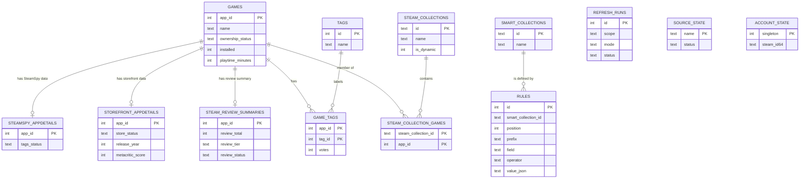

# game-cat v1: build-ready specification

Status: proposed for [#8](https://github.com/fran2889/game-cat/issues/8), ready for review. When this
document merges it becomes the single v1 contract and supersedes
[the data model and API draft](game-cat-v1-data-model-and-api.md),
[the rule grammar draft](game-cat-v1-rule-grammar.md), and
[the run contract draft](game-cat-v1-run-contract.md). Until then, those drafts remain the review
inputs and this document is the assembled proposal.

The spec is build-ready: every normative choice needed for implementation is made here. Remaining
unknowns are recorded only in [§11](#11-open-risks); none blocks implementation.

## Inputs

This document assembles the resolved tickets and links their evidence rather than duplicating it.

| Input                                    | Link                                                                                                                                                                                                                                                   |
| ---------------------------------------- | ------------------------------------------------------------------------------------------------------------------------------------------------------------------------------------------------------------------------------------------------------ |
| Parent map and scope                     | [#1](https://github.com/fran2889/game-cat/issues/1)                                                                                                                                                                                                    |
| Data model and HTTP API decisions        | [#3](https://github.com/fran2889/game-cat/issues/3) and [draft](game-cat-v1-data-model-and-api.md)                                                                                                                                                     |
| Rule grammar and evaluator decisions     | [#4](https://github.com/fran2889/game-cat/issues/4) and [draft](game-cat-v1-rule-grammar.md)                                                                                                                                                           |
| Steam metadata contract                  | [#5](https://github.com/fran2889/game-cat/issues/5) and [research note](https://github.com/fran2889/game-cat/blob/research/metadata-sources/docs/research/metadata-sources.md)                                                                         |
| Steam local library files and discovery  | [#2](https://github.com/fran2889/game-cat/issues/2) and [research note](https://github.com/fran2889/game-cat/blob/research/steam-local-library/docs/research/steam-local-library.md)                                                                   |
| Dynamic Steam Collections (`filterSpec`) | [#14](https://github.com/fran2889/game-cat/issues/14) and [research note](https://github.com/fran2889/game-cat/blob/research/steam-filterspec/docs/research/steam-filterspec.md)                                                                       |
| HLTB v2 source                           | [#9](https://github.com/fran2889/game-cat/issues/9) and [research note](https://github.com/fran2889/game-cat/blob/research/hltb-source/docs/research/hltb-source.md)                                                                                   |
| UI prototype and accepted decisions      | [#6](https://github.com/fran2889/game-cat/issues/6), [prototype](https://github.com/fran2889/game-cat/blob/prototype/v1-ui/docs/prototype/v1-ui.html), and [notes](https://github.com/fran2889/game-cat/blob/prototype/v1-ui/docs/prototype/README.md) |
| Run and distribution decisions           | [#7](https://github.com/fran2889/game-cat/issues/7) and [draft](game-cat-v1-run-contract.md)                                                                                                                                                           |
| Library ownership decision               | [ADR 0001](../adr/0001-steam-web-api-for-library-ownership.md)                                                                                                                                                                                         |
| License                                  | [ADR 0002](../adr/0002-license.md)                                                                                                                                                                                                                     |
| Vocabulary                               | [GLOSSARY.md](../../GLOSSARY.md)                                                                                                                                                                                                                       |

The research branches are throwaway. If a branch is deleted, the pinned issue comment remains the
stable summary. The prototype branch is also throwaway and is not merged; it is the UI reference,
not production code.

## Contents

- [1. Scope and non-goals](#1-scope-and-non-goals)
- [2. Domain model](#2-domain-model)
- [3. SQLite schema](#3-sqlite-schema)
- [4. HTTP API](#4-http-api)
- [5. Rule grammar and evaluation](#5-rule-grammar-and-evaluation)
- [6. Metadata and Refresh](#6-metadata-and-refresh)
- [7. UI flows and states](#7-ui-flows-and-states)
- [8. Run contract](#8-run-contract)
- [9. Acceptance criteria](#9-acceptance-criteria)
- [10. Test plan](#10-test-plan)
- [11. Open risks](#11-open-risks)

## 1. Scope and non-goals

### 1.1 Product statement

game-cat v1 is a locally run web application for one Steam Account. It combines the full owned Game
roster from the Steam Web API with installed state, playtime, and Steam Collections from local Steam
files; caches Tags, storefront Metadata, and Steam review summaries; and evaluates saved Smart
Collections over the resulting Library. It is read-only with respect to Steam.

The user opens a browser on the same machine, browses and searches the Library, builds Rules with
AND/OR/NOT prefixes, previews the match count, and saves reusable Smart Collections. A background
Refresh keeps local and external data current without blocking the UI.

### 1.2 v1 capabilities

1. Install from the GitHub repository, start a loopback-only server, and open the browser.
2. Detect Steam, select one Account, require a Steam Web API key, and run the first Fetch.
3. Maintain a Library that is the union of ownership, local installs, playtime, and Steam Collection
   membership, with an explicit Ownership status per Game.
4. Mirror Steam Collections read-only, including static membership and dynamic Collection metadata.
5. Browse the Library in a cover grid or a sortable table, search by Game name, filter to installed
   Games, and page through large Libraries.
6. Show Game detail with local state, storefront Metadata, Tags with votes, review summary, Steam
   Collections, Metadata status, a store link, and Launch for installed Games.
7. Create, rename, delete, and evaluate Smart Collections using the Rule grammar.
8. Preview matches while editing; autosave after the first explicit save; recover from save failures.
9. Refresh in Fetch mode (fill gaps) or Full Refresh mode (re-request selected Games), with per-source
   status, progress, deduplication, interruption recovery, and a Refresh-errors view.
10. Expose the documented HTTP API, persist all game-cat domain state in one SQLite database per data
    directory, and keep configuration and the API key in `config.json` or the environment.
11. Provide the startup, configuration, logging, lifecycle, and v4 wrapper seams in
    [§8](#8-run-contract).

### 1.3 Non-goals

The following are explicitly out of scope for v1.

- Writing Steam Collections, Steam files, or anything inside the Steam tree. That is v3.
- HLTB Time and any HLTB integration. That is v2.
- Non-Steam platforms, launchers, or shortcuts.
- Multiple Steam Accounts in one data directory and multi-account merging. One Account per data
  directory; Family Sharing is not resolved into a second roster.
- Manual pin/unpin overrides on a Smart Collection, nested Smart Collections, or a Rule that
  references another Smart Collection.
- Recommendations, similarity search, social features, sharing, cloud sync, and telemetry.
- A mobile application, LAN access, TLS, authentication, or a hosted mode.
- The v4 desktop wrapper itself; v1 only preserves the wrapper contract.
- Publishing to the npm registry, installers, Docker images, or a service/daemon.
- Automatic, periodic, or scheduled refreshes. v1 has one startup Fetch and user-triggered runs.
- Evaluating dynamic Steam Collection membership.
- Review-bomb adjustment, review language filters, or purchase-type filters beyond the documented
  review request.
- A per-Game error-message API. v1 exposes safe per-source errors and per-Game statuses only.
- Undo for Smart Collection edits, multi-user collaboration, or conflict resolution beyond
  last-write-wins.
- A separate visual identity. The prototype is the functional visual reference.

### 1.4 Sources of truth

| Data                                | Source                                                                                                       | Notes                                                                                                                                                          |
| ----------------------------------- | ------------------------------------------------------------------------------------------------------------ | -------------------------------------------------------------------------------------------------------------------------------------------------------------- |
| Ownership roster                    | Steam Web API `IPlayerService/GetOwnedGames/v1`                                                              | Requires a user Web API key and the selected Account's SteamID64. One request per ownership refresh.                                                           |
| Installed state, install path, size | `appmanifest_<appid>.acf` in every library                                                                   | `installed` is derived from `StateFlags`, the install directory, and depot presence, per the local-library note.                                               |
| Playtime, last played               | `localconfig.vdf`, plus `appmanifest.LastPlayed`                                                             | Minutes and Unix seconds; never stored as float hours.                                                                                                         |
| Steam Collections                   | `userdata/<account-id>/config/cloudstorage/cloud-storage-namespace-1.json` plus the `.modified.json` overlay | Read-only mirror. If the overlay exists, merge it over the base by key, preferring the overlay entry. Dynamic Collections are opaque metadata, not membership. |
| Tags                                | SteamSpy `appdetails`                                                                                        | Tag names with per-Game vote counts.                                                                                                                           |
| Canonical Metadata                  | Steam storefront `appdetails`                                                                                | Name, type, developers, publishers, genres, categories, release data, Metacritic, platforms.                                                                   |
| Review summary                      | Steam `appreviews/<appid>`                                                                                   | Score, tier, and counts. A third Metadata source.                                                                                                              |
| game-cat state                      | SQLite                                                                                                       | Smart Collections, Rules, refresh history, source health, Account binding.                                                                                     |
| Configuration and secret            | `config.json` or environment                                                                                 | The Steam Web API key never enters SQLite, API responses, logs, or backups.                                                                                    |

### 1.5 Architecture

- TypeScript end to end. The server is Node 24 or newer with Fastify. SQLite is accessed through
  `better-sqlite3` with the connection settings in [§3.1](#31-connection-settings). The browser client
  is React with Vite, built to static assets and served by the same process in production.
- One process serves the UI and `/api` on one loopback port. One in-process Refresh worker runs at a
  time. There is no queue, scheduler, second writer, or separate worker process.
- The server starts before the browser and exposes `GET /api/status` as its readiness signal.
- Local Steam files are only read. The only writes are to the data directory.
- Upstream access goes through small, injectable adapters (`SteamOwnershipSource`, `SteamSpySource`,
  `StorefrontSource`, `ReviewSource`, `SteamLocalReader`) so tests can replace them without changing
  the Refresh logic. The adapter boundaries are also the v2/v3 seams.
- The production build has no runtime network dependency except the documented Steam, SteamSpy, and
  Steam CDN endpoints. All game-cat state is local.

### 1.6 Build order

The contract is implementable in vertical slices. Each slice ends with its acceptance checks green.

| Slice | Delivers                                                                                       | Depends on |
| ----- | ---------------------------------------------------------------------------------------------- | ---------- |
| 1     | Scaffolding, config, startup, data directory, lock, migrations, SQLite schema                  | —          |
| 2     | Local scan, ownership refresh, Library persistence, `GET /api/games` and Game detail           | 1          |
| 3     | Metadata adapters, Fetch/Full Refresh engine, source state, status and refresh endpoints       | 2          |
| 4     | Rule evaluator, validation, preview, Smart Collection persistence and endpoints                | 2          |
| 5     | Library UI, detail dialog, onboarding, refresh banner, Refresh-errors view                     | 2, 3       |
| 6     | Smart Collection editor, live preview, autosave, selection handoff                             | 4, 5       |
| 7     | Launch, accessibility pass, performance pass, packaging, v4 wrapper seam, release verification | 1-6        |

### 1.7 Decisions this document makes

These were left open by earlier tickets. They are normative for v1.

| Topic                     | Decision                                                                                                                                                                                                                                                    |
| ------------------------- | ----------------------------------------------------------------------------------------------------------------------------------------------------------------------------------------------------------------------------------------------------------- |
| Library layout default    | Grid. The user can switch to table from the toolbar or table header controls.                                                                                                                                                                               |
| Layout persistence        | The choice is stored in browser `localStorage` per view kind (`library`, `installed`, `smart`, `steam`) under `game-cat.layout.v1.<viewKind>`. It is a client preference, not server state.                                                                 |
| Large Library rendering   | Server-side pagination at 60 Games per page. The client does not virtualize or render the full Library. Page controls replace infinite scrolling.                                                                                                           |
| Autosave                  | A new Smart Collection is created by an explicit Save. After that, name and Rule edits autosave 600 ms after the last change. One save is in flight at a time; newer edits coalesce into the next save. No undo in v1.                                      |
| Autosave failure          | Retry after 2 s, 5 s, and 15 s. Keep local edits, show `Save failed`, and offer Retry. Block navigation with a confirmation while the save is failed.                                                                                                       |
| Save conflicts            | Last-write-wins. v1 is single-user and has no ETag/version field.                                                                                                                                                                                           |
| Refresh-errors view       | A separate route, `/errors`, linked from the refresh banner. It lists one row per source with status, timestamps, retry deadline, safe last error, affected-Game count, and actions.                                                                        |
| Per-Game error text       | Not exposed. The API exposes per-Game statuses and per-source `lastError`; raw upstream bodies and per-Game error strings stay server-side.                                                                                                                 |
| Launch                    | Enabled only when `installed === true`. Opens `steam://rungameid/<appId>`. v1 cannot detect a launch failure; it shows an "Opening Steam" toast and never writes Steam files.                                                                               |
| Non-game Library entries  | Shown in the Library by default. `storefrontType` is a Rule Field, so DLC, demos, tools, and soundtracks can be filtered without being silently hidden.                                                                                                     |
| Table header sorting      | Table headers sort Game (`name`), Playtime, Last played, and Released (`releaseYear`). The toolbar sort control still exposes the full `/api/games` whitelist, including Metacritic and App ID. Installed, Review, and Tags headers are not sortable in v1. |
| Dynamic Steam Collections | Never evaluated and never counted. The UI labels them `dynamic` and explains that Steam computes their membership.                                                                                                                                          |
| Library search scope      | Game name only. Tags, Genres, developers, and playtime belong in Rules. FTS5 is deferred.                                                                                                                                                                   |
| New from selection limit  | Disabled with an explanation when the selection is empty or larger than 1,000, because the `game` Rule accepts 1-1,000 App IDs.                                                                                                                             |
| Empty Rules copy          | `No rules. This matches all N games. Add a rule to narrow it.`                                                                                                                                                                                              |
| No matches copy           | `No games match these rules. An OR rule widens the result; a NOT rule removes games.`                                                                                                                                                                       |
| NOT copy                  | `NOT removes matching games. It does not require the field to have a value.`                                                                                                                                                                                |
| Metadata source wording   | "Metadata", never "Enrichment". "Fetch" and "Full Refresh" are Refresh modes.                                                                                                                                                                               |

## 2. Domain model

### 2.1 Game, Library, and Ownership

A **Game** is an entry in the user's Steam Library, identified by its Steam App ID. A Game exists
whether or not it is installed.

The **Library** is the set of Games game-cat knows about for the selected Account. `games` contains
one row for every App ID seen in any of:

1. the `GetOwnedGames` response;
2. an `appmanifest_*.acf`;
3. `localconfig.vdf`'s `apps` block;
4. a Steam Collection's static membership.

The union is deliberate. A full ownership roster is the primary roster, but local files can reveal
Games the API omits: delisted Games, family-shared installs, or an API outage. game-cat must not drop a
Game because one source is missing.

**Ownership** is one property of a Library Game, not the definition of the Library.

| `ownership_status` | Meaning                                                                                                                                                                                                                                                                           |
| ------------------ | --------------------------------------------------------------------------------------------------------------------------------------------------------------------------------------------------------------------------------------------------------------------------------- |
| `owned`            | Present in the most recent **conclusive** `GetOwnedGames` response. An empty response is inconclusive and does not change Ownership.                                                                                                                                              |
| `local_only`       | Not present in the most recent **conclusive** response, but has local evidence: an install, an entry in `localconfig.vdf`, or Steam Collection membership. Before the first conclusive ownership refresh, this applies to installed Games and Games present in `localconfig.vdf`. |
| `unknown`          | No conclusive ownership refresh has completed yet and the only evidence is Steam Collection membership. After the first conclusive ownership refresh, a Collection-only row absent from the response becomes `local_only`.                                                        |

If the Web API is unavailable, `local_only` and `unknown` Games remain browsable, and
`GET /api/status` says why the roster may be incomplete. game-cat never claims a full Library when a
conclusive ownership refresh has not completed.

`source_mask` records evidence: `1` = `GetOwnedGames`, `2` = appmanifest, `4` = `localconfig`,
`8` = Steam Collection. "Local evidence" means `(source_mask & 14) != 0`.

### 2.2 Account

One Steam Account is bound to one data directory. The Account is the Steam account whose local Steam
files and owned-Games roster game-cat reads.

- The selected Account comes from `config.steamId64`, the single local account, the unique
  `MostRecent` account, or the newest `Timestamp` with a visible warning and the picker, in that
  order.
- The database binds to a SteamID64 before the first `library`, `ownership`, or `all` run that
  writes. A `metadata` run does not bind an Account.
- If the selected Account differs from `account_state.steam_id64`, startup exits
  `DB_ACCOUNT_MISMATCH` and a run fails with `ACCOUNT_MISMATCH`; neither writes or deletes data.
- Switching Accounts requires a new data directory. There is no in-place reset.
- `loginusers.vdf`'s `AccountName` is never exposed or logged. SteamID64, the derived account ID, and
  `PersonaName` may be shown.

The local Account ID used for `userdata/` is `steam_id64 - 76561197960265728`. A defensive reader tries
that directory first, then the SteamID64 folder, accepting whichever contains `config/localconfig.vdf`
or `config/cloudstorage/`.

### 2.3 Metadata

**Metadata** is Game data fetched from external sources and cached locally: SteamSpy Tags, storefront
details, and Steam review summaries. Missing Metadata never hides a Game and never removes local data.
Metadata is fetched at runtime and never redistributed.

| Source           | `source_state.name` | Supplies                                                                                    | Access                                         |
| ---------------- | ------------------- | ------------------------------------------------------------------------------------------- | ---------------------------------------------- |
| SteamSpy         | `steamspy`          | Tags with vote counts, SteamSpy name fallback                                               | Keyless, one App per request, about 1 req/s    |
| Steam storefront | `storefront`        | Name, type, developers, publishers, genres, categories, release date, Metacritic, platforms | Keyless, one App per request, 200 req/5 min    |
| Steam reviews    | `steam_reviews`     | Review score, review tier, review count                                                     | Keyless, shares the storefront host budget     |
| Local Steam      | `steam_local`       | Installed state, playtime, last played, Steam Collections                                   | Local files, read-only                         |
| Steam Web API    | `steam_web_api`     | Ownership roster                                                                            | Web API key, one request per ownership refresh |

`steam_local` and `steam_web_api` share the source-state table but are not Metadata sources. Metadata
status vocabularies are independent per Metadata source:

| Status        | `tags_status` | `store_status` | `review_status` | Meaning                                                                                 |
| ------------- | ------------- | -------------- | --------------- | --------------------------------------------------------------------------------------- |
| `ok`          | yes           | yes            | yes             | A usable value is stored.                                                               |
| `missing`     | yes           | yes            | yes             | No usable value has been fetched. With `*_fetched_at` set, a miss is settled for Fetch. |
| `unavailable` | no            | yes            | yes             | The source answered successfully with no usable value. Settled for Fetch.               |
| `stale`       | yes           | yes            | yes             | A later attempt failed and last-known-good values are served. Fetch retries.            |
| `error`       | yes           | yes            | yes             | The last attempt failed and no usable fallback was stored. Fetch retries.               |

A Game with no row for a source is read as `missing` with unknown values. `tags_status` has no
`unavailable`: a successful SteamSpy response with no Tags is a settled `missing` with
`tags_fetched_at` set, not a pending fetch.

Review semantics:

- `reviewScore` is the percentage of positive reviews, rounded half away from zero:
  `round(100 * review_positive / review_total)`, clamped to 0-100. It is `null` when
  `review_total` is `null` or `0`.
- `reviewTier` is Steam's `review_score_desc` string. "No user reviews" is not stored as a tier.
- `reviewCount` is `review_total`. A known zero is `0`; unknown is `null`. The distinction matters:
  `reviewCount lt 10` matches a known zero and not an unknown count.

Metadata is associated with the `metadata` Refresh scope. "Enrichment" is retired vocabulary.

### 2.4 Steam Collections

A **Steam Collection** is a grouping persisted by Steam itself, cached in Steam's cloud-storage JSON.
game-cat reads Steam Collections in v1 but never writes them.

- `id` is Steam's own key suffix: `favorite`, `hidden`, `uc-…`, `from-tag-…`, or `type-…`.
- `kind` is derived from the ID: `favorite`, `hidden`, `uc-*` → `user`, `from-tag-*` → `tag`,
  `type-*` → `system`, everything else → `other`.
- A Collection is dynamic when its stored inner object has a valid `filterSpec` with
  `nFormatVersion: 2`. Dynamic Collections have no membership rows; their `added` array is manual
  pins, not membership.
- Static Collections store their `added` membership. `removed` is preserved in the raw payload but
  ignored for static Collections, matching the Steam client. `from-tag-*` Collections are static
  snapshots.
- Steam Collection names are not unique; there is no unique constraint. Steam Collection names and
  Smart Collection names are separate namespaces; a collision is allowed and the UI distinguishes
  them by type.
- Dynamic Collections are visible in the sidebar and detail surfaces but never contribute to Rule
  matching and have `gameCount: null`.

### 2.5 Smart Collections and Rules

A **Smart Collection** is a named, persisted set of Rules owned by game-cat. Membership is computed by
evaluating the Rules against the current Library; it is never stored Game by Game.

- `id` is an opaque UUIDv4 string generated by the server.
- The name is 1-80 Unicode code points after trimming, with no control characters. Names are unique
  case-insensitively via the shared normalized form. A rename that only changes case is allowed on the
  same row.
- Rules are ordered by zero-based, contiguous `position`. A PATCH replaces the whole Rules array
  atomically.
- A Smart Collection has 0-100 Rules. An empty Rules array matches every Game.
- A Rule has a Prefix, a Field, an Operator, and a Value. Prefixes are `AND`, `OR`, and `NOT`.
  Prefixes group globally, not by adjacency.
- There is no `isNot`, `notHas`, or `notIn` operator. Negation is the `NOT` Prefix.
- A Rule has no API ID; array position is the client-side identity while editing.

### 2.6 Refresh

A **Refresh** is a run that reads Steam or external Metadata sources and updates game-cat's stored
data. A run has a scope and, for Metadata, a mode.

| Scope       | Mode    | Behavior                                                                         |
| ----------- | ------- | -------------------------------------------------------------------------------- |
| `library`   | absent  | Re-read local Steam files. Always a full read; there is no missing-only variant. |
| `ownership` | absent  | One `GetOwnedGames` request. Always full.                                        |
| `metadata`  | `fetch` | Fill gaps: select only `(Game, source)` pairs with no usable current data.       |
| `metadata`  | `full`  | Re-request all three Metadata sources for an explicit `appIds` selection.        |
| `all`       | `fetch` | `library`, then `ownership`, then `metadata` in Fetch mode.                      |

`all` with `full` is invalid. `library` and `ownership` reject a mode. `metadata` requires a mode.
`appIds` is valid only with `metadata` + `full`; it is rejected with `fetch`, `all`, `library`, and
`ownership`. This keeps an expensive full-Library re-fetch from being an accidental one-click action.

**Fetch** is completion-based, not age-based. It is not a TTL. It selects only sources with no usable
current data, so a settled miss is not retried forever and a `stale` or `error` source is retried
without waiting a week.

**Full Refresh** is the explicit re-fetch of every selected Game from every Metadata source, even when
the stored values are current. It requires an `appIds` selection and is never triggered
automatically.

Run statuses are `queued`, `running`, `succeeded`, `partial`, and `failed`. `partial` means the run
finished with per-Game or per-source failures, a source skipped by backoff, selected Games missing, or
ownership not configured. `failed` means the run did not finish: interruption, account mismatch,
database failure, or an internal fatal error. A source failure is `partial`, not `failed`.

### 2.7 Field precedence and name updates

| Field           | Precedence                                                                                                                                                                                                                                                                                                                                                                   |
| --------------- | ---------------------------------------------------------------------------------------------------------------------------------------------------------------------------------------------------------------------------------------------------------------------------------------------------------------------------------------------------------------------------- |
| Display name    | Storefront `name` → `GetOwnedGames` `name` → `appmanifest.name` → SteamSpy `name` → `Game <appid>`                                                                                                                                                                                                                                                                           |
| Playtime        | `localconfig.Playtime` when present; otherwise `GetOwnedGames` `playtime_forever`; `0` when neither exists                                                                                                                                                                                                                                                                   |
| Recent playtime | `localconfig.Playtime2wks` when present; otherwise `GetOwnedGames` `playtime_2weeks`; `null` when neither exists                                                                                                                                                                                                                                                             |
| Last played     | `max(appmanifest.LastPlayed, localconfig.LastPlayed)`, `null` when neither exists                                                                                                                                                                                                                                                                                            |
| Installed       | Local manifest only. `1` when a manifest is present and the installed test passes; `0` when a manifest is present but the test fails, or when every library was read completely and no manifest exists; `null` until a scan has read install evidence for that Game. A partial scan may set `1` or `0` from a readable manifest but preserves prior values for unseen Games. |
| Tags            | SteamSpy only. No fallback; an empty or missing tag payload is recorded as `missing`, not `ok`.                                                                                                                                                                                                                                                                              |
| Release year    | Parsed storefront `release_date`; `null` when unparseable. The raw string is retained.                                                                                                                                                                                                                                                                                       |

Storefront Metadata must never hide or delete a Game. A local scan must never overwrite a storefront
name with a stale local name.

Name updates by source:

| Source              | May replace `name` when current `name_source` is    |
| ------------------- | --------------------------------------------------- |
| Local scan          | `placeholder`, `steamspy`, `local`                  |
| Ownership refresh   | `placeholder`, `local`, `steamspy`, `steam_web_api` |
| SteamSpy Metadata   | `placeholder`, `steamspy`                           |
| Storefront Metadata | any value, including `storefront`                   |

A source may replace its own previous name, so a later storefront rename or a corrected API name is not
stuck behind the first write. Cross-source precedence still follows the display-name order above. The
winning write sets `name_source` to its own source. Any write that changes `name` also recomputes
`name_key`. An empty or missing incoming name never changes `name`.

The shared name key normalization is `name.normalize("NFC").trim().toLowerCase()`. It applies to
`games.name_key`, `tags.name_key`, and `smart_collections.name_key`, and to Rule text matching. SQLite's
`NOCASE` is ASCII-only, so it is not used for these rules.

### 2.8 Domain diagram



## 3. SQLite schema

### 3.1 Connection settings

The process opens one SQLite database per game-cat data directory at
`<data-dir>/game-cat.sqlite`. The path, file permissions, and backup location are defined in
[§8.3](#83-data-directory-and-configuration). The schema assumes a single local file.

At every connection:

```sql
PRAGMA journal_mode = WAL;
PRAGMA foreign_keys = ON;
PRAGMA busy_timeout = 5000;
PRAGMA synchronous = NORMAL;
```

WAL lets reads continue while a Refresh writes. Writes are serialized by the application; v1 has no
second writer process. `foreign_keys = ON` is mandatory because the schema relies on
`ON DELETE CASCADE`.

### 3.2 Migration table and runner

The migration runner creates this table before applying numbered migrations:

```sql
CREATE TABLE IF NOT EXISTS schema_migrations (
    version    INTEGER PRIMARY KEY,
    name       TEXT    NOT NULL,
    applied_at INTEGER NOT NULL
);
```

`version` is a monotonically increasing integer starting at 1. `name` is the migration file's slug.
`applied_at` is Unix seconds. The runner also sets `PRAGMA user_version` to the highest applied
version for quick diagnostics; `schema_migrations` is authoritative.

The startup migration sequence is:

1. Open the database and set the connection pragmas.
2. Inspect `sqlite_master` for `schema_migrations` and any user tables, ignoring `sqlite_*` internal
   tables.
3. If `schema_migrations` is absent and there are no user tables, create it and treat the database as
   version 0.
4. If `schema_migrations` is absent but user tables exist, refuse to start with `DB_UNRECOGNIZED`; do
   not guess at an unknown schema.
5. Read `MAX(version)`. If it is greater than the app's highest bundled migration, refuse to start
   with `DB_SCHEMA_TOO_NEW` and name both versions. Do not modify the file.
6. If migrations are pending, make a consistent pre-migration copy with
   `VACUUM INTO 'game-cat.pre-v<target>-<epoch>.sqlite'` (or SQLite's backup API), then apply each
   migration in its own `BEGIN IMMEDIATE` transaction, insert its `schema_migrations` row, and update
   `PRAGMA user_version`. A fresh database has nothing to back up; skip the copy.
7. On any migration error, roll back that migration, leave the previous version intact, and refuse to
   start with `DB_MIGRATION_FAILED`. The backup remains for manual recovery.
8. Keep the last three pre-migration backups; delete older ones after a successful start.

After migrations, read the selected Account and compare it with `account_state.steam_id64`. If the
database is bound to a different SteamID64, refuse to start with `DB_ACCOUNT_MISMATCH`; do not modify
the file. A fresh or unbound database binds on the first account-scoped Refresh.

Migrations are forward-only. There are no down migrations in v1. Rollback means restoring the
pre-migration backup and running the previous app version. Migration files are immutable once
released; a correction is a new numbered migration.

### 3.3 Migration 0001

```sql
-- One Steam Account per data directory.
CREATE TABLE account_state (
    singleton  INTEGER PRIMARY KEY CHECK (singleton = 1),
    steam_id64 TEXT    NOT NULL CHECK (length(steam_id64) > 0),
    bound_at   INTEGER NOT NULL
);

-- Games: identity, Ownership, and local Steam state.
CREATE TABLE games (
    app_id                        INTEGER PRIMARY KEY,
    name                          TEXT    NOT NULL,
    name_key                      TEXT    NOT NULL,
    name_source                   TEXT    NOT NULL DEFAULT 'placeholder'
                                          CHECK (name_source IN ('placeholder', 'local', 'steam_web_api', 'steamspy', 'storefront')),
    ownership_status              TEXT    NOT NULL DEFAULT 'unknown'
                                          CHECK (ownership_status IN ('owned', 'local_only', 'unknown')),
    installed                     INTEGER          CHECK (installed IN (0, 1) OR installed IS NULL),
    library_path                  TEXT,
    install_dir                   TEXT,
    size_on_disk_bytes            INTEGER          CHECK (size_on_disk_bytes IS NULL OR size_on_disk_bytes >= 0),
    state_flags                   INTEGER,
    local_playtime_minutes        INTEGER          CHECK (local_playtime_minutes IS NULL OR local_playtime_minutes >= 0),
    api_playtime_minutes          INTEGER          CHECK (api_playtime_minutes IS NULL OR api_playtime_minutes >= 0),
    playtime_minutes              INTEGER NOT NULL DEFAULT 0
                                          CHECK (playtime_minutes >= 0),
    local_playtime_2weeks_minutes INTEGER          CHECK (local_playtime_2weeks_minutes IS NULL OR local_playtime_2weeks_minutes >= 0),
    api_playtime_2weeks_minutes   INTEGER          CHECK (api_playtime_2weeks_minutes IS NULL OR api_playtime_2weeks_minutes >= 0),
    playtime_2weeks_minutes       INTEGER          CHECK (playtime_2weeks_minutes IS NULL OR playtime_2weeks_minutes >= 0),
    manifest_last_played_at       INTEGER          CHECK (manifest_last_played_at IS NULL OR manifest_last_played_at >= 0),
    localconfig_last_played_at    INTEGER          CHECK (localconfig_last_played_at IS NULL OR localconfig_last_played_at >= 0),
    last_updated_at               INTEGER          CHECK (last_updated_at IS NULL OR last_updated_at >= 0),
    source_mask                   INTEGER NOT NULL DEFAULT 0 CHECK (source_mask >= 0),
    first_seen_at                 INTEGER NOT NULL,
    last_seen_at                  INTEGER NOT NULL
);

-- SteamSpy data, one row per fetched Game.
CREATE TABLE steamspy_appdetails (
    app_id            INTEGER PRIMARY KEY REFERENCES games(app_id) ON DELETE CASCADE,
    steamspy_name     TEXT,
    tags_status       TEXT NOT NULL DEFAULT 'missing'
                      CHECK (tags_status IN ('ok', 'missing', 'stale', 'error')),
    tags_fetched_at   INTEGER,
    tags_error        TEXT,
    raw_steamspy_json TEXT,
    updated_at        INTEGER NOT NULL
);

-- Storefront data, one row per fetched Game.
CREATE TABLE storefront_appdetails (
    app_id           INTEGER PRIMARY KEY REFERENCES games(app_id) ON DELETE CASCADE,
    type             TEXT,
    developers_json  TEXT NOT NULL DEFAULT '[]' CHECK (json_valid(developers_json)),
    publishers_json  TEXT NOT NULL DEFAULT '[]' CHECK (json_valid(publishers_json)),
    genres_json      TEXT NOT NULL DEFAULT '[]' CHECK (json_valid(genres_json)),
    categories_json  TEXT NOT NULL DEFAULT '[]' CHECK (json_valid(categories_json)),
    platforms_json   TEXT NOT NULL DEFAULT '{}' CHECK (json_valid(platforms_json)),
    release_date_raw TEXT,
    release_year     INTEGER,
    metacritic_score INTEGER,
    store_status     TEXT NOT NULL DEFAULT 'missing'
                     CHECK (store_status IN ('ok', 'unavailable', 'missing', 'stale', 'error')),
    store_fetched_at INTEGER,
    store_error      TEXT,
    raw_store_json   TEXT,
    updated_at       INTEGER NOT NULL
);

-- Steam review summary, one row per fetched Game.
CREATE TABLE steam_review_summaries (
    app_id            INTEGER PRIMARY KEY REFERENCES games(app_id) ON DELETE CASCADE,
    review_positive   INTEGER CHECK (review_positive IS NULL OR review_positive >= 0),
    review_negative   INTEGER CHECK (review_negative IS NULL OR review_negative >= 0),
    review_total      INTEGER CHECK (review_total IS NULL OR review_total >= 0),
    review_tier       TEXT,
    review_status     TEXT NOT NULL DEFAULT 'missing'
                      CHECK (review_status IN ('ok', 'unavailable', 'missing', 'stale', 'error')),
    review_fetched_at INTEGER CHECK (review_fetched_at IS NULL OR review_fetched_at >= 0),
    review_error      TEXT,
    raw_reviews_json  TEXT CHECK (raw_reviews_json IS NULL OR json_valid(raw_reviews_json)),
    updated_at        INTEGER NOT NULL,
    CHECK (
        (review_positive IS NULL AND review_negative IS NULL AND review_total IS NULL)
        OR (
            review_positive IS NOT NULL
            AND review_negative IS NOT NULL
            AND review_total IS NOT NULL
            AND review_positive + review_negative = review_total
        )
    )
);

-- Tag vocabulary and per-Game vote counts.
CREATE TABLE tags (
    id       INTEGER PRIMARY KEY,
    name     TEXT NOT NULL,
    name_key TEXT NOT NULL UNIQUE
);

CREATE TABLE game_tags (
    app_id INTEGER NOT NULL REFERENCES games(app_id) ON DELETE CASCADE,
    tag_id INTEGER NOT NULL REFERENCES tags(id) ON DELETE CASCADE,
    votes  INTEGER NOT NULL CHECK (votes >= 0),
    PRIMARY KEY (app_id, tag_id)
);

-- Read-only mirror of Steam Collections.
CREATE TABLE steam_collections (
    id               TEXT PRIMARY KEY,
    name             TEXT NOT NULL,
    kind             TEXT NOT NULL CHECK (kind IN ('favorite', 'hidden', 'user', 'tag', 'system', 'other')),
    is_dynamic       INTEGER NOT NULL DEFAULT 0 CHECK (is_dynamic IN (0, 1)),
    filter_spec_json TEXT CHECK (filter_spec_json IS NULL OR json_valid(filter_spec_json)),
    raw_value_json   TEXT NOT NULL CHECK (json_valid(raw_value_json)),
    imported_at      INTEGER NOT NULL
);

CREATE TABLE steam_collection_games (
    steam_collection_id TEXT NOT NULL REFERENCES steam_collections(id) ON DELETE CASCADE,
    app_id              INTEGER NOT NULL REFERENCES games(app_id) ON DELETE CASCADE,
    PRIMARY KEY (steam_collection_id, app_id)
);

-- game-cat-owned Smart Collections.
CREATE TABLE smart_collections (
    id         TEXT PRIMARY KEY,
    name       TEXT NOT NULL,
    name_key   TEXT NOT NULL UNIQUE,
    created_at INTEGER NOT NULL,
    updated_at INTEGER NOT NULL
);

CREATE TABLE rules (
    id                  INTEGER PRIMARY KEY AUTOINCREMENT,
    smart_collection_id TEXT NOT NULL REFERENCES smart_collections(id) ON DELETE CASCADE,
    position            INTEGER NOT NULL CHECK (position >= 0),
    prefix              TEXT NOT NULL CHECK (prefix IN ('AND', 'OR', 'NOT')),
    field               TEXT NOT NULL CHECK (length(trim(field)) > 0),
    operator            TEXT NOT NULL CHECK (length(trim(operator)) > 0),
    value_json          TEXT NOT NULL CHECK (json_valid(value_json)),
    UNIQUE (smart_collection_id, position)
);

-- Refresh history and source health.
CREATE TABLE refresh_runs (
    id            INTEGER PRIMARY KEY AUTOINCREMENT,
    scope         TEXT NOT NULL CHECK (scope IN ('library', 'ownership', 'metadata', 'all')),
    mode          TEXT CHECK (mode IN ('fetch', 'full') OR mode IS NULL),
    status        TEXT NOT NULL CHECK (status IN ('queued', 'running', 'succeeded', 'partial', 'failed')),
    steam_id64    TEXT,
    started_at    INTEGER NOT NULL,
    finished_at   INTEGER,
    total         INTEGER CHECK (total IS NULL OR total >= 0),
    done          INTEGER NOT NULL DEFAULT 0 CHECK (done >= 0),
    app_ids_json  TEXT CHECK (app_ids_json IS NULL OR json_valid(app_ids_json)),
    error_code    TEXT,
    error_message TEXT,
    stats_json    TEXT CHECK (stats_json IS NULL OR json_valid(stats_json)),
    CHECK (
        (scope IN ('library', 'ownership') AND mode IS NULL AND app_ids_json IS NULL)
        OR (scope = 'all' AND mode = 'fetch' AND app_ids_json IS NULL)
        OR (scope = 'metadata' AND mode = 'fetch' AND app_ids_json IS NULL)
        OR (scope = 'metadata' AND mode = 'full' AND app_ids_json IS NOT NULL)
    )
);

CREATE TABLE source_state (
    name            TEXT PRIMARY KEY
                    CHECK (name IN ('steam_local', 'steam_web_api', 'steamspy', 'storefront', 'steam_reviews')),
    status          TEXT NOT NULL
                    CHECK (status IN ('unknown', 'ok', 'partial', 'empty', 'stale',
                                      'not_configured', 'invalid_key', 'rate_limited',
                                      'blocked', 'offline', 'error')),
    last_success_at INTEGER,
    last_attempt_at INTEGER,
    retry_after_at  INTEGER,
    last_error      TEXT
);

-- Query surface used by the list and detail endpoints. It also exposes raw local fields for
-- diagnostics and future Fields.
CREATE VIEW v_games AS
SELECT
    g.app_id,
    g.name,
    g.name_key,
    g.name_source,
    g.ownership_status,
    g.installed,
    g.library_path,
    g.install_dir,
    g.size_on_disk_bytes,
    g.state_flags,
    g.local_playtime_minutes,
    g.api_playtime_minutes,
    g.playtime_minutes,
    g.local_playtime_2weeks_minutes,
    g.api_playtime_2weeks_minutes,
    g.playtime_2weeks_minutes,
    g.last_updated_at,
    g.source_mask,
    g.first_seen_at,
    g.last_seen_at,
    CASE
        WHEN COALESCE(g.manifest_last_played_at, 0) = 0
         AND COALESCE(g.localconfig_last_played_at, 0) = 0 THEN NULL
        ELSE MAX(COALESCE(g.manifest_last_played_at, 0),
                 COALESCE(g.localconfig_last_played_at, 0))
    END AS last_played_at,
    sf.type,
    COALESCE(sf.developers_json, '[]') AS developers_json,
    COALESCE(sf.publishers_json, '[]') AS publishers_json,
    COALESCE(sf.genres_json, '[]')     AS genres_json,
    COALESCE(sf.categories_json, '[]') AS categories_json,
    sf.platforms_json                  AS platforms_json,
    sf.release_date_raw,
    sf.release_year,
    sf.metacritic_score,
    COALESCE(sp.tags_status, 'missing')    AS tags_status,
    sp.tags_fetched_at,
    COALESCE(sf.store_status, 'missing')   AS store_status,
    sf.store_fetched_at,
    COALESCE(sr.review_status, 'missing')  AS review_status,
    sr.review_fetched_at,
    sr.review_positive,
    sr.review_negative,
    sr.review_total,
    sr.review_tier,
    CASE
        WHEN sr.review_total > 0
        THEN MIN(100, CAST(ROUND(100.0 * sr.review_positive / sr.review_total) AS INTEGER))
        ELSE NULL
    END AS review_score
FROM games g
LEFT JOIN steamspy_appdetails sp ON sp.app_id = g.app_id
LEFT JOIN storefront_appdetails sf ON sf.app_id = g.app_id
LEFT JOIN steam_review_summaries sr ON sr.app_id = g.app_id;

CREATE INDEX idx_games_name              ON games(name_key);
CREATE INDEX idx_games_ownership         ON games(ownership_status);
CREATE INDEX idx_games_installed         ON games(installed);
CREATE INDEX idx_games_playtime          ON games(playtime_minutes DESC);
CREATE INDEX idx_game_tags_tag           ON game_tags(tag_id, votes DESC);
CREATE INDEX idx_steam_collection_games  ON steam_collection_games(app_id);
CREATE INDEX idx_steam_collections_name  ON steam_collections(name, id);
CREATE INDEX idx_refresh_runs_started    ON refresh_runs(started_at DESC);
CREATE INDEX idx_refresh_runs_running    ON refresh_runs(scope, status)
                                         WHERE status IN ('queued', 'running');
CREATE INDEX idx_steamspy_tags_status    ON steamspy_appdetails(tags_status);
CREATE INDEX idx_storefront_release      ON storefront_appdetails(release_year);
CREATE INDEX idx_storefront_metacritic   ON storefront_appdetails(metacritic_score);
CREATE INDEX idx_storefront_status       ON storefront_appdetails(store_status);
CREATE INDEX idx_steam_reviews_status    ON steam_review_summaries(review_status);
CREATE INDEX idx_steam_reviews_total     ON steam_review_summaries(review_total);
```

### 3.4 Table notes

#### Name keys

`games.name_key`, `tags.name_key`, and `smart_collections.name_key` use the same normalization:
`name.normalize('NFC').trim().toLowerCase()`. Recompute the key whenever the source name changes. The
key is for matching and sorting; `name` is the display form.

#### `account_state`

One row binds the data directory to the Steam Account whose local files it reads. `steam_id64` is a
string because a 64-bit integer loses precision in JavaScript. The row is inserted before the first
`library`, `ownership`, or `all` Refresh that writes, using the selected Account. Before it exists,
the database is unbound and the first account-scoped Refresh claims it. `bound_at` is Unix seconds.

#### `games`

- `app_id` is Steam's App ID and is the only public Game identifier.
- `name` is the best-known display name. `name_source` records which source won:
  `placeholder`, `local`, `steam_web_api`, `steamspy`, or `storefront`.
- `ownership_status` is `owned`, `local_only`, or `unknown` ([§2.1](#21-game-library-and-ownership)).
- `installed` is tri-state: `1` installed, `0` not installed, `null` unknown. The rule engine must not
  treat `null` as `0`.
- `local_*` and `api_*` columns preserve provenance. `playtime_minutes` and
  `playtime_2weeks_minutes` are the resolved values used by Rules and sorting.
- `manifest_last_played_at` and `localconfig_last_played_at` are raw Unix seconds. The API exposes
  their maximum as `lastPlayedAt`; `null` means never or unknown.
- `last_updated_at` is the appmanifest content-update time, not last played. `null` means unknown.
- `library_path`, `install_dir`, `size_on_disk_bytes`, `state_flags`, `manifest_last_played_at`, and
  `last_updated_at` are parsed from the appmanifest. `local_playtime_minutes`,
  `local_playtime_2weeks_minutes`, and `localconfig_last_played_at` are parsed from `localconfig.vdf`.
  `v_games` exposes the raw local fields for diagnostics and future Fields; no v1 endpoint returns
  them.
- `source_mask` is the evidence bit set from [§2.1](#21-game-library-and-ownership).
- `first_seen_at` and `last_seen_at` are game-cat audit timestamps, not Steam timestamps.

#### `steamspy_appdetails`

- A missing row means SteamSpy has not been fetched; readers treat it as `tags_status = 'missing'`.
- `tags_status` is `ok` (the latest response contained at least one Tag), `missing` (no data or a
  response with no Tags), `stale` (last-known-good data is served after a failed attempt), or `error`
  (the last attempt failed with no usable data).
- `tags_status = 'missing'` with `tags_fetched_at` set is a successful response with no usable Tags.
  It is a settled miss, not a pending fetch.
- `steamspy_name` is a display-name fallback only. Raw payloads are retained for forward
  compatibility and are never returned by the API.
- `tags_error` is a short diagnostic for logs; it is not exposed by the API.

#### `storefront_appdetails`

- A missing row means the storefront has not been fetched; readers treat it as
  `store_status = 'missing'` and unknown Metadata. `v_games.platforms_json` is `null` for a missing row;
  an empty object means the storefront reports no supported platforms.
- `store_status` is `ok`, `unavailable` (the storefront returned `success: false`, meaning delisted,
  region-blocked, or not a store product; keep the last-known-good Metadata), `missing` (never
  fetched), `stale` (last-known-good data is served after a failed attempt), or `error` (the last
  attempt failed with no usable data).
- JSON columns hold canonical arrays/objects. `genres_json` and `categories_json` are arrays of names.
  The raw storefront objects remain in `raw_store_json`.
- `release_date_raw` is the exact localized string. `release_year` is parsed and may be `null`.
- `store_fetched_at` is diagnostic and API data; it does not drive a TTL.
- `store_error` is a short diagnostic for logs; it is not exposed by the API.

#### `steam_review_summaries`

- A missing row means reviews have not been fetched; readers treat it as
  `review_status = 'missing'` with null score, tier, and count.
- `review_status` is `ok`, `unavailable` (a successful response with no usable summary, including zero
  reviews), `missing` (never fetched), `stale` (last-known-good values are served after a failed
  attempt), or `error` (the last attempt failed with no usable data).
- The table CHECK enforces that the three counts are all null or all present and consistent:
  `review_positive + review_negative = review_total`.
- `reviewScore` is not stored. `v_games` computes it from the counts.
- Raw review payloads are retained for forward compatibility and are never returned by the API.
- `review_error` is a short diagnostic for logs; it is not exposed by the API.

#### `tags` and `game_tags`

- Tag names are unique case-insensitively via `name_key`; the first spelling seen is preserved in
  `name`.
- `votes` is the SteamSpy vote count for that Game/Tag pair.
- A Tag's `gameCount` is `COUNT(DISTINCT game_tags.app_id)` at query time. Tags with no Games are
  excluded from the API.

#### `steam_collections` and `steam_collection_games`

- `id` is Steam's own key suffix. `kind` is derived from the ID ([§2.4](#24-steam-collections)).
- `is_dynamic` is `1` when the stored inner object has a valid `filterSpec` with
  `nFormatVersion: 2`. Dynamic Collections have no rows in `steam_collection_games`.
- `raw_value_json` preserves `added`, `removed`, and any `filterSpec` for diagnostics.
- Static Collections store their `added` membership. `removed` is preserved but ignored, matching the
  Steam client. `from-tag-*` Collections are static snapshots.
- Steam Collection names are not unique; do not add a unique constraint.

#### `smart_collections` and `rules`

- `id` is an opaque UUIDv4 string generated by the server.
- `position` is zero-based and contiguous within a Smart Collection. The API exposes Rules as an
  ordered array and does not expose `rules.id`.
- `prefix` is fixed to `AND`, `OR`, or `NOT` by the database.
- `field` and `operator` are opaque to the storage layer. The API validates them against the Field
  registry in [§5.3](#53-field-registry).
- `value_json` stores the exact JSON value supplied by the client; storage does not coerce it.
- Smart Collection membership is never materialized. There is no membership table.

#### `refresh_runs` and `source_state`

- `scope` is `library`, `ownership`, `metadata`, or `all`.
- `mode` is `null` for `library` and `ownership`, `fetch` or `full` for `metadata`, and `fetch` for
  `all`.
- `app_ids_json` is the explicit, normalized Full Refresh selection, or `null` for every other
  combination. Fetch does not store the computed pending set; the next Fetch recomputes it from the
  source tables.
- `steam_id64` records the Account used for that run. When the database is bound it must match
  `account_state.steam_id64`; a `metadata` run on an unbound database stores `null`. A mismatch fails
  the run with `ACCOUNT_MISMATCH` without writing.
- `total` and `done` count Games, not source requests. `total` may be `null` while a phase is still
  discovering its size, and `done` is monotonically increasing.
- `stats_json` holds small, non-secret counters: `sources.<steamspy|storefront|steam_reviews>` with
  `candidates`, `done`, `failed`, and `skipped`, plus `lastProgressAt`. A library scan may also store
  `warnings.negativePlaytime`; warnings are internal diagnostics and are not exposed by the API.
- `source_state` is one row per source and is never deleted. `last_error` is a short, user-safe
  message; never a raw response body or an API key.
- `source_state.status` uses the shared 11-value CHECK. Per-source subsets are:
  - `steam_local`: `unknown`, `ok`, `partial`, `error`.
  - `steam_web_api`: `unknown`, `not_configured`, `ok`, `partial`, `empty`, `invalid_key`,
    `rate_limited`, `error`.
  - `steamspy`, `storefront`, `steam_reviews`: `unknown`, `ok`, `partial`, `stale`, `rate_limited`,
    `blocked`, `offline`, `error`.
- The five rows are created on first start with `status = 'unknown'`; `steam_web_api` becomes
  `not_configured` when no key or SteamID64 is configured.
- `source_state` is source-level. A per-Game `stale` or `error` does not by itself change the source
  row; only a source-wide failure does. The per-Game status describes that Game.
- On server start, any `refresh_runs` row left `queued` or `running` is marked `failed` with
  `error_code = 'INTERRUPTED'`.

### 3.5 Stored versus computed

| Value                                              | Stored                                                          | Computed at read time                                  |
| -------------------------------------------------- | --------------------------------------------------------------- | ------------------------------------------------------ |
| Game identity, display name, Ownership status      | `games`                                                         | —                                                      |
| Bound Steam Account                                | `account_state.steam_id64`                                      | —                                                      |
| Normalized name keys                               | `games.name_key`, `tags.name_key`, `smart_collections.name_key` | — (recomputed on write)                                |
| Installed state, install paths, size               | `games`                                                         | —                                                      |
| Resolved playtime and recent playtime              | `games`                                                         | —                                                      |
| Raw local/API playtime provenance                  | `games`                                                         | —                                                      |
| Last played                                        | raw `manifest_*` and `localconfig_*` columns                    | `MAX(...)` in `v_games`                                |
| SteamSpy, storefront, and review data and statuses | the three source-named Metadata tables                          | —                                                      |
| Review score                                       | counts in `steam_review_summaries`                              | `v_games.review_score`                                 |
| Tag vocabulary and votes                           | `tags`, `game_tags`                                             | Tag `gameCount`                                        |
| Genre, category, developer, and publisher pickers  | `storefront_appdetails` JSON arrays                             | Distinct values and `gameCount`                        |
| Steam Collection metadata and static membership    | `steam_collections`, `steam_collection_games`                   | Static `gameCount`                                     |
| Steam Collection dynamic flag                      | `steam_collections.is_dynamic`                                  | — (derived from `filter_spec_json` at import)          |
| Smart Collection names and ordered Rules           | `smart_collections`, `rules`                                    | —                                                      |
| Smart Collection membership                        | —                                                               | Rule evaluation ([§5](#5-rule-grammar-and-evaluation)) |
| Rule preview                                       | —                                                               | Rule evaluation                                        |
| Library/installed/Metadata counts                  | —                                                               | `GET /api/status` aggregates                           |
| Playtime in hours                                  | —                                                               | UI formatting only                                     |
| Dynamic Steam Collection membership                | —                                                               | Never computed in v1                                   |

`filter_spec_json`, raw payloads, `retry_after_at`, and `stats_json` are retained for diagnostics and
forward compatibility. No v1 read path depends on their contents beyond the documented fields.

## 4. HTTP API

### 4.1 Conventions

- Base path: `/api`. There is no `/v1` segment; v1 changes are additive. A breaking change requires a
  new app major and a new path.
- Requests and responses are `application/json; charset=utf-8`. POST/PATCH bodies must be JSON; other
  content types return `415`.
- Response fields are camelCase. Database columns are snake_case.
- Timestamps are ISO-8601 UTC strings with `Z` (for example `2026-11-13T17:48:04Z`). Unix seconds are
  converted at the API boundary. `null` means unknown, not epoch zero.
- Durations are integer minutes (`playtimeMinutes`). The UI formats hours; the API never returns float
  hours.
- `appId` is a JSON number. `steamId64` is a JSON string to avoid JavaScript precision loss.
- Smart Collection IDs and Steam Collection IDs are JSON strings. Clients treat them as opaque.
- List responses use:

```json
{
  "data": [],
  "pagination": {
    "page": 1,
    "pageSize": 60,
    "totalItems": 0,
    "totalPages": 0
  },
  "meta": {}
}
```

`page` is 1-based. `pageSize` defaults to 60 and is capped at 200. `totalPages` is
`ceil(totalItems / pageSize)`, or `0` when `totalItems` is `0`. A list with no matches returns `200`
and `data: []`, never `404`. `meta` is optional per endpoint; the top-level `meta` is unrelated to the
per-Game `metadata` object.

- Error responses use one shape:

```json
{
  "error": {
    "code": "VALIDATION_ERROR",
    "message": "Request body is invalid",
    "details": {
      "fieldErrors": {
        "name": "must be 1-80 characters"
      }
    },
    "requestId": "01J..."
  }
}
```

`details` is optional and its shape is code-specific. `requestId` is present on every error and is also
returned in the `X-Request-Id` response header. Internal error details and stack traces never appear
in a response.

- Sorting is explicit: `sort` selects a whitelisted field, `order` is `asc` or `desc`. Game-list
  endpoints use `appId ASC` as the stable final tiebreaker. Lists that are not Game lists use their
  documented tiebreaker. `null` values sort last in both directions.
- The request-trust checks in [§4.8](#48-security-and-request-trust) apply to every endpoint.

### 4.2 Common objects

#### `GameSummary`

```json
{
  "appId": 620,
  "name": "Portal 2",
  "ownershipStatus": "owned",
  "installed": true,
  "playtimeMinutes": 612,
  "lastPlayedAt": "2024-01-02T20:11:00Z",
  "releaseYear": 2011,
  "metacriticScore": 95,
  "reviewScore": 98,
  "reviewTier": "Overwhelmingly Positive",
  "reviewCount": 5000,
  "type": "game",
  "platforms": {
    "windows": true,
    "mac": true,
    "linux": true
  },
  "tags": [
    { "name": "Puzzle", "votes": 31415 },
    { "name": "Co-op", "votes": 21000 }
  ],
  "metadata": {
    "tagsStatus": "ok",
    "storeStatus": "ok",
    "reviewStatus": "ok"
  }
}
```

`installed` is `true`, `false`, or `null`. `ownershipStatus` is `owned`, `local_only`, or `unknown`.
`platforms` is `null` when storefront Metadata is unknown. `type` is the storefront `type`
(`game`, `dlc`, `demo`, `application`, `tool`, …) or `null`. `tags` contains up to three Tags sorted by
votes descending, then name ascending; `GameDetail.tags` contains the full set. `metadata` exposes the
per-Game source statuses so a client can find Games that need a targeted Refresh. `reviewScore`,
`reviewTier`, and `reviewCount` are nullable.

#### `GameDetail`

`GameDetail` adds the detail fields to `GameSummary`:

```json
{
  "appId": 620,
  "name": "Portal 2",
  "ownershipStatus": "owned",
  "installed": true,
  "playtimeMinutes": 612,
  "lastPlayedAt": "2024-01-02T20:11:00Z",
  "releaseYear": 2011,
  "releaseDateRaw": "Apr 18, 2011",
  "metacriticScore": 95,
  "reviewScore": 98,
  "reviewTier": "Overwhelmingly Positive",
  "reviewCount": 5000,
  "type": "game",
  "platforms": { "windows": true, "mac": true, "linux": true },
  "developers": ["Valve"],
  "publishers": ["Valve"],
  "genres": ["Action", "Adventure"],
  "categories": ["Single-player", "Multi-player", "Co-op", "Steam Achievements"],
  "tags": [
    { "name": "Puzzle", "votes": 31415 },
    { "name": "Co-op", "votes": 21000 }
  ],
  "steamCollections": [{ "id": "favorite", "name": "Favorites", "kind": "favorite" }],
  "sizeOnDiskBytes": 13200000000,
  "metadata": {
    "tagsStatus": "ok",
    "storeStatus": "ok",
    "reviewStatus": "ok",
    "tagsFetchedAt": "2026-11-13T17:48:04Z",
    "storeFetchedAt": "2026-11-13T17:48:26Z",
    "reviewFetchedAt": "2026-11-13T17:48:40Z"
  }
}
```

- `GameDetail` replaces `GameSummary.tags` with the full Tag list.
- `tags` is sorted by `votes` descending, then `name` ascending.
- `steamCollections` contains static Steam Collections only. Dynamic Collections are discovered
  through `GET /api/steam-collections`.
- `metadata` reports per-source status and fetch timestamps but never raw payloads or error text.

#### `Rule`

```json
{
  "prefix": "AND",
  "field": "tag",
  "operator": "has",
  "value": "Co-op"
}
```

`prefix`, `field`, `operator`, and `value` are defined by [§5](#5-rule-grammar-and-evaluation). The
API requires valid JSON, at most 100 Rules per Smart Collection, and at most 16 KiB per serialized
`value`. Those caps are transport guards, not grammar semantics. The API never invents operators or
coerces values.

#### `SmartCollection`

```json
{
  "id": "2f0c9f7e-6a5e-4a5b-9f0e-3f5b0c7a1d22",
  "name": "Short co-op games",
  "rules": [
    { "prefix": "AND", "field": "tag", "operator": "has", "value": "Co-op" },
    { "prefix": "AND", "field": "playtime", "operator": "lt", "value": 600 }
  ],
  "createdAt": "2026-11-13T18:00:00Z",
  "updatedAt": "2026-11-13T18:05:00Z"
}
```

Smart Collection list items omit `rules` and include `ruleCount` and `matchCount`:

```json
{
  "id": "2f0c9f7e-6a5e-4a5b-9f0e-3f5b0c7a1d22",
  "name": "Short co-op games",
  "ruleCount": 2,
  "matchCount": 37,
  "createdAt": "2026-11-13T18:00:00Z",
  "updatedAt": "2026-11-13T18:05:00Z"
}
```

`matchCount` is the evaluated membership count for the current Library, computed at read time. The
server may evaluate all list items in one Library pass; it must equal
`GET /api/smart-collections/{id}/games` → `pagination.totalItems` when the data has not changed.

#### `SteamCollectionSummary`

```json
{
  "id": "from-tag-492",
  "name": "Indie",
  "kind": "tag",
  "isDynamic": false,
  "gameCount": 84
}
```

For a dynamic Collection, `gameCount` is `null` and `isDynamic` is `true`.

#### `RefreshRun`

```json
{
  "id": "42",
  "scope": "metadata",
  "mode": "fetch",
  "status": "running",
  "startedAt": "2026-11-13T18:10:00Z",
  "finishedAt": null,
  "total": 1300,
  "done": 120,
  "appIds": null,
  "stats": {
    "sources": {
      "steamspy": { "candidates": 120, "done": 100, "failed": 5, "skipped": 15 },
      "storefront": { "candidates": 120, "done": 90, "failed": 10, "skipped": 20 },
      "steam_reviews": { "candidates": 120, "done": 90, "failed": 10, "skipped": 20 }
    }
  },
  "error": null
}
```

- `id` is the decimal `refresh_runs.id` as a string.
- `mode` is `null` for `library`/`ownership`, `fetch` for `metadata` Fetch and `all`, and `full` for
  `metadata` Full Refresh.
- `appIds` is the normalized selection for a `metadata` + `full` run, or `null` otherwise.
- `stats` is `null` for `library` and `ownership` runs. It is present for `metadata` and `all` runs and
  contains only the whitelisted per-source counters.
- `error` is `{ "code": "...", "message": "..." }` or `null`.
- Progress is advisory: `total` may be `null` while a phase is discovering its size, and `done` is
  monotonically increasing.

#### `Status`

```json
{
  "app": {
    "version": "1.0.0",
    "dbSchemaVersion": 1
  },
  "steam": {
    "state": "ready",
    "root": "/home/fran/.local/share/Steam",
    "account": {
      "steamId64": "76561198000000000",
      "accountId": "39734272",
      "personaName": "Fran"
    }
  },
  "ownership": {
    "state": "ok",
    "gameCount": 1234,
    "lastSuccessAt": "2026-11-13T18:00:00Z",
    "lastAttemptAt": "2026-11-13T18:00:00Z",
    "error": null
  },
  "library": {
    "gameCount": 1300,
    "installedCount": 123,
    "lastScanAt": "2026-11-13T18:01:00Z",
    "lastScanStatus": "ok"
  },
  "metadata": {
    "tags": { "ok": 1000, "missing": 200, "stale": 50, "error": 50 },
    "store": { "ok": 1000, "unavailable": 100, "missing": 100, "stale": 50, "error": 50 },
    "reviews": { "ok": 900, "unavailable": 200, "missing": 100, "stale": 50, "error": 50 },
    "lastSuccessAt": "2026-11-13T18:20:00Z"
  },
  "sources": [
    {
      "name": "steam_local",
      "status": "ok",
      "lastSuccessAt": "2026-11-13T18:01:00Z",
      "lastAttemptAt": "2026-11-13T18:01:00Z",
      "retryAfterAt": null,
      "lastError": null
    }
  ],
  "activeRefresh": null,
  "lastRefresh": {
    "id": "42",
    "scope": "all",
    "mode": "fetch",
    "status": "succeeded",
    "startedAt": "2026-11-13T18:00:00Z",
    "finishedAt": "2026-11-13T18:20:00Z",
    "total": 1300,
    "done": 1300,
    "appIds": null,
    "stats": {
      "sources": {
        "steamspy": { "candidates": 1300, "done": 1300, "failed": 0, "skipped": 0 },
        "storefront": { "candidates": 1300, "done": 1300, "failed": 0, "skipped": 0 },
        "steam_reviews": { "candidates": 1300, "done": 1300, "failed": 0, "skipped": 0 }
      }
    },
    "error": null
  }
}
```

- `steam.state`: `ready`, `not_found`, `no_account`, or `error`.
- `steam.account` is `null` when no Account is selected. `AccountName` is never exposed.
- `ownership.state`: `ok`, `partial`, `empty`, `not_configured`, `invalid_key`, `rate_limited`, or
  `error`. `unknown` is used before the first attempt. `partial` means the response was shorter than
  `game_count`, so absent Games were not reconciled. `empty` means a successful response with zero
  Games; if local evidence exists, the UI warns that the profile may be private.
- `library.lastScanStatus`: `never`, `ok`, `partial`, or `failed`. `never` maps to `steam_local.status = "unknown"` before the first scan; `failed` maps to `steam_local.status = "error"`; `partial` maps to `partial`.
- `metadata` count objects classify every Game; a Game with no row counts as `missing` for that
  source. `lastSuccessAt` is the latest successful completion across the three Metadata sources, or
  `null`.
- `sources` is ordered `steam_local`, `steam_web_api`, `steamspy`, `storefront`, `steam_reviews`. The
  array always contains all five; the example shows one for brevity.
- `activeRefresh` and `lastRefresh` use the `RefreshRun` shape. `activeRefresh` is `null` when no run
  is active; `lastRefresh` is `null` before the first run.

#### `Config`

```json
{
  "dataDir": "/home/fran/.local/share/game-cat",
  "steamRoot": "/home/fran/.local/share/Steam",
  "steamId64": "76561198000000000",
  "port": 4780,
  "listeningUrl": "http://127.0.0.1:4780/",
  "openBrowser": true,
  "logLevel": "info",
  "steamApiKeySet": true,
  "steamApiKeySource": "file"
}
```

`steamApiKeySource` is `file`, `env`, or `none`. `steamRoot` and `steamId64` are `null` when neither
configured nor detected. The key value is never returned.

#### `SteamAccount`

```json
{
  "steamId64": "76561198000000000",
  "accountId": "39734272",
  "personaName": "Fran"
}
```

`AccountName` is never included.

### 4.3 Endpoints

| Method   | Path                                | Purpose                                                                     |
| -------- | ----------------------------------- | --------------------------------------------------------------------------- |
| `GET`    | `/api/status`                       | Application, Steam, Ownership, Library, Metadata, source, and Refresh state |
| `GET`    | `/api/games`                        | Library listing and name search                                             |
| `GET`    | `/api/games/{appId}`                | Game detail                                                                 |
| `GET`    | `/api/tags`                         | Tag typeahead                                                               |
| `GET`    | `/api/rule-values`                  | Existing Genre, Storefront Category, developer, and publisher values        |
| `GET`    | `/api/steam-collections`            | Read-only Steam Collection list                                             |
| `GET`    | `/api/steam-collections/{id}`       | Get one Steam Collection summary                                            |
| `GET`    | `/api/steam-collections/{id}/games` | List a static Steam Collection's members                                    |
| `POST`   | `/api/rules/preview`                | Evaluate an unsaved Rules array                                             |
| `GET`    | `/api/smart-collections`            | List Smart Collections                                                      |
| `POST`   | `/api/smart-collections`            | Create a Smart Collection                                                   |
| `GET`    | `/api/smart-collections/{id}`       | Get a Smart Collection                                                      |
| `PATCH`  | `/api/smart-collections/{id}`       | Rename and/or replace Rules                                                 |
| `DELETE` | `/api/smart-collections/{id}`       | Delete a Smart Collection                                                   |
| `GET`    | `/api/smart-collections/{id}/games` | Evaluate a saved Smart Collection                                           |
| `POST`   | `/api/refresh`                      | Start a Refresh run                                                         |
| `GET`    | `/api/refresh/{id}`                 | Poll a Refresh run                                                          |
| `GET`    | `/api/config`                       | Effective non-secret configuration and secret presence                      |
| `PATCH`  | `/api/config`                       | Write non-secret settings and, optionally, the Web API key                  |
| `GET`    | `/api/steam/accounts`               | Local Steam Accounts for the first-run picker                               |

#### `GET /api/status`

Response: `{ data: Status }`.

Returns `200` whenever the server is running, including when Steam is missing, the ownership key is
unconfigured, and the database is empty. The UI uses `steam.state`, `ownership.state`, and
`library.lastScanStatus` to choose the onboarding or degraded state.

Metadata coverage is aggregate here; per-Game statuses are in `GameSummary`/`GameDetail`, and
`GET /api/games?tagsStatus=missing` (or `storeStatus=` / `reviewStatus=`) finds Games that need a
targeted Refresh.

#### `GET /api/games`

Query parameters:

| Name           | Type    | Default | Rules                                                                                       |
| -------------- | ------- | ------- | ------------------------------------------------------------------------------------------- |
| `search`       | string  | —       | Trimmed and normalized; case-insensitive substring of `games.name_key`; max 200 characters. |
| `sort`         | enum    | `name`  | `name`, `playtime`, `lastPlayed`, `releaseYear`, `metacritic`, `appId`.                     |
| `order`        | enum    | `asc`   | `asc` or `desc`.                                                                            |
| `installed`    | boolean | —       | `true` → installed = 1; `false` → installed = 0; omitted → any, including `null`.           |
| `tagsStatus`   | enum    | —       | `ok`, `missing`, `stale`, or `error`.                                                       |
| `storeStatus`  | enum    | —       | `ok`, `unavailable`, `missing`, `stale`, or `error`.                                        |
| `reviewStatus` | enum    | —       | `ok`, `unavailable`, `missing`, `stale`, or `error`.                                        |
| `page`         | integer | `1`     | `>= 1`.                                                                                     |
| `pageSize`     | integer | `60`    | `1..200`.                                                                                   |

Response: `{ data: GameSummary[], pagination, meta: { dataAsOf } }`.

`name` sorting uses `name_key`. Each `GameSummary` includes its Metadata statuses, so a client can
drive a targeted Refresh without fetching every Game detail. `dataAsOf` is the later of the last
successful local scan, ownership refresh, and Metadata completion, or `null` if none has succeeded.
Search does not match Tags, Genres, developers, or publishers. Substring search is a scan; the
`name_key` index supports sorting and prefix/equality lookups. FTS5 is deliberately deferred.

#### `GET /api/games/{appId}`

`appId` is a positive integer. Returns `{ data: GameDetail }` or `404 NOT_FOUND`.

#### `GET /api/tags`

Query parameters: `query` (max 80 characters), `page` (default 1), `pageSize` (default 20, max 100).
The response is a normal paginated list:

```json
{
  "data": [
    { "name": "Roguelike", "gameCount": 42 },
    { "name": "Rogue-like", "gameCount": 3 }
  ],
  "pagination": {
    "page": 1,
    "pageSize": 20,
    "totalItems": 2,
    "totalPages": 1
  }
}
```

Returns Tags whose `name_key` contains the normalized `query`, ordered by `gameCount` descending, then
`name_key` ascending, then `id` ascending. The query is normalized the same way as `name_key`. Only
Tags with at least one Game are returned. This feeds the Rule value picker; the Library search box
remains name-only.

#### `GET /api/rule-values`

Query parameters:

| Name       | Type    | Default | Rules                                                                  |
| ---------- | ------- | ------- | ---------------------------------------------------------------------- |
| `field`    | enum    | —       | Required: `genre`, `category`, `developer`, or `publisher`.            |
| `query`    | string  | —       | Trimmed and normalized; case-insensitive substring; max 80 characters. |
| `page`     | integer | `1`     | `>= 1`.                                                                |
| `pageSize` | integer | `20`    | `1..100`.                                                              |

Returns the distinct values already present in the matching `storefront_appdetails` JSON array, with
`gameCount` as the number of distinct Games:

```json
{
  "data": [
    { "value": "Action", "gameCount": 42 },
    { "value": "Adventure", "gameCount": 31 }
  ],
  "pagination": {
    "page": 1,
    "pageSize": 20,
    "totalItems": 2,
    "totalPages": 1
  }
}
```

Values are grouped by the shared normalization; the lexicographically smallest spelling is the display
form. Only values with at least one Game are returned, ordered by `gameCount` descending, then
normalized value ascending. The endpoint is computed from `genres_json`, `categories_json`,
`developers_json`, or `publishers_json` at read time and adds no table. An unsupported `field` returns
`422 VALIDATION_ERROR` with `details.fieldErrors.field`. Tag values continue to use `GET /api/tags`.

#### `GET /api/steam-collections`

Returns `{ data: SteamCollectionSummary[], pagination }`. Query: `page` (default 1), `pageSize`
(default 60, max 200). Ordered by `name` ascending, then `id` ascending. No write endpoints exist in
v1.

#### `GET /api/steam-collections/{id}`

Returns `{ data: SteamCollectionSummary }` or `404 NOT_FOUND`. This is the cold-load source for the
`/steam/:id` route.

#### `GET /api/steam-collections/{id}/games`

Query: `page` (default 1), `pageSize` (default 60, max 200), `sort`, `order` (same whitelist and
defaults as `/api/games`). Returns `{ data: GameSummary[], pagination, meta: { dataAsOf, dynamic } }`
or `404 NOT_FOUND` for an unknown Collection.

- A static Collection returns its `steam_collection_games` members, sorted and paged like the
  Library. `meta.dynamic` is `false`.
- A dynamic Collection returns `data: []` with `totalItems: 0` and `meta.dynamic: true`; it has no
  stored membership. The detail summary already reports `isDynamic: true` and `gameCount: null`.
- An empty static Collection returns `200`, `data: []`, and `totalItems: 0`.

#### `POST /api/rules/preview`

Body:

```json
{
  "rules": [{ "prefix": "AND", "field": "tag", "operator": "has", "value": "Roguelike" }],
  "page": 1,
  "pageSize": 60,
  "sort": "name",
  "order": "asc"
}
```

Returns `{ data: GameSummary[], pagination, meta: { dataAsOf } }`. `pagination.totalItems` is the
number of matching Games before paging. `sort` and `order` use the `/api/games` whitelist and default
to `name` and `asc`. The request does not persist and does not require a Smart Collection. The same
validator is used for preview and persistence. An empty Rules array matches every Game.

#### `GET /api/smart-collections`

Query: `page` (default 1), `pageSize` (default 60, max 200), `sort` (`name` or `updatedAt`), `order`.
Defaults are `name` and `asc`; `name` sorts on `name_key`. Returns
`{ data: SmartCollectionListItem[], pagination }`. Each item includes `ruleCount` and the evaluated
`matchCount`; the sidebar uses `matchCount` for its live counts.

#### `POST /api/smart-collections`

Body: `{ "name": "...", "rules": [ Rule, ... ] }`. `name` is required; `rules` is optional and
defaults to `[]`. `rules` may be empty; an empty Rules array matches every Game.

Returns `201`, `Location: /api/smart-collections/{id}`, and `{ data: SmartCollection }`.

Errors: `422 VALIDATION_ERROR`, `409 NAME_CONFLICT`.

#### `GET /api/smart-collections/{id}`

Returns `{ data: SmartCollection }` or `404 NOT_FOUND`.

#### `PATCH /api/smart-collections/{id}`

Body may contain `name`, `rules`, or both. At least one is required.

When `rules` is present, the server validates the full array, deletes the existing rows, inserts the
new rows with contiguous positions, and updates `updated_at` in one transaction. A failure leaves the
old name and Rules untouched. Rule IDs are not stable across a replacement; clients use array position
as the identity while editing.

Returns `{ data: SmartCollection }`.

Errors: `422 VALIDATION_ERROR`, `404 NOT_FOUND`, `409 NAME_CONFLICT`.

#### `DELETE /api/smart-collections/{id}`

Returns `204` with no body. Rules are deleted by cascade. Returns `404 NOT_FOUND` when the id is
unknown. A client retrying a successful delete should treat `404` as success.

#### `GET /api/smart-collections/{id}/games`

Query: `page`, `pageSize`, `sort`, `order` (same whitelist and defaults as `/api/games`).

Returns `{ data: GameSummary[], pagination, meta: { dataAsOf } }`, evaluating the stored Rules against
the current Library. If the Collection has no matches, `data` is `[]` with `totalItems: 0`. This is the
read side of a saved Smart Collection; the preview endpoint is for an unsaved Rules array.

#### `POST /api/refresh`

Body examples:

```json
{ "scope": "all", "mode": "fetch" }
```

```json
{ "scope": "metadata", "mode": "fetch" }
```

```json
{ "scope": "metadata", "mode": "full", "appIds": [10, 20, 30] }
```

```json
{ "scope": "library" }
```

```json
{ "scope": "ownership" }
```

Validation:

| Request                                               | Result                                                    |
| ----------------------------------------------------- | --------------------------------------------------------- |
| `metadata` or `all` without `mode`                    | `422 VALIDATION_ERROR` (`fieldErrors.mode`)               |
| `metadata` + `full` without `appIds`                  | `422 VALIDATION_ERROR` (`fieldErrors.appIds`)             |
| `metadata` + `fetch` with `appIds`                    | `422 VALIDATION_ERROR` (`fieldErrors.appIds`)             |
| `all` + `full`                                        | `422 VALIDATION_ERROR` (`fieldErrors.mode`)               |
| `library` or `ownership` with `mode`                  | `422 VALIDATION_ERROR` (`fieldErrors.mode`)               |
| `appIds` empty, duplicate, non-integer, or over 5,000 | `422 VALIDATION_ERROR`                                    |
| Identical run already running                         | `202` with the existing run and `meta.deduplicated: true` |
| A different run already running                       | `409 REFRESH_IN_PROGRESS`                                 |

Returns `202` with `{ data: RefreshRun }` and `Location: /api/refresh/{id}`.

If `scope = ownership` and the Web API key or SteamID64 is not configured, return
`409 OWNERSHIP_NOT_CONFIGURED` with `details: { "missing": ["webApiKey"] }` or `["steamId64"]`.
If `scope = all` and ownership is not configured, run the local and Metadata phases, skip ownership,
and finish the run as `partial` with `error.code = "OWNERSHIP_NOT_CONFIGURED"`. Never claim a full
roster in that case.

Deduplication:

- The deduplication identity is `scope`, `mode` (including `null`), and the normalized `appIds`
  selection (including `null`). If an identical run is already `queued` or `running`, return `202`
  with that run and `meta: { "deduplicated": true }`.
- Any other running run returns `409 REFRESH_IN_PROGRESS` with
  `details: { "runId": "...", "scope": "...", "mode": "..." }`. v1 has one Refresh worker; it does not
  queue a second request.
- A repeated request after a run finishes starts a new run. There is no result cache.

#### `GET /api/refresh/{id}`

Returns `{ data: RefreshRun }` or `404 NOT_FOUND`.

#### `GET /api/config`

Returns `{ data: Config }`. See [§4.2](#42-common-objects) for the shape.

#### `PATCH /api/config`

Accepts any subset of `steamApiKey`, `steamRoot`, `steamId64`, `port`, `openBrowser`, and `logLevel`.
It validates, writes atomically through a same-directory temporary file with 0600 permissions, and
returns `{ data: Config, meta: { restartRequired } }` with the same `Config` shape as `GET`.
`restartRequired` is a boolean.

- `restartRequired` is `true` when `port` changes; the listening socket does not move until the next
  start. `logLevel` applies immediately. `openBrowser` applies to the next start. `steamRoot` and
  `steamId64` apply to the next discovery and run; an in-flight run keeps its snapshot.
- Writing `steamApiKey` when `GAME_CAT_STEAM_API_KEY` is set returns `422 VALIDATION_ERROR` with
  `fieldErrors.steamApiKey = "managed by GAME_CAT_STEAM_API_KEY"`; the file value would be
  ineffective.
- Changing `steamId64` when the database is bound to a different Account returns `409 ACCOUNT_BOUND`
  with `details.boundSteamId64`. The write is rejected; the UI explains that switching Accounts
  requires a new data directory.
- The server does not start a run as a side effect of a config write. The client starts it explicitly.

#### `GET /api/steam/accounts`

Returns `{ data: SteamAccount[], pagination }` from `loginusers.vdf`. The list is always a single page:
`page` is `1`, `pageSize` equals `totalItems`, and `totalPages` is `1`, or `0` for an empty list. It
never returns `AccountName`. An empty array is a normal `no_account` state, not an error. A missing
Steam root returns an empty array and the status endpoint reports `steam.state`.

### 4.4 Validation limits

| Field                      | Limit                                                      |
| -------------------------- | ---------------------------------------------------------- |
| Smart Collection name      | 1-80 Unicode code points after trim; no control characters |
| Rules per Smart Collection | 0-100                                                      |
| Rule `field` / `operator`  | 1-64 characters, non-blank                                 |
| Serialized Rule `value`    | 16 KiB                                                     |
| Request body               | 256 KiB                                                    |
| `search`                   | 200 characters                                             |
| Tag `query`                | 80 characters                                              |
| Tag `pageSize`             | 1-100                                                      |
| Rule value `query`         | 80 characters                                              |
| Rule value `pageSize`      | 1-100                                                      |
| `pageSize`                 | 1-200                                                      |
| Refresh `appIds`           | 1-5000                                                     |
| Rule text value            | 1-200 Unicode code points after normalization              |
| Rule `steamCollection` ID  | 1-128 characters                                           |
| Rule `game` value          | 1-1000 unique positive App IDs                             |
| `port`                     | 0-65535                                                    |
| `steamId64`                | 17-digit SteamID64                                         |

Validation happens at the HTTP boundary. Internal code trusts the parsed values. Third-party
responses (Steam Web API, SteamSpy, storefront, reviews) are untrusted and are validated before
storage.

### 4.5 Error codes

| HTTP  | Code                       | When                                                       |
| ----- | -------------------------- | ---------------------------------------------------------- |
| `400` | `MALFORMED_JSON`           | The body is not valid JSON.                                |
| `403` | `HOST_NOT_ALLOWED`         | The `Host` header is not the loopback server.              |
| `403` | `ORIGIN_NOT_ALLOWED`       | A state-changing request has a foreign `Origin`.           |
| `404` | `NOT_FOUND`                | Unknown Game, Smart Collection, or Refresh run.            |
| `409` | `NAME_CONFLICT`            | A Smart Collection name already exists (case-insensitive). |
| `409` | `REFRESH_IN_PROGRESS`      | A different Refresh run is already running.                |
| `409` | `OWNERSHIP_NOT_CONFIGURED` | An ownership-only Refresh has no Web API key or SteamID64. |
| `409` | `ACCOUNT_BOUND`            | A config write would change the bound Account.             |
| `413` | `PAYLOAD_TOO_LARGE`        | The request body exceeds 256 KiB.                          |
| `415` | `UNSUPPORTED_MEDIA_TYPE`   | A POST/PATCH body is not JSON.                             |
| `422` | `VALIDATION_ERROR`         | Schema or semantic validation failed.                      |
| `500` | `INTERNAL_ERROR`           | Unexpected server failure.                                 |

`NAME_CONFLICT` details include `{ "conflictingId": "..." }`. `NOT_FOUND` details include the
looked-up identifier. `OWNERSHIP_NOT_CONFIGURED` details include
`{ "missing": ["webApiKey" | "steamId64"] }`. `ACCOUNT_BOUND` details include
`{ "boundSteamId64": "..." }`. `VALIDATION_ERROR` details include `fieldErrors` keyed by dotted path
(for example `rules.0.prefix`).

### 4.6 Empty and degraded states

| Situation                        | Response                                                         | UI signal                                                        |
| -------------------------------- | ---------------------------------------------------------------- | ---------------------------------------------------------------- |
| Fresh database, no scan          | `200` list with `data: []`                                       | `status.library.lastScanStatus = "never"`                        |
| Steam not installed              | `200`; Games may still exist from a previous scan or the Web API | `status.steam.state = "not_found"`                               |
| No Account selected              | `200`; local files may still be readable                         | `status.steam.state = "no_account"`                              |
| Web API key missing              | `200` with local-only Games                                      | `status.ownership.state = "not_configured"`                      |
| Ownership API returns zero Games | `200` with existing rows unchanged                               | `status.ownership.state = "empty"`; warn about a private profile |
| Ownership API fails              | `200` with cached rows                                           | `status.ownership.state = "error"`                               |
| No search/rule matches           | `200` with `data: []`, `totalItems: 0`                           | Empty state, not an error                                        |
| No Smart Collections             | `200` with `data: []`                                            | Create CTA                                                       |
| Metadata missing                 | Game still returned; `tags: []`, Metadata values `null`          | "no tags yet" / "metadata unavailable"                           |
| Refresh running                  | `200` with cached data                                           | `status.activeRefresh` drives a progress indicator               |
| Unknown id                       | `404 NOT_FOUND`                                                  | Route-level error                                                |
| Validation failure               | `422 VALIDATION_ERROR`                                           | Field-level messages                                             |

An empty list is not an error. `404` is reserved for a specific resource that does not exist.

### 4.7 Idempotency and concurrency

- `POST /api/refresh` deduplicates an identical running request and rejects any other running Refresh
  with `409`. Retrying a Refresh request is safe.
- `POST /api/smart-collections` is not idempotent; a retry with the same name returns
  `409 NAME_CONFLICT`. That is intentional and exposes the duplicate to the user.
- `PATCH` is last-write-wins. v1 is a single-user local app; there is no ETag or version field.
- Writes are serialized. A PATCH and a Refresh do not deadlock: Refresh writes batches in short
  transactions, and the Smart Collection transaction is independent.

### 4.8 Security and request trust

- The server binds `127.0.0.1` only. It never binds `0.0.0.0`, `::`, or a LAN interface in v1. There is
  no LAN or mobile-access mode, and there is no authentication.
- Reject a request whose `Host` is not `127.0.0.1:<port>`, or `localhost:<port>` when `localhost`
  resolves to loopback, with `403 HOST_NOT_ALLOWED`.
- For `POST`, `PATCH`, and `DELETE`, when `Origin` is present it must match the server's origin;
  otherwise reject with `403 ORIGIN_NOT_ALLOWED`. Requests from `curl` without an `Origin` are allowed
  because they are not browser cross-origin requests.
- Require `Content-Type: application/json` for JSON bodies. A non-JSON POST or PATCH is
  `415 UNSUPPORTED_MEDIA_TYPE`; a form-encoded cross-site write never succeeds.
- CORS is same-origin only. No `Access-Control-Allow-Origin: *` and no cross-origin credentials.
- Serve HTML with `Content-Security-Policy`, `X-Frame-Options: DENY`, and `Referrer-Policy:
no-referrer`. Send `X-Content-Type-Options: nosniff` on every response. The CSP must not require
  inline script.
- The Steam Web API key is a secret. It lives in server-side configuration or environment, never in
  SQLite, API responses, or logs. Redact `key` from upstream URLs in request logs. The settings API is
  write-only for the key.
- `loginusers.vdf`'s `AccountName` is sensitive and is never exposed or logged. SteamID64, the derived
  account ID, and `PersonaName` may be shown.
- Launch options, license blobs, and raw localconfig data are not stored.
- Raw SteamSpy, storefront, and review payloads are stored locally and are not returned by the API.
- All SQL uses bound parameters.
- v1 never opens a Steam file for writing and never writes inside the Steam tree.
- The config endpoints are subject to all of these checks. They write a secret and are the
  highest-value target.

## 5. Rule grammar and evaluation

### 5.1 Decisions

| Topic                     | Decision                                                                                                                                                                                                |
| ------------------------- | ------------------------------------------------------------------------------------------------------------------------------------------------------------------------------------------------------- |
| Rule shape                | A Rule is a Prefix, a Field, an Operator, and a Value. Prefixes are `AND`, `OR`, and `NOT`.                                                                                                             |
| Groups                    | Prefixes group globally, not by adjacency: all AND Rules must match, at least one OR Rule must match when any OR Rule exists, and no NOT Rule may match.                                                |
| Empty Rules               | An empty Rules array matches every Game.                                                                                                                                                                |
| Missing values            | Evaluation is two-valued. A comparison against a missing value is false. A matching NOT Rule vetoes; it does not assert the opposite.                                                                   |
| Matching                  | Text and enum values use the shared `name_key` normalization. `is` and `has` are exact after normalization; `contains` is a normalized substring. List values are not accepted for multi-valued Fields. |
| Numbers                   | Playtime, years, scores, and counts use `lt`, `lte`, `gt`, and `gte` only. No numeric `is`.                                                                                                             |
| Last Played               | A UTC date value (`YYYY-MM-DD`); no `is`, no relative windows, and no clock-dependent Field in v1.                                                                                                      |
| Steam Collection Field    | The value is a Steam Collection ID. Only static membership matches; dynamic and unknown IDs never match.                                                                                                |
| Game Field                | Field `game`, operator `in`, a list of 1-1000 unique positive App IDs. Unknown App IDs are allowed and never match.                                                                                     |
| Validation                | Field and Operator IDs are strict. Vocabulary values (Tag, Genre, Developer, and so on) are free text and may match nothing. Unknown `storefrontType` and `reviewTier` labels are accepted.             |
| Evaluation implementation | A pure, deterministic evaluator over the current Library. It may run in memory or compile to SQL, but the semantics below are the contract.                                                             |

### 5.2 Rule object and grammar

```json
{
  "prefix": "AND",
  "field": "tag",
  "operator": "has",
  "value": "Co-op"
}
```

- `prefix` is exactly `AND`, `OR`, or `NOT`. It is stored as an uppercase string.
- `field` is one of the IDs in [§5.3](#53-field-registry). It is case-sensitive.
- `operator` is one of `is`, `contains`, `has`, `in`, `lt`, `lte`, `gt`, and `gte`. It is lowercase
  and case-sensitive.
- `value` is JSON. Its required type is defined by the Field and Operator. The server stores the
  exact JSON supplied and never coerces it; validation rejects a value of the wrong type or shape.
- Rules are ordered by `position` (zero-based, contiguous) for display and short-circuit evaluation.
  The result does not depend on array order because Prefixes group globally.
- A Smart Collection has 0-100 Rules. Each serialized `value` is at most 16 KiB and the request body
  is at most 256 KiB.
- There is no `isNot`, `notHas`, or `notIn` operator. Negation is the `NOT` Prefix.
- A Rule has no ID in the API; array position is the client-side identity while editing.

The JSON object encodes this abstract grammar:

```ebnf
rules       ::= "[" [ rule { "," rule } ] "]"
rule        ::= prefix field operator value
prefix      ::= "AND" | "OR" | "NOT"
field       ::= Field
operator    ::= Operator
value       ::= string | integer | boolean | app-id-list
app-id-list ::= "[" app-id { "," app-id } "]"
app-id      ::= positive-integer
```

`Field` and `Operator` are exactly the IDs in [§5.3](#53-field-registry), which is the source of truth
for both. §5.3 also constrains which Operators each Field accepts, and [§5.7](#57-validation) rejects a
disallowed pair. `value` is typed by its Field; validation rejects a string for a numeric Field, an
array outside `game`, and a boolean outside `installed`.

### 5.3 Field registry

| Field             | Value type          | Operators                | Source                                        | Missing value                         |
| ----------------- | ------------------- | ------------------------ | --------------------------------------------- | ------------------------------------- |
| `name`            | text                | `is`, `contains`         | `games.name`                                  | never missing                         |
| `playtime`        | integer minutes     | `lt`, `lte`, `gt`, `gte` | `games.playtime_minutes`                      | never missing; `0` is a real value    |
| `installed`       | boolean             | `is`                     | `games.installed`                             | `null` means unknown                  |
| `ownershipStatus` | enum                | `is`                     | `games.ownership_status`                      | never missing                         |
| `lastPlayed`      | date                | `lt`, `lte`, `gt`, `gte` | `v_games.last_played_at`                      | `null` means never or unknown         |
| `releaseYear`     | integer year        | `lt`, `lte`, `gt`, `gte` | `storefront_appdetails.release_year`          | `null` means unknown                  |
| `metacriticScore` | integer 0-100       | `lt`, `lte`, `gt`, `gte` | `storefront_appdetails.metacritic_score`      | `null` means unknown                  |
| `reviewScore`     | integer 0-100       | `lt`, `lte`, `gt`, `gte` | `steam_review_summaries` counts, computed     | `null` means no usable review summary |
| `reviewTier`      | text, open enum     | `is`                     | `steam_review_summaries.review_tier`          | `null` means no usable review summary |
| `reviewCount`     | integer count       | `lt`, `lte`, `gt`, `gte` | `steam_review_summaries.review_total`         | `null` means unknown; `0` is known    |
| `storefrontType`  | text, open enum     | `is`                     | `storefront_appdetails.type`                  | `null` means unknown                  |
| `platform`        | enum, multi-valued  | `has`                    | `storefront_appdetails.platforms_json`        | empty set when unknown                |
| `genre`           | text, multi-valued  | `has`                    | `storefront_appdetails.genres_json`           | empty set when unknown                |
| `category`        | text, multi-valued  | `has`                    | `storefront_appdetails.categories_json`       | empty set when unknown                |
| `developer`       | text, multi-valued  | `has`                    | `storefront_appdetails.developers_json`       | empty set when unknown                |
| `publisher`       | text, multi-valued  | `has`                    | `storefront_appdetails.publishers_json`       | empty set when unknown                |
| `tag`             | text, multi-valued  | `has`                    | `tags`, `game_tags`                           | empty set when unknown                |
| `steamCollection` | Steam Collection ID | `has`                    | `steam_collections`, `steam_collection_games` | empty set when unknown                |
| `game`            | App ID list         | `in`                     | `games.app_id`                                | never missing                         |

Operator semantics:

| Operator   | Types                     | Meaning                                                          |
| ---------- | ------------------------- | ---------------------------------------------------------------- |
| `is`       | text, enum, boolean       | Normalized equality. `installed` accepts JSON `true` or `false`. |
| `contains` | text                      | Normalized substring. No wildcards, regex, or tokenization.      |
| `has`      | multi-valued text or enum | Normalized membership: at least one element equals the value.    |
| `in`       | App ID list               | The Game's `appId` is a member of the value array.               |
| `lt`       | integer, date             | Strictly less than.                                              |
| `lte`      | integer, date             | Less than or equal to.                                           |
| `gt`       | integer, date             | Strictly greater than.                                           |
| `gte`      | integer, date             | Greater than or equal to.                                        |

There is no numeric or date `is`. An exact integer or date can be expressed with `gte X` and `lte X`
together; the UI may offer that as a convenience but must emit the two Rules.

### 5.4 Field semantics

#### 5.4.1 Text and enum normalization

`name`, `tag`, `genre`, `category`, `developer`, `publisher`, `storefrontType`, `reviewTier`,
`ownershipStatus`, and the text equivalents of enum values use the shared normalization:
`NFC`, trim, then lowercase. The display form is preserved; matching uses the normalized form.

- `is` compares normalized strings for equality.
- `contains` searches for the normalized value as a substring of the normalized Field value.
- `has` compares the normalized value with every element of a multi-valued Field.
- `ownershipStatus` is a closed enum: `owned`, `local_only`, or `unknown`. Values are matched
  case-insensitively after normalization.
- `platform` is a closed enum: `windows`, `mac`, or `linux`. Values are matched case-insensitively
  after normalization.
- `storefrontType` and `reviewTier` are open text enums. A new storefront type or Steam review label
  does not require a grammar change.
- `steamCollection` IDs are opaque and case-sensitive. Do not normalize an ID.

Text values are trimmed for the emptiness check but are stored exactly as supplied. A value that
normalizes to empty is invalid. A value with leading or trailing whitespace is valid and matches the
trimmed form.

#### 5.4.2 Single-valued Fields

`name` is the display name. `is` is an exact normalized match; `contains` is the useful form.

`playtime` is the resolved Playtime in whole minutes. `0` is a real value, not "unknown". The
comparison is numeric and integer-only.

`installed` is `true`, `false`, or unknown (`null`). `is true` and `is false` match only the
corresponding known state; neither matches `null`.

`ownershipStatus` is the Ownership value from [§2.1](#21-game-library-and-ownership).

`lastPlayed` is the UTC calendar date of `v_games.last_played_at`. The stored value is Unix seconds;
the evaluator converts it to a UTC date and compares date ordinals. A Game last played at
`2024-01-01T00:00:00Z` is on `2024-01-01`; a Game last played at `2023-12-31T23:59:59Z` is on
`2023-12-31`. `lt "2024-01-01"` includes the latter and excludes the former; `lte` includes both. A
`null` timestamp never matches.

`releaseYear`, `metacriticScore`, `reviewScore`, and `reviewCount` are integers with the bounds in
[§5.7](#57-validation). They are nullable and never treated as zero.

`reviewScore` is the percentage of positive reviews, rounded half away from zero:
`round(100 * review_positive / review_total)`, clamped to 0-100. It is `null` when `review_total` is
`null` or `0`.

`reviewTier` is Steam's `review_score_desc` string, for example `Very Positive` or `Mixed`. It is
`null` when the Game has no usable review summary. "No user reviews" is not stored as a tier.

`reviewCount` is `review_total`. A known zero is `0`; unknown is `null`. This distinction matters:
`reviewCount lt 10` matches a Game with a known zero, but not a Game whose review data is missing.

`storefrontType` is the storefront `type` (`game`, `dlc`, `demo`, `application`, `tool`, and so on).

#### 5.4.3 Multi-valued Fields

`platform`, `genre`, `category`, `developer`, `publisher`, `tag`, and `steamCollection` are membership
tests. The value is a single string; multiple values require multiple Rules with `AND` or `OR` as
appropriate. This is deliberate: the only list-valued Field in v1 is `game`.

- `platform` is stored as a JSON object of boolean flags
  (`{"windows": true, "mac": false, "linux": true}`). Its set is the keys whose value is `true`. A
  missing row, `null`, or `{}` yields the empty set. The API's `platforms` object may be `null` for
  unknown Metadata, and the evaluator treats that as the empty set.
- A Game with no storefront Metadata has an empty set for `platform`, `genre`, `category`,
  `developer`, and `publisher`. A positive `has` fails; `NOT` can match.
- A Game with no usable Tag payload has an empty set for `tag`.
- `tag` matches the SteamSpy Tag name; vote counts are not part of v1. A Tag with one vote and a Tag
  with 100,000 votes match identically.
- `category` is the Storefront Category, not a Steam Collection.
- `steamCollection` value is the Steam Collection **ID** (`favorite`, `hidden`, `uc-...`,
  `from-tag-...`, and so on), not its name. Steam Collection names are not unique and can be renamed.
  Static membership only: Favorites and Hidden are static and match; `from-tag-*` snapshots are static
  and match; dynamic `filterSpec` Collections have no membership rows and never match. An unknown or
  deleted ID also never matches. The value ID is not validated against the current mirror, so a Rule
  can be saved before the first Steam scan.

#### 5.4.4 The Game Field

`game` is the hand-picked Game list. The value is a JSON array of 1-1000 unique positive App IDs:

```json
{
  "prefix": "AND",
  "field": "game",
  "operator": "in",
  "value": [620, 4000]
}
```

The evaluator tests the Game's `appId` for membership. App IDs not in the current Library are allowed
and simply never match. `NOT game in [...]` excludes the listed Games. Order is irrelevant;
duplicates are rejected by validation rather than silently deduplicated.

### 5.5 Evaluation

For a Smart Collection or preview with Rules `R`:

```text
matches(R, game) =
    all(AND Rules match)
    AND (there are no OR Rules OR at least one OR Rule matches)
    AND (no NOT Rule matches)
```

Consequences:

- Empty `R`: all three clauses are vacuously true, so every Game matches.
- Only AND Rules: every AND Rule must match.
- Only OR Rules: at least one OR Rule must match.
- Only NOT Rules: every Game matches except those vetoed by a NOT Rule.
- An OR group does not rescue a failed AND Rule. An AND Rule does not rescue an empty OR group.
- Duplicate Rules are allowed and all apply. Contradictory Rules are allowed and can make the result
  empty.
- A NOT Rule is a veto. `NOT tag has "Horror"` means "remove Games that are tagged Horror"; it does
  not require the Game to have a Tag or to be known not to be Horror.

#### 5.5.1 Reference algorithm

```ts
type Prefix = "AND" | "OR" | "NOT";

function matches(rules: Rule[], game: Game): boolean {
  for (const rule of rules) {
    if (rule.prefix === "AND" && !test(rule, game)) return false;
  }

  const orRules = rules.filter((rule) => rule.prefix === "OR");
  if (orRules.length > 0 && !orRules.some((rule) => test(rule, game))) {
    return false;
  }

  for (const rule of rules) {
    if (rule.prefix === "NOT" && test(rule, game)) return false;
  }

  return true;
}

function test(rule: Rule, game: Game): boolean {
  const actual = readField(rule.field, game);

  if (actual === null || actual === undefined) return false;

  switch (rule.operator) {
    case "is":
      if (typeof actual === "boolean") return actual === rule.value;
      return normalize(actual) === normalize(rule.value);
    case "contains":
      return normalize(actual).includes(normalize(rule.value));
    case "has":
      return actual.some((item) =>
        rule.field === "steamCollection"
          ? item === rule.value
          : normalize(item) === normalize(rule.value),
      );
    case "in":
      return rule.value.includes(game.appId);
    case "lt":
      return compare(actual, rule.value) < 0;
    case "lte":
      return compare(actual, rule.value) <= 0;
    case "gt":
      return compare(actual, rule.value) > 0;
    case "gte":
      return compare(actual, rule.value) >= 0;
    default:
      return false;
  }
}
```

`readField` returns `null` for a nullable Field with no value, and an empty array for a multi-valued
Field with no values. `compare` uses integer comparison for numbers and UTC date ordinals for dates.
`normalize` is `NFC`, trim, lowercase; it applies to text and enum elements, never to a Steam
Collection ID. The implementation must not coerce `null` to `0`, `false`, `""`, or `[]`.

#### 5.5.2 Determinism, order, and performance

Evaluation is deterministic and pure: no network, clock, random, or database writes. The same Rules and
the same Library produce the same membership. Rules are evaluated in `position` order within each
Prefix group and may short-circuit:

- AND stops at the first non-match.
- OR stops at the first match.
- NOT stops at the first match.

Grouping is global, so short-circuiting changes only performance and per-Rule diagnostics, not the
result. Pagination and sorting apply after membership is computed; the `appId ASC` tiebreaker remains.

The reference implementation evaluates in memory over the joined Library rows (`v_games` plus Tags and
Steam Collections), then sorts and pages. A SQL compilation is allowed if it produces identical
results, including the missing-value behavior. The performance budget is in
[§10.5](#105-performance-tests).

### 5.6 Missing and unknown values

This section is the single source of truth for missing-value behavior; the registry column and the
field notes summarize it.

| Field                                                                               | Missing means            | Positive comparison | NOT Rule effect |
| ----------------------------------------------------------------------------------- | ------------------------ | ------------------- | --------------- |
| `installed`                                                                         | `null` (not yet scanned) | false               | may match       |
| `lastPlayed`                                                                        | never played or unknown  | false               | may match       |
| `releaseYear`, `metacriticScore`, `reviewScore`, `reviewTier`                       | no usable Metadata       | false               | may match       |
| `reviewCount`                                                                       | unknown                  | false               | may match       |
| `storefrontType`                                                                    | unknown                  | false               | may match       |
| `platform`, `genre`, `category`, `developer`, `publisher`, `tag`, `steamCollection` | empty set                | false               | may match       |
| `name`, `playtime`, `ownershipStatus`, `game`                                       | never missing            | —                   | —               |

The rule "a NOT Rule can match a missing value" is intentional. A user who writes "exclude Horror"
should not lose a Game with missing Metadata by accident; the Game is included because the engine
cannot prove it is Horror. The UI explains this in the Rule editor, not hides it.

A known zero is not missing. There is no `is` operator for `playtime`; use `playtime lt 1` to match
exactly zero. `reviewCount lt 10` matches a known zero and not an unknown count.

There is no first-class `is null` or `is unknown` operator in v1.

### 5.7 Validation

Validation happens at the HTTP boundary for `POST /api/rules/preview`, `POST /api/smart-collections`, and `PATCH /api/smart-collections/{id}`. The same validator is used for preview and persistence. Errors use the single error shape with `details.fieldErrors` keyed by dotted path, for example `rules.0.value`.

| Case                                                                                | Result                                       |
| ----------------------------------------------------------------------------------- | -------------------------------------------- |
| Unknown `field`                                                                     | `422 VALIDATION_ERROR` at `rules.N.field`    |
| Unknown `operator`                                                                  | `422 VALIDATION_ERROR` at `rules.N.operator` |
| Operator not allowed for the Field                                                  | `422 VALIDATION_ERROR` at `rules.N.operator` |
| Unknown or lowercase `prefix`                                                       | `422 VALIDATION_ERROR` at `rules.N.prefix`   |
| Value has the wrong JSON type                                                       | `422 VALIDATION_ERROR` at `rules.N.value`    |
| `installed` value is not a boolean                                                  | `422 VALIDATION_ERROR` at `rules.N.value`    |
| `playtime` is negative, non-integer, or not a safe integer                          | `422 VALIDATION_ERROR` at `rules.N.value`    |
| `releaseYear` is outside 1000-9999 or not an integer                                | `422 VALIDATION_ERROR` at `rules.N.value`    |
| `metacriticScore` or `reviewScore` is outside 0-100                                 | `422 VALIDATION_ERROR` at `rules.N.value`    |
| `reviewCount` is negative or not an integer                                         | `422 VALIDATION_ERROR` at `rules.N.value`    |
| `lastPlayed` is not a real `YYYY-MM-DD` date                                        | `422 VALIDATION_ERROR` at `rules.N.value`    |
| Text normalizes to empty, is over 200 code points, or has controls                  | `422 VALIDATION_ERROR` at `rules.N.value`    |
| `reviewTier` or `storefrontType` normalizes to empty                                | `422 VALIDATION_ERROR` at `rules.N.value`    |
| `steamCollection` is empty or over 128 characters                                   | `422 VALIDATION_ERROR` at `rules.N.value`    |
| `game` is not an array of 1-1000 unique positive integers                           | `422 VALIDATION_ERROR` at `rules.N.value`    |
| `ownershipStatus` does not normalize to `owned`, `local_only`, or `unknown`         | `422 VALIDATION_ERROR` at `rules.N.value`    |
| `platform` does not normalize to `windows`, `mac`, or `linux`                       | `422 VALIDATION_ERROR` at `rules.N.value`    |
| Unknown Tag, Genre, Category, Developer, Publisher, Storefront Type, or Review Tier | allowed; the Rule matches nothing            |
| Unknown or dynamic `steamCollection` ID                                             | allowed; the Rule matches nothing            |
| Duplicate Rules                                                                     | allowed                                      |
| Empty Rules array                                                                   | allowed; matches every Game                  |
| More than 100 Rules                                                                 | `422 VALIDATION_ERROR` at `rules`            |
| Serialized `value` over 16 KiB                                                      | `422 VALIDATION_ERROR` at `rules.N.value`    |

Bounds:

- `playtime`: non-negative safe integer minutes.
- `releaseYear`: integer 1000-9999.
- `metacriticScore` and `reviewScore`: integer 0-100.
- `reviewCount`: non-negative safe integer.
- `lastPlayed`: real Gregorian date from 1970-01-01 through 9999-12-31, UTC.
- Text values: 1-200 Unicode code points after normalization; no C0 or C1 control characters.
- `steamCollection`: 1-128 characters; not normalized.
- `game`: 1-1000 unique positive safe integers.

A Field's value type is fixed by the registry; the server never accepts a string for a number, a number
for a boolean, or an array for a single-valued Field. The `rules` table remains opaque at the database
layer; the API owns this validation.

### 5.8 Worked test cases

The fixture is a small Library with static Favorites and Hidden Collections, several static user
Collections, one dynamic user Collection, and one unknown Collection ID. `uc-dynamic` has no
membership rows; `uc-missing` does not exist.

Local and Ownership data:

| appId | Name     | ownershipStatus | installed | playtime | lastPlayed |
| ----- | -------- | --------------- | --------- | -------- | ---------- |
| 10    | Alpha    | owned           | true      | 3602     | 2025-01-02 |
| 570   | Gamma    | owned           | false     | 0        | null       |
| 620   | Portal 2 | owned           | true      | 612      | 2024-01-02 |
| 700   | Zeta     | owned           | true      | 120      | 2023-06-15 |
| 800   | Theta    | owned           | false     | 0        | null       |
| 999   | Epsilon  | unknown         | null      | 0        | null       |
| 4000  | Delta    | local_only      | false     | 0        | null       |

Storefront data:

| appId | storefrontType | platforms           | genres               | categories           | developers | publishers | releaseYear | metacriticScore |
| ----- | -------------- | ------------------- | -------------------- | -------------------- | ---------- | ---------- | ----------- | --------------- |
| 10    | game           | windows, linux      | Action, Free to Play | Multi-player         | Valve      | Valve      | 2012        | null            |
| 570   | game           | windows, mac, linux | Action, Strategy     | Multi-player         | Valve      | Valve      | 2013        | 90              |
| 620   | game           | windows, mac, linux | Action, Adventure    | Single-player, Co-op | Valve      | Valve      | 2011        | 95              |
| 700   | dlc            | windows             | Action               | Single-player        | Valve      | Valve      | 2020        | 70              |
| 800   | game           | windows             | Indie                | Single-player        | IndieDev   | IndiePub   | 2019        | 80              |
| 999   | null           | none                | none                 | none                 | none       | none       | null        | null            |
| 4000  | game           | windows, mac, linux | Indie                | Single-player        | Facepunch  | Valve      | 2006        | null            |

Tags, Steam Collections, and reviews:

| appId | tags               | steamCollections  | reviewScore | reviewTier              | reviewCount | reviewStatus |
| ----- | ------------------ | ----------------- | ----------- | ----------------------- | ----------- | ------------ |
| 10    | FPS, Shooter       | favorite          | 85          | Very Positive           | 1000        | ok           |
| 570   | MOBA, Free to Play | uc-moba           | 80          | Very Positive           | 2000        | ok           |
| 620   | Puzzle, Co-op      | favorite, uc-coop | 98          | Overwhelmingly Positive | 5000        | ok           |
| 700   | Action             | none              | 60          | Mixed                   | 50          | ok           |
| 800   | none               | none              | null        | null                    | 0           | unavailable  |
| 999   | none               | hidden            | null        | null                    | null        | missing      |
| 4000  | Sandbox            | uc-sandbox        | null        | null                    | null        | missing      |

Rules are written `PREFIX field operator value`. Values are JSON, so strings are quoted. Expected
matches are ascending `appId`.

| #   | Rules                                                                          | Matches                           | Proves                                    |
| --- | ------------------------------------------------------------------------------ | --------------------------------- | ----------------------------------------- |
| 1   | none                                                                           | 10, 570, 620, 700, 800, 999, 4000 | Empty Rules match all                     |
| 2   | `AND tag has "Co-op"`; `AND playtime lt 1000`                                  | 620                               | AND requires every Rule                   |
| 3   | `AND tag has "Co-op"`; `AND playtime gt 1000`                                  | none                              | One failed AND rejects the Game           |
| 4   | `OR tag has "Puzzle"`; `OR tag has "MOBA"`                                     | 570, 620                          | OR needs one match                        |
| 5   | `OR tag has "Horror"`; `OR tag has "Racing"`                                   | none                              | OR with no match rejects                  |
| 6   | `AND installed is true`; `OR genre has "Adventure"`; `OR genre has "Strategy"` | 620                               | AND and OR combine                        |
| 7   | `NOT tag has "Co-op"`                                                          | 10, 570, 700, 800, 999, 4000      | NOT vetoes                                |
| 8   | `NOT installed is true`                                                        | 570, 800, 999, 4000               | NOT includes false and unknown            |
| 9   | `NOT tag has "Horror"`                                                         | 10, 570, 620, 700, 800, 999, 4000 | Missing Tags do not trigger a veto        |
| 10  | `AND metacriticScore gte 90`                                                   | 570, 620                          | Numeric bound                             |
| 11  | `AND metacriticScore lt 95`                                                    | 570, 700, 800                     | Missing scores are excluded               |
| 12  | `AND installed is false`                                                       | 570, 800, 4000                    | `null` is not false                       |
| 13  | `NOT installed is false`                                                       | 10, 620, 700, 999                 | `null` survives the NOT                   |
| 14  | `AND playtime gte 600`; `AND playtime lt 3600`                                 | 620                               | Integer range                             |
| 15  | `AND lastPlayed lt "2025-01-01"`                                               | 620, 700                          | UTC date comparison                       |
| 16  | `AND lastPlayed lte "2024-01-02"`                                              | 620, 700                          | Inclusive date bound                      |
| 17  | `NOT lastPlayed lt "2025-01-01"`                                               | 10, 570, 800, 999, 4000           | Never-played survives the NOT             |
| 18  | `AND reviewScore gte 90`                                                       | 620                               | Review Score                              |
| 19  | `AND reviewTier is "very positive"`                                            | 10, 570                           | Case-insensitive tier                     |
| 20  | `AND reviewCount gte 3000`                                                     | 620                               | Review Count                              |
| 21  | `AND game in [620, 4000]`                                                      | 620, 4000                         | Hand-picked list                          |
| 22  | `NOT game in [620]`                                                            | 10, 570, 700, 800, 999, 4000      | Negated hand-picked list                  |
| 23  | `AND steamCollection has "favorite"`                                           | 10, 620                           | Static Steam Collection by ID             |
| 24  | `AND steamCollection has "uc-dynamic"`                                         | none                              | Dynamic Collection never matches          |
| 25  | `AND steamCollection has "uc-missing"`                                         | none                              | Unknown Collection never matches          |
| 26  | `AND genre has "action"`                                                       | 10, 570, 620, 700                 | Multi-valued membership, case-insensitive |
| 27  | `AND platform has "linux"`                                                     | 10, 570, 620, 4000                | Multi-valued platform                     |
| 28  | `AND name contains "portal"`                                                   | 620                               | Normalized substring                      |
| 29  | `AND storefrontType is "game"`                                                 | 10, 570, 620, 800, 4000           | Open enum, excludes DLC and unknown       |
| 30  | `AND ownershipStatus is "local_only"`                                          | 4000                              | Enum equality                             |
| 31  | `AND playtime gt 1000`; `AND playtime lt 100`                                  | none                              | Contradictory Rules                       |
| 32  | `AND tag has "Co-op"`; `AND tag has "Co-op"`                                   | 620                               | Duplicate Rules                           |
| 33  | `AND reviewCount lt 10`                                                        | 800                               | Known zero matches; unknown does not      |
| 34  | `NOT reviewCount lt 10`                                                        | 10, 570, 620, 700, 999, 4000      | Unknown survives; known zero is vetoed    |
| 35  | `AND releaseYear gte 2011`                                                     | 10, 570, 620, 700, 800            | Year range                                |
| 36  | `AND name is "portal 2"`                                                       | 620                               | Normalized exact text                     |

## 6. Metadata and Refresh

### 6.1 Sources and request contract

Metadata is fetched per Game from three sources. The endpoints, field inventories, and live findings
are in the [Steam metadata research note](https://github.com/fran2889/game-cat/blob/research/metadata-sources/docs/research/metadata-sources.md).
The review contract is in [§6.7](#67-steam-review-response-handling). This section states the
normative behavior.

| Source        | Request                                                                                                                                                                    | Pacing and credentials                                           |
| ------------- | -------------------------------------------------------------------------------------------------------------------------------------------------------------------------- | ---------------------------------------------------------------- |
| SteamSpy      | `GET https://steamspy.com/api.php?request=appdetails&appid=<appid>`                                                                                                        | Keyless. One App per request. About 1 request/second, serial.    |
| Storefront    | `GET https://store.steampowered.com/api/appdetails?appids=<appid>&cc=us&l=english&filters=basic,developers,publishers,genres,categories,release_date,metacritic,platforms` | Keyless. One App per request. 200 requests / 5 minutes, serial.  |
| Steam reviews | `GET https://store.steampowered.com/appreviews/<appid>?json=1&language=all&purchase_type=all&num_per_page=0&l=english`                                                     | Keyless. One App per request. Shares the storefront host budget. |

- The storefront and reviews are both on `store.steampowered.com` and share one rate budget. Their
  passes are serialized against that host, never concurrent, and share a pause on `429`, `403`, or a
  block challenge.
- SteamSpy is independent of the store host and may run in parallel with the store-host pass, but is
  serial within itself.
- One request per App per source is the contract. Do not batch canonical storefront Metadata; the
  tested batch forms fail. Do not design a Tag bootstrap around SteamSpy's bulk `all` feed; it no
  longer carries Tags.
- Use a descriptive User-Agent such as `game-cat/<version> (local Steam library app)`. Do not
  impersonate a browser.
- No new credentials exist for Metadata. The Steam Web API key is only for `GetOwnedGames`.

### 6.2 Metadata status and Fetch selection

Fetch selects work per source, not per Game. A Game can need none, one, two, or all three sources.
A source is **pending** for a Game when:

| Stored state                                                                  | Pending? |
| ----------------------------------------------------------------------------- | -------- |
| No row for that source                                                        | yes      |
| `missing` with `*_fetched_at IS NULL` (never attempted)                       | yes      |
| `missing` with `*_fetched_at` set (settled miss, for example a SteamSpy miss) | no       |
| `error`                                                                       | yes      |
| `stale` (the last attempt failed and last-known-good data is served)          | yes      |
| `ok`                                                                          | no       |
| `unavailable` (a successful answer with no usable summary)                    | no       |

- `unavailable` is settled because the source answered: the storefront reported the Game as delisted
  or region-blocked, or reviews returned zero or an empty summary. Fetch does not re-request it; Full
  Refresh does, because availability can change.
- Fetch skips a source whose `source_state.retry_after_at` is in the future. The skipped work stays
  pending; the run records it and finishes `partial`.
- Fetch runs across the whole Library. It does not take `appIds`; a narrowed retry is a Full Refresh of
  the affected Games.
- The selection is computed at the start of the Metadata phase, so an `all` run sees Games added or
  removed by its library and ownership phases.
- A `metadata` + Fetch with no pending work creates a `succeeded` run with `total: 0`, makes no
  Metadata requests, and lets the UI say "up to date". An `all` + Fetch still performs its library
  scan; when ownership is configured it also makes one ownership request. When ownership is not
  configured or the selected Account is missing, it skips that phase and finishes `partial`. Only its
  Metadata phase is a no-op.

### 6.3 Full Refresh selection

- `appIds` is required: 1 to 5,000 unique positive App IDs, normalized to ascending order and stored in
  `refresh_runs.app_ids_json`.
- Every selected Game is fetched from all three sources, even when the stored value is `ok`.
  `unavailable` is also re-requested, because storefront availability can change.
- There is no per-Game skip. Only a source-wide `retry_after_at` can skip a source; the run then
  finishes `partial` and the UI can retry.
- A selected App ID that no longer exists is skipped and counted in `stats_json`; the run finishes
  `partial` if any were missing.
- Full Refresh is only for selected Games. There is no global "refresh everything" action. The UI
  disables the action above 5,000 selected Games and explains the limit rather than silently
  truncating.

### 6.4 Per-source execution and progress

- Per-Game and per-source rows are committed as work completes. The run record's progress is updated
  at most every 25 items to avoid write amplification. No transaction spans the run.
- A per-Game failure is recorded on that source's row and counted. A source-wide failure updates
  `source_state`, stops that source for the documented backoff, and does not stop the other sources.
- A source failure makes the run `partial`, not `failed`.
- `total` and `done` count Games, not source requests. For Fetch, a Game is counted once if it has at
  least one pending source; it is done when all of its pending sources have been attempted or skipped
  by backoff. For Full Refresh, `total` is the selection size and a Game is done when all three sources
  have been attempted or skipped by backoff. For `all`, `total` and `done` describe the Metadata phase;
  library and ownership progress is visible through `status.library` and the run log. `total` may be
  `null` while the selection is being computed.
- `stats_json` holds `sources.<steamspy|storefront|steam_reviews>` with `candidates`, `done`, `failed`,
  and `skipped`, plus `lastProgressAt`. The source keys are `source_state.name` values. `lastProgressAt`
  is internal; it becomes an interrupted run's `finished_at`.
- Metadata runs do not bind an Account. On an unbound database they store `steam_id64 = null`; on a
  bound database they record the bound SteamID64 for history.

### 6.5 SteamSpy response handling

| Upstream result                                       | Stored effect                                                                      | `tags_status`   | Source state      |
| ----------------------------------------------------- | ---------------------------------------------------------------------------------- | --------------- | ----------------- |
| `200`, `appid` matches, `name` non-null, Tags present | Store the Tag set and votes, replace `game_tags` atomically, set `tags_fetched_at` | `ok`            | `ok`              |
| `200`, zeroed record or empty Tags                    | Store `steamspy_name` if present; set `tags_fetched_at`; store no Tags             | `missing`       | `ok`              |
| `429`                                                 | Honour `Retry-After`; keep last-known-good                                         | `stale`/`error` | `rate_limited`    |
| `403` or block challenge                              | Stop the source for 15 minutes; keep last-known-good                               | `stale`/`error` | `blocked`         |
| `5xx`, timeout, or network error                      | Retry with backoff; keep last-known-good                                           | `stale`/`error` | `error`/`offline` |
| `appid` mismatch or malformed JSON                    | Do not store; record a short error; keep last-known-good                           | `stale`/`error` | `error`           |

A response has no usable data when `appid` does not match the request, `name` is `null`, or `tags` is
empty (`[]`, `{}`, or absent). A zeroed record is a settled miss, not an error. Tags are sorted by
votes descending, then name ascending. A SteamSpy name may replace `placeholder` or its own prior
`steamspy` name ([§2.7](#27-field-precedence-and-name-updates)). SteamSpy `userscore` is not used.

### 6.6 Storefront response handling

| Upstream result                                             | Stored effect                                                                         | `store_status`  | Source state      |
| ----------------------------------------------------------- | ------------------------------------------------------------------------------------- | --------------- | ----------------- |
| `200`, `success: true`, usable `data`                       | Store canonical fields and raw payload; set `store_fetched_at`; apply name precedence | `ok`            | `ok`              |
| `200`, `success: false`, missing key, `data: null`, or `{}` | Keep last-known-good Metadata; record that no store data is available                 | `unavailable`   | `ok`/`partial`    |
| `200`, malformed JSON or `steam_appid` mismatch             | Do not store; record a short error; keep last-known-good                              | `stale`/`error` | `error`/`partial` |
| `400`                                                       | Request-shape bug; do not retry; record a short error                                 | `stale`/`error` | `error`           |
| `429`                                                       | Honour `Retry-After`; keep last-known-good                                            | `stale`/`error` | `rate_limited`    |
| `403` or block challenge                                    | Stop the store host for 15 minutes; keep last-known-good                              | `stale`/`error` | `blocked`         |
| `5xx`, timeout, or network error                            | Retry with backoff; keep last-known-good                                              | `stale`/`error` | `error`/`offline` |

- `success: false` means delisted, region-blocked, or not a store product. The response cannot
  distinguish them, so the UI says "not available on the store", never "delisted".
- Store `type`, developer and publisher arrays, Genre and Storefront Category names, platforms,
  Metacritic score, and the raw localized `release_date.date`. Parse a release year defensively; keep
  the raw string. Never sort on the raw release string.
- Deduplicate categories by Steam's numeric `id`; labels can repeat.
- A failed storefront fetch never hides a Game and never removes Tags or review data.

### 6.7 Steam review response handling

| Upstream result                                           | Stored effect                                                                  | `review_status`       | Source state         |
| --------------------------------------------------------- | ------------------------------------------------------------------------------ | --------------------- | -------------------- |
| `200`, `success = 1`, `total_reviews > 0`, non-empty tier | Store counts and tier; compute score; set `review_fetched_at`                  | `ok`                  | `ok`                 |
| `200`, `success = 1`, `total_reviews = 0`                 | Store `review_total = 0`; clear score and tier                                 | `unavailable`         | `ok` or `partial`    |
| `200`, `success = 0` or missing `query_summary`           | Keep last-known-good values if any; otherwise clear them; record the response  | `stale`/`unavailable` | `ok` or `partial`    |
| `200`, malformed JSON or inconsistent counts              | Keep last-known-good values if any; record a short error                       | `stale`/`error`       | `error` or `partial` |
| `3xx`, HTML instead of JSON, or `403`                     | Treat as blocked; do not parse; keep cached values; stop the source for 15 min | `stale`/`error`       | `blocked`            |
| `429`                                                     | Honour `Retry-After`; keep cached values                                       | `stale`/`error`       | `rate_limited`       |
| `5xx`, timeout, or network error                          | Retry with backoff; keep cached values                                         | `stale`/`error`       | `error` or `offline` |

Rules:

- `success` must be the integer `1`, and `query_summary` must be an object.
- Counts must be non-negative integers. `total_positive + total_negative` must equal `total_reviews`; a
  mismatch is a malformed response, not a silent correction.
- `reviewScore` is computed from `total_positive / total_reviews`; `reviewCount` is `total_reviews`;
  `reviewTier` is the exact `review_score_desc`.
- A known zero is stored as `review_total = 0`, with `reviewScore` and `reviewTier` null. An unknown
  value is stored as `null`, with `review_status = missing`, `stale`, or `error`.
- No review-bomb adjustment, language filter, or purchase-type filter beyond the request above.
- A failed review fetch never hides a Game and never removes the other Metadata sources.

### 6.8 Retry, backoff, and circuit breaking

| Response                 | Action                                                                                                                                                            |
| ------------------------ | ----------------------------------------------------------------------------------------------------------------------------------------------------------------- |
| `429`                    | Honour `Retry-After`; otherwise exponential backoff with full jitter, base 2 s, factor 2, cap 60 s, max 5 attempts. Pause the whole source, not just the request. |
| `403`                    | Block or challenge. Do not retry quickly. Stop the source for 15 minutes, surface `blocked`, resume on a later Fetch.                                             |
| `400` (storefront)       | Request-shape bug, not transient. Fix the query; do not retry.                                                                                                    |
| `5xx`, timeout, reset    | Retry with jitter, max 5 attempts; mark `stale`, continue with the next App.                                                                                      |
| Other `4xx`              | No retry. Record the status and continue.                                                                                                                         |
| `200` + `success: false` | Not an error. Record `unavailable`; no immediate retry.                                                                                                           |
| 5 consecutive failures   | Open the circuit for that source for 15 minutes; keep serving cache.                                                                                              |

Do not parallelize within a source. One in-flight request per host is enough at these budgets. A
source in backoff is skipped by Fetch until `retry_after_at`; the run is `partial` and records the
skipped count.

### 6.9 No TTL and the Fetch distinction

There is **no TTL** for any external Metadata source. The #4 no-TTL decision remains true for Full
Refresh: every selected Game is fetched from every source, even when recently fetched.

Fetch does not violate the no-TTL rule, because Fetch narrows the `(Game, source)` selection before
the fetch; it does not skip work inside a Full Refresh selection. Fetch is completion-based, not
age-based. A settled miss is not retried forever, and a `stale` or `error` source is retried without
waiting a week.

There is no scheduler in v1. "On demand" means the user's explicit Metadata or `all` Refresh. The
startup `all` + Fetch is a one-shot gap fill and recovery, not a scheduler. Ownership and the local
Steam scan remain their own scopes; neither has a TTL.

### 6.10 Local library and ownership Refresh

The `library` and `ownership` scopes do not use the Metadata source tables. They share the Account
guard and the run record.

#### Local library scan

1. Discover the Steam root and every library folder from `config/libraryfolders.vdf` (or the older
   `steamapps/libraryfolders.vdf`). The Steam root is always an implicit library. Resolve symlinks and
   de-duplicate by real path. The configured `steamRoot` wins and never silently falls back.
2. Read every `appmanifest_*.acf`, the selected Account's `localconfig.vdf`, and the cloud-storage base
   file plus `cloud-storage-namespace-1.modified.json` when present. VDF key lookup is
   case-insensitive. Filter cloud-storage keys to `user-collections.*`, skip `is_deleted: true`,
   double-decode each `entry.value`, and merge the overlay over the base by key, preferring the overlay
   entry.
3. Upsert a `games` row for every App ID in the union. Set `source_mask` bits and local fields. Parse
   `library_path`, `install_dir`, `size_on_disk_bytes`, `state_flags`, `manifest_last_played_at`, and
   `last_updated_at` from each manifest; parse `local_playtime_minutes`,
   `local_playtime_2weeks_minutes`, and `localconfig_last_played_at` from `localconfig.vdf`. Clamp
   negative playtime to `0` and increment `stats_json.warnings.negativePlaytime`. Update the display
   name only when [§2.7](#27-field-precedence-and-name-updates) permits it.
   - For a new row, set `ownership_status` per [§2.1](#21-game-library-and-ownership): `local_only`
     when it has local evidence, except a Collection-only row before the first conclusive ownership
     refresh, which is `unknown`.
   - For an existing row before the first conclusive ownership refresh, `unknown` becomes `local_only`
     when appmanifest or `localconfig` evidence appears. Collection membership alone does not make it
     `local_only`. A local scan never demotes `owned` or `local_only`; after a conclusive ownership
     response, reconciliation alone changes Ownership.
   - Recompute `playtime_minutes` as local playtime when present, otherwise API playtime, otherwise
     `0`; recompute `playtime_2weeks_minutes` the same way, with `null` when neither exists.
   - For a Game absent from a fully read `localconfig.vdf` Apps block, clear
     `local_playtime_minutes`, `local_playtime_2weeks_minutes`, and `localconfig_last_played_at`. If the
     file was unreadable, preserve them. Recompute the resolved values after clearing.
4. Derive `installed`: `(StateFlags & 4) == 4`, the install directory exists under
   `<library>/steamapps/common/<installdir>`, and `InstalledDepots` is non-empty. Do not test
   `StateFlags == 4` exactly; an app running or with missing files can still be installed. If a
   manifest exists but the test fails, set `installed = 0` and re-read on the next scan.
   When every library was read completely and no library has a manifest for a Game, set `installed = 0`
   and clear `library_path`, `install_dir`, `size_on_disk_bytes`, `state_flags`,
   `manifest_last_played_at`, and `last_updated_at`; `last_played_at` then falls back to
   `localconfig_last_played_at` or `null`.
5. On a **fully successful** scan (every discovered library and the required Account files were read),
   recompute local `source_mask` bits 2, 4, and 8 for every Game from the evidence just read, and set
   `installed` to `1` when the test passes or `0` otherwise. Do not clear bit 1 (ownership). Delete a
   row whose status is not `owned` when its local bits all become `0`.
6. On a **partial** scan (one or more libraries or required Account files were unreadable), process each
   evidence source independently: update and clear a source's bit and derived values only when that
   source was read completely; otherwise preserve them. In particular:
   - Manifest evidence (bit 2): update Games seen in readable libraries. Clear bit 2 for unseen Games
     only when every library was read completely; otherwise preserve it.
   - `localconfig` evidence (bit 4): update or clear it only when `localconfig.vdf` was read completely;
     otherwise preserve it.
   - Steam Collection evidence (bit 8): governed by step 7.
   - `installed`: update Games with a readable manifest; set it to `0` for unseen Games when every
     library was read completely, otherwise preserve it.

   Do not delete rows on a partial scan. Deletion requires every local evidence source to be read
   completely. The next fully successful scan reconciles the missing evidence.

7. Replace the Steam Collection mirror only when the cloud-storage base and overlay were read
   successfully: upsert Collections, replace static membership, delete Collections that no longer
   exist, and recompute/clear source bit 8 for every Game. If they were unreadable, preserve the mirror
   and bit 8. Dynamic Collections get metadata only.
8. Update `refresh_runs` and `source_state`. A fully successful scan is `ok`; a partial scan updates
   what it read and marks the scan `partial`; a failed or unavailable scan leaves all prior values and
   the mirror intact and marks the scan `failed`.
9. A scan never writes a Steam file, creates a lock or temporary file inside the Steam tree, or repairs
   a malformed file.

#### Ownership refresh

Request:

```http
GET https://api.steampowered.com/IPlayerService/GetOwnedGames/v1/
    ?key=<key>
    &steamid=<steamid64>
    &include_appinfo=1
    &include_played_free_games=1
    &language=english
    &format=json
```

The key is server-side configuration and never enters SQLite, the API, or logs. The SteamID64 comes
from the selected Account.

| Upstream result                                       | Stored effect                                                 | `source_state` / `ownership.state` |
| ----------------------------------------------------- | ------------------------------------------------------------- | ---------------------------------- |
| `200`, `game_count > 0`, `games.length == game_count` | Upsert every returned Game as `owned`; reconcile absent rows. | `ok`                               |
| `200`, `game_count > 0`, shorter `games` array        | Upsert returned Games; do **not** delete absent rows.         | `partial`                          |
| `200`, `game_count == 0` or no `games`                | Do not delete anything. Record `empty`.                       | `empty`                            |
| `401` / `403`                                         | Keep cached data.                                             | `invalid_key`                      |
| `429`                                                 | Keep cached data; honour `Retry-After`.                       | `rate_limited`                     |
| `5xx`, timeout, network error                         | Keep cached data; retry with backoff.                         | `error`                            |

A successful upsert sets `ownership_status = 'owned'`, fills `api_playtime_minutes` and
`api_playtime_2weeks_minutes`, and updates `last_seen_at`. Local playtime wins when present; the API
value fills `playtime_minutes` only when the local value is absent. The same rule applies to
`playtime_2weeks_minutes`. The upsert sets `source_mask = source_mask | 1` and applies the name-update
matrix.

Only reconcile absent rows when the response is conclusive: `game_count == games.length` and
`game_count > 0`. Clear bit 1 on every existing row not present in the response. A row with local
evidence (`source_mask & 14 != 0`) becomes `local_only`. A row with no local evidence and
`ownership_status = 'owned'` is deleted; its Metadata, Tag, and Collection membership rows cascade.

An empty response is inconclusive: a private profile, a new Account, and a genuinely empty Library look
identical. Never treat it as permission to delete. An `all` run performs `library`, then `ownership`,
then `metadata`.

## 7. UI flows and states

### 7.1 Shell and routes

The UI is a single-page React application served by the same process. Routes are:

| Route           | View                                                                              |
| --------------- | --------------------------------------------------------------------------------- |
| `/`             | Library, All games                                                                |
| `/installed`    | Library filtered to installed Games                                               |
| `/smart/:id`    | Saved Smart Collection editor and results                                         |
| `/smart/new`    | New Smart Collection draft, optionally prefilled from the current selection       |
| `/steam/:id`    | Read-only Steam Collection view                                                   |
| `/errors`       | Refresh-errors view linked from the Refresh banner                                |
| `/games/:appId` | Game detail dialog over the current view; closing returns to the underlying route |
| `/onboarding`   | First-run setup when no Steam Web API key is configured                           |

The shell has:

- A sidebar with All games, Installed, the Smart Collection list with live counts, the read-only
  Steam Collection list, the Refresh status card, and the selected Account.
- A top bar with the breadcrumb, a name-only search box, sort control and direction, an Installed
  filter toggle, a grid/table layout switch, and the New collection action.
- A content area with an optional banner, the selection bar, and the results.
- A modal dialog for Game detail and a toast region with `aria-live="polite"`.

The selected Account is shown as `PersonaName` and SteamID64. `AccountName` never appears.

### 7.2 First run and onboarding

The app fetches `GET /api/status` and `GET /api/config` on load.

- If `steamApiKeySet` is `false` and `steamApiKeySource` is `none`, route to `/onboarding`; any other
  route redirects there while no key is configured.
- If a key is configured, show the Library. The automatic `all` + Fetch has already started if the
  server was able to start it.
- If Steam is missing or no Account is selected, the Library remains usable with the degraded state
  in [§7.8](#78-states-and-copy); onboarding is still reachable from the status card.

The onboarding flow is:

1. **Steam folder.** Show the detected root in an editable text field with a Change action. There is
   no server-side file browser in v1; the path is validated on save. A configured `steamRoot` that does
   not exist is reported, not replaced by auto-discovery. If Steam is not installed, explain how to
   install or start Steam and allow a manual root.
2. **Account.** Show the selected Account, or a picker populated by `GET /api/steam/accounts` when
   multiple Accounts exist. Never display `AccountName`. The choice persists through
   `PATCH /api/config` with `steamId64`.
3. **Steam Web API key.** Required. The field is write-only. A link opens
   `https://steamcommunity.com/dev/apikey`. If the key is managed by `GAME_CAT_STEAM_API_KEY`, the
   field is disabled with an explanation. Saving does not verify the key upstream; the first Fetch
   does.
4. **Scan.** The primary action saves the key with `PATCH /api/config` and then sends
   `POST /api/refresh` with `{ "scope": "all", "mode": "fetch" }`. The client starts the run
   explicitly; the config write does not start it as a side effect.

The onboarding footer states that game-cat reads local Steam files and never writes to Steam. Closing
the browser before saving the key returns to onboarding on the next start. Closing it after starting
the first Fetch is safe; the run continues server-side and the Library shows progress on return.

If the key is invalid, `ownership.state = "invalid_key"` and a banner offers **Fix API key** (opens
onboarding at the key step) and **Retry**. If the roster is empty while local evidence exists, warn
that the Steam profile may be private; do not claim the Library is complete.

### 7.3 Library views

#### Layout and pagination

- Grid is the default. The toolbar switch toggles grid and table. The choice is persisted in
  `localStorage` per view kind under `game-cat.layout.v1.<viewKind>`, where `viewKind` is `library`,
  `installed`, `smart`, or `steam`.
- The client requests `GET /api/games` (or the equivalent Smart Collection/preview endpoint) with
  `pageSize=60`. It renders one page at a time and does not virtualize or render the full Library.
  Page controls show the current page and total pages; changing search, sort, filter, or view resets to
  page 1.
- The results header shows the total count, and when filtered, the shown count. The footer shows
  `dataAsOf` when present.

#### Grid cards

Each card shows cover art, an Installed pill (`Installed`, `Unknown`, or absent for not installed), a
review pill when `reviewScore` is not null, the name, playtime, an Ownership flag for `local_only` and
`unknown`, up to two Tags, and a selection checkbox. A missing cover falls back to a tinted initials
cover; cover URLs are derived from `appId` and are not API data.

#### Table

Columns: selection checkbox, Game (thumbnail, name, Ownership flag), Installed, Playtime, Last played,
Review, Released, Tags.

- Sortable headers are Game (`name`), Playtime, Last played, and Released (`releaseYear`). The toolbar
  sort control exposes the full `/api/games` whitelist, including Metacritic and App ID. Installed,
  Review, and Tags are not sortable in v1.
- The active header carries `aria-sort`; activating a header sets `sort` and toggles `order`.
- `null` values display `—` and sort last.
- The table scrolls inside its container on narrow screens; the page itself does not scroll
  horizontally.

#### Search and filters

- Search is name-only, case-insensitive, and debounced 250 ms. It maps to the `search` parameter and
  is reflected in `?q=` for reload/deep-link. A clear action restores the full list.
- The Installed toggle maps to `installed=true`. There is no "not installed" filter in v1; use a Rule.
- No search results shows `No games match "<query>". Search looks at game names only. Tags, genres, and playtime belong in Rules.` with a Clear search action.

#### Selection

- A Game can be selected from the grid or table. The results header offers Select shown and Clear
  selection. The selection bar shows `N selected`, Clear, and New from selection.
- Selection is session-wide across Library, Installed, Smart Collection, and Steam Collection views so
  a user can gather Games from several views. It is cleared by Clear, after a Smart Collection is
  created from it, or on a full page reload.
- New from selection is disabled with an explanation when the selection is empty or over 1,000.
- In an existing Smart Collection editor, the selection bar also offers Add to current rules, which
  adds a `game` Rule or appends to the existing `game` Rule value without creating a second one. It is
  disabled when the resulting `game` Rule would exceed 1,000 App IDs.
- Every view with a non-empty selection also offers Refresh selected, which sends
  `{ "scope": "metadata", "mode": "full", "appIds": [...] }`. It is disabled above 5,000 selected
  Games and explains the limit.

### 7.4 Smart Collection editor

#### Entry points

- **New collection** in the top bar or sidebar opens `/smart/new` with the name prefilled as
  `New Smart Collection`.
- **New from selection** opens `/smart/new` with the name prefilled as `New Smart Collection` and one
  `AND game in [...]` Rule containing the selected App IDs in ascending order.
- **Add to current rules** from the selection bar adds or extends the `game` Rule in the open editor.

There are no nested groups. Prefixes are global, and the editor must not imply row-by-row evaluation.

#### Editor layout

- The results pane shows the live matches using the current grid/table layout and the same page
  controls as the Library, so a broad Rule remains browsable. The editor pane contains the name, save
  state, match count, global prefix callout, Rule rows, Add rule, and quick-add actions for Tag,
  Playtime, Steam Collection, and Game list.
- The name is a text field with the 1-80 code point limit. A blank or duplicate name is an inline
  validation error.
- Each Rule row is prefix-first: an `AND`/`OR`/`NOT` segmented control, a Field select, an
  Operator select constrained by the Field, and a value control. A remove action is always available.
- Value controls: boolean toggle for `installed`; enum select for `ownershipStatus`; a platform select
  for `windows`, `mac`, and `linux` that emits one `has` Rule per selected platform; Collection select
  for `steamCollection` with dynamic Collections disabled and labelled `dynamic`; date input for
  `lastPlayed`; hours input for `playtime` (converted to integer minutes); number/score inputs for
  numeric Fields; text or datalist input for text Fields; a game picker for `game` with search,
  checkboxes, chips, and Use selection.
- Inline validation appears under the row and uses the dotted path in the API error when the server
  rejects a save.

#### Global prefix callout and counts

The editor always shows the counts and this copy:

```text
2 AND · 1 OR · 0 NOT
Prefixes group globally: every AND must match, at least one OR must match, no NOT may match.
They are not evaluated row by row.
```

The counts update as Rules are added, removed, or have their prefix changed. The match count is
`aria-live="polite"`.

#### Live preview

- Preview requests are debounced 300 ms after the last edit. Only one preview request is in flight; a
  newer edit cancels or supersedes the pending request.
- The editor keeps the last result visible while a new preview is pending, shows an `Updating…`
  indicator, and replaces the count and results atomically when the response arrives.
- Invalid Rules do not trigger a preview. The count area shows the validation state and the last valid
  result remains visible.
- The preview uses `POST /api/rules/preview` with the current Rules, the current results page, and
  `pageSize=60`. The total comes from `pagination.totalItems`; the pane shows the current range (for
  example `1-60 of 240`) and page controls. Changing the page re-requests immediately; changing a Rule
  resets the page to 1.
- Empty Rules show the copy in [§1.7](#17-decisions-this-document-makes) and match every Game.
- No matches show the copy in [§1.7](#17-decisions-this-document-makes).

#### Save model

- A new Smart Collection is created by an explicit **Save**. The button is disabled while the name or
  any Rule is invalid, or while the request is in flight. A successful create returns `201` and the
  client replaces `/smart/new` with `/smart/{id}`.
- After the first save, name and Rule edits autosave 600 ms after the last change. One save is in
  flight at a time. Edits made during a save are coalesced into the next save, which starts when the
  current one finishes.
- Save states are `Saved`, `Saving…`, `Unsaved changes`, and `Save failed`. The indicator is visible
  next to the name.
- A failed save is retried after 2 s, 5 s, and 15 s. The local edits remain. After the third failure,
  show `Save failed` with a Retry action and a message that the server may be unavailable. Navigating
  away while the save is failed asks for confirmation.
- A `409 NAME_CONFLICT` keeps the draft and shows the inline name error with a link to the conflicting
  Collection when `details.conflictingId` is present. A `422` maps `fieldErrors` to the affected
  fields. A `500` follows the save-failure path.
- Save conflicts are last-write-wins. There is no ETag, version field, collaborative editing, or undo
  of a successful save. Discard reverts unsaved local edits to the last successful save; it does not
  undo an autosaved change.
- `Ctrl`/`Cmd`+`S` forces an immediate save when the editor is valid.

#### Delete

Delete asks for confirmation, calls `DELETE /api/smart-collections/{id}`, and on success removes the
Collection from the sidebar and navigates to `/`. A `404` is treated as already deleted. The UI never
deletes a Steam Collection.

### 7.5 Steam Collections

- The sidebar lists Steam Collections read-only with a lock marker and `Read-only mirror · never written back` copy.
- The route cold-loads `GET /api/steam-collections/{id}` for the summary and
  `GET /api/steam-collections/{id}/games` for the paged members. A static Collection shows its
  `gameCount` and its member Games in the current grid/table layout.
- A dynamic Collection shows `dynamic` instead of a count and a view explaining:
  `Steam computes this Collection's membership. game-cat treats dynamic Collections as opaque metadata in v1.` It has no member list and never produces matches for the `steamCollection` Rule Field.
- A static Collection with no members shows `This Steam Collection is empty` and says Steam returned
  no static members.
- There is no create, rename, delete, or write action for Steam Collections in v1.

### 7.6 Game detail and Launch

The detail dialog opens from any Game card or row and is deep-linkable at `/games/:appId`. It shows:

- Name, cover, Ownership, Installed, Playtime, Last played, Released, Metacritic, review score/tier/
  count, type, platforms, Genres, Storefront Categories, developers, publishers, Tags with votes,
  Steam Collections, size on disk, and the per-source Metadata status with fetch timestamps.
- Missing values display `—`, `No tags yet`, `Reviews unavailable`, or `No user reviews` for a known
  zero count. A storefront `unavailable` status displays `Not available on the store`, never
  `delisted`.
- **View on Steam Store** opens `https://store.steampowered.com/app/<appId>/` in a new tab.
- **Launch** is enabled only when `installed === true`. It navigates to
  `steam://rungameid/<appId>`. For `installed === false` or `null`, it is disabled with the tooltip
  `Install the game in Steam to launch it.`
- Launch cannot report failure: the browser has no reliable completion signal for a protocol handler.
  v1 shows an `Opening Steam…` toast and never writes a Steam file. If Steam is not running, the OS
  protocol handler starts it.

The dialog traps focus, restores focus on close, and closes on Escape. The underlying route remains
visible behind the dialog.

### 7.7 Refresh, progress, and errors

#### Primary action

- The primary Refresh action is labelled **Fetch**. It sends
  `POST /api/refresh` with `{ "scope": "all", "mode": "fetch" }` and is disabled while
  `status.activeRefresh` is non-null.
- The sidebar status card shows the current state: `Library up to date`, `Reading Library`,
  `Fetching metadata`, `Ownership incomplete`, or `Not connected`, with the Game and installed counts
  and a relative `dataAsOf` time.

#### Running banner

While a run is active, the banner shows:

- the mode (`Fetch` or `Full Refresh`) and phase (`library`, `ownership`, or `metadata`);
- overall Game progress `done of total` when `total` is known, otherwise an indeterminate bar;
- per-source chips from `stats.sources` with done/candidates and skipped counts;
- the copy `The Library stays usable while this runs.` and a link to `/errors`;
- no cancel action. v1 has no run cancellation.

The Library, search, detail, and editor remain usable. Cached data is never blocked by a Refresh.

#### Completion and failure

- `succeeded`: show a `Library up to date` toast; the banner clears.
- `partial`: show a persistent banner. If `error` is non-null, show its code and message; otherwise say
  `Fetch finished with some work incomplete.` Always include **View refresh errors** and **Retry**
  (same request shape). The Library remains usable.
- `failed`: show the run error, **View refresh errors**, and **Retry** (same request shape). If the
  failure was `INTERRUPTED`, say the run was interrupted and the next Fetch will resume pending work.
- Ownership failure: show `Ownership incomplete` with the owned, local-only, and unknown counts, plus
  **View refresh errors**, **Fix API key**, and **Retry** (sends `{ "scope": "ownership" }`).

#### Refresh-errors view

`/errors` lists one row per source in the order `steam_local`, `steam_web_api`, `steamspy`,
`storefront`, `steam_reviews`. Each row shows:

- status and a status tone;
- last success and last attempt timestamps;
- `retryAfterAt` when the source is in backoff;
- the safe `lastError` message, never a raw upstream body;
- the affected-Game count for Metadata sources;
- actions **Fetch now** and **Select affected** for Metadata sources.

**Fetch now** sends the same `all` + Fetch as the primary action. **Select affected** selects Games
whose status for that source is `missing`, `stale`, or `error`, excludes `ok` and `unavailable`,
navigates to `/`, and shows the selection bar. The selection bar then offers **Refresh selected**,
which sends `{ "scope": "metadata", "mode": "full", "appIds": [...] }` and is disabled above 5,000
selected Games.

The affected counts are computed with `GET /api/games?tagsStatus=…` (and the store/review equivalents)
and `pagination.totalItems`. Per-Game error text is not exposed; the view uses statuses and counts.

### 7.8 States and copy

| State                         | What the user sees                                                                                           | Action                                  |
| ----------------------------- | ------------------------------------------------------------------------------------------------------------ | --------------------------------------- |
| Initial load                  | Skeleton grid with `aria-busy="true"`                                                                        | None                                    |
| First run, no key             | Onboarding, key required                                                                                     | Save key and scan                       |
| Steam not found               | Empty Library with the configured path, install/start guidance, Change Steam folder                          | Change folder, Scan again               |
| No Account selected           | Library still shows local data; `no_account` warning                                                         | Open account picker                     |
| Empty Library                 | `No games found.` Explanation of moved libraries, Flatpak paths, or a fresh install; Steam root path         | Scan again, Change Steam folder         |
| No search results             | `No games match "<query>". Search looks at game names only. Tags, genres, and playtime belong in Rules.`     | Clear search                            |
| No Rule matches               | `No games match these rules. An OR rule widens the result; a NOT rule removes games.`                        | Remove last rule, Add an OR tag rule    |
| Empty static Steam Collection | `This Steam Collection is empty.`                                                                            | None                                    |
| Dynamic Steam Collection      | `Steam computes this Collection's membership. game-cat treats dynamic Collections as opaque metadata in v1.` | None                                    |
| Metadata Refresh running      | Banner with progress; Library usable                                                                         | View refresh errors                     |
| Ownership invalid key         | `Ownership incomplete`; owned/local-only/unknown counts                                                      | View refresh errors, Fix API key, Retry |
| Fetch partial                 | Banner with the run error or `Fetch finished with some work incomplete.`                                     | View refresh errors, Retry              |
| Fetch failed                  | Banner with the run error                                                                                    | View refresh errors, Retry              |
| Save failed                   | `Save failed` next to the name; edits retained                                                               | Retry, Keep editing                     |
| Server disconnected           | `Cannot reach game-cat. Is the server still running?` with the last known data where possible                | Retry connection                        |
| Unknown route or Game         | `Not found` with a link back to the Library                                                                  | Back to Library                         |
| Metadata missing              | Game detail shows `No tags yet`, `Not available on the store`, or `Reviews unavailable`                      | Fetch, Refresh selected                 |

### 7.9 Accessibility and responsiveness

- Target WCAG 2.2 AA. Every control has an accessible name; icon-only buttons have `aria-label`.
- Keyboard: `/` focuses search, Escape closes dialogs/sidebar, `Ctrl`/`Cmd`+`S` saves the editor, and
  Tab order follows the visual order. Dialogs trap focus and restore it on close.
- Table headers expose `aria-sort`. Match counts and Refresh progress use live regions. Toasts are
  polite. The skip link targets the main content.
- Colour is never the only signal: status includes text and an icon or shape.
- Respect `prefers-reduced-motion`; progress and skeleton animations become static.
- The layout responds down to 390 px: the sidebar becomes a drawer, tables scroll inside their
  container, and the page never scrolls horizontally.
- Automated axe checks report zero serious or critical violations on Library, editor, picker, detail,
  onboarding, errors, and narrow layouts.

### 7.10 Visual reference

The [prototype](https://github.com/fran2889/game-cat/blob/prototype/v1-ui/docs/prototype/v1-ui.html)
is the functional and visual reference: dark neutral surfaces, a persistent sidebar, a top bar, cover
grid, table, editor aside, and detail dialog. Exact colour tokens, spacing, and branding are not
contractual. Visual identity beyond a functional interface is not a v1 acceptance criterion.

## 8. Run contract

### 8.1 Decisions

The decisions below were settled on [#7](https://github.com/fran2889/game-cat/issues/7).

| Topic             | Decision                                                                                                                                                                                                                                                                                                            |
| ----------------- | ------------------------------------------------------------------------------------------------------------------------------------------------------------------------------------------------------------------------------------------------------------------------------------------------------------------- |
| Install           | `npm install -g github:fran2889/game-cat#<tag-or-commit>`, then `game-cat`. A source checkout is the contributor path. No npm registry publish, installers, or Docker in v1.                                                                                                                                        |
| Runtime           | Node `>=24` and npm with the committed lockfile. v1 declares `.nvmrc` 24; app CI tests 24 and 26. The CLI refuses to start on an older Node.                                                                                                                                                                        |
| Data directory    | OS-standard per-user directory, overridable with `--data-dir` or `GAME_CAT_DATA_DIR`. The database is fixed at `<data-dir>/game-cat.sqlite`; there is no separate `--db` path.                                                                                                                                      |
| Configuration     | `<data-dir>/config.json`, JSON, mode 0600 on POSIX, validated at startup. Precedence is CLI, then environment, then config file, then defaults.                                                                                                                                                                     |
| Steam Web API key | Stored in `config.json` or supplied by `GAME_CAT_STEAM_API_KEY`. It never enters SQLite, API responses, or logs. The browser onboarding writes it.                                                                                                                                                                  |
| Bind and port     | `127.0.0.1:4780` by default. Loopback only; no LAN mode and no authentication. A busy port exits non-zero; it never falls back to another port. `--port 0` is supported for the v4 wrapper.                                                                                                                         |
| Single instance   | An exclusive lock per data directory. A second process exits `ALREADY_RUNNING` and never touches the database.                                                                                                                                                                                                      |
| First run         | The server starts first, then the browser shows onboarding. Steam root and Account are discovered; the user picks an Account if ambiguous. The API key is required before the first Fetch.                                                                                                                          |
| Run scopes        | `library`, `ownership`, `metadata`, `all`. `all` is library, then ownership, then metadata.                                                                                                                                                                                                                         |
| Run modes         | `metadata` runs in **Fetch** or **Full Refresh** mode. `all` runs only Fetch. Fetch selects only sources with no usable current data (never attempted, `error`, or `stale`); it skips `ok`, `unavailable`, and settled misses. Full Refresh re-requests all three sources for an explicit `appIds` selection.       |
| Triggers          | An automatic `all` + Fetch on startup, and the same run from the primary UI action. Full Refresh is only available for selected Games. No scheduler, periodic job, or automatic Full Refresh.                                                                                                                       |
| Logging           | Pino. Human-readable on a TTY, JSON otherwise, plus a rotating `<data-dir>/logs/game-cat.log` (10 MB, 3 files). The key and `AccountName` are always redacted.                                                                                                                                                      |
| Lifecycle         | Foreground process. Closing the terminal stops it. SIGINT, SIGTERM, and SIGHUP trigger a graceful shutdown; no daemon, service, or auto-start in v1.                                                                                                                                                                |
| v4 wrapper        | The server is startable as a library, with option and environment overrides, `port: 0`, a readiness signal, a graceful stop, an injectable log sink, and a replaceable secret store. The wrapper may change packaging, windowing, keychain storage, and update delivery, not this contract's data or run semantics. |

### 8.2 Install and start

```sh
npm install -g github:fran2889/game-cat#v1.0.0
game-cat
```

- The git install runs the package's `prepare` build (server and frontend) and installs the `game-cat`
  binary. It requires Git, Node 24 or newer, and npm.
- Pin a tag or commit. Do not install a floating `main` for daily use; an unreviewed commit can change
  the data contract.
- The first start creates the data directory, applies migrations, prints the URL, opens the browser,
  and shows onboarding or starts the automatic Fetch.
- `game-cat --help` lists the flags; `game-cat --version` prints the app version and bundled database
  schema version.
- v1 ships a publish-ready package (a `bin` entry, a `files` whitelist, and a `prepare` build), but
  publishing to the npm registry is not part of v1. A future publish changes only the install command.
- The GPL-3.0-only license applies. The GitHub repository is the corresponding source.

Contributor path:

```sh
git clone https://github.com/fran2889/game-cat.git
cd game-cat
npm ci
npm run dev
```

`npm run dev` runs the API and Vite together. Vite listens on 5173 and proxies `/api` to the API on 4780. The browser UI is `http://127.0.0.1:5173/`; the API URL is not opened directly in dev.
`npm run build && npm start` runs the production-shaped single process. Contributors should use a
separate data directory, for example `GAME_CAT_DATA_DIR="$PWD/.data" npm run dev`.

Runtime prerequisites:

| Requirement   | Value                                                                                                                               |
| ------------- | ----------------------------------------------------------------------------------------------------------------------------------- |
| Node          | 24 or newer (v1 declares `engines.node: ">=24"`). The CLI checks `process.versions.node` and exits `NODE_VERSION` if older.         |
| npm           | The npm shipped with Node 24, using the committed `package-lock.json`. No pnpm or yarn.                                             |
| Git           | Required for the supported GitHub install. Not required after installation.                                                         |
| Steam API key | A Steam Web API key, required before the first Fetch. Stored in `config.json` or `GAME_CAT_STEAM_API_KEY`; never in SQLite or logs. |
| Disk          | A writable local data directory. Network shares are unsupported because SQLite WAL needs shared-memory semantics.                   |
| Network       | Required for the first Fetch and for Full Refresh. Cached data remains browsable offline.                                           |

The app CI matrix is Node 24 and Node 26. Native modules in the app must publish prebuilt binaries for
supported platforms; otherwise the install needs a C/C++ toolchain.

### 8.3 Data directory and configuration

#### Location

| Platform | Default                                                            |
| -------- | ------------------------------------------------------------------ |
| Linux    | `$XDG_DATA_HOME/game-cat`, or `~/.local/share/game-cat` when unset |
| macOS    | `~/Library/Application Support/game-cat`                           |
| Windows  | `%LOCALAPPDATA%\game-cat`                                          |

- `--data-dir <path>` overrides the default for one process; `GAME_CAT_DATA_DIR` overrides it for an
  environment. The CLI wins over the environment.
- The path is resolved to an absolute path. `~` is expanded. A relative path is resolved against the
  current working directory and logged in absolute form at startup.
- The data directory is created with mode 0700 on POSIX if it does not exist.
- The data directory must not resolve inside the discovered Steam root. Starting with one is a hard
  error, `DATA_DIR_IN_STEAM`, because v1 never writes inside the Steam tree.
- There is no separate database path option. The database identity, Account binding, and backups are
  tied to one data directory.
- Only one data directory per Steam Account is supported in v1. Switching Accounts requires a new
  data directory.

#### Layout

```text
<data-dir>/
  config.json
  game-cat.sqlite
  game-cat.sqlite-wal
  game-cat.sqlite-shm
  game-cat.lock
  backups/
    game-cat.pre-v2-<epoch>.sqlite
  logs/
    game-cat.log
    game-cat.log.1
    game-cat.log.2
```

`game-cat.sqlite` is the only database. `-wal` and `-shm` are SQLite's files; do not delete them while
the process runs. `backups/` holds pre-migration copies; the migration runner keeps the last three.
`logs/` holds the rotating log. `game-cat.lock` is the single-instance lock; its content is
diagnostic and the OS lock is authoritative. The config file is the only place a secret may be stored.

#### Permissions

- On POSIX, the process sets `umask 0077` before creating the data directory and its files. The data
  directory and `logs/` and `backups/` are 0700; `config.json`, the database, WAL, SHM, backups, and
  logs are 0600.
- At startup, if `config.json` is group- or world-accessible on POSIX, the app attempts to tighten it
  to 0600. If that fails and the effective key comes from the file, startup exits
  `CONFIG_PERMISSIONS` rather than run with a readable secret. If the key comes from the environment,
  a warning is enough.
- On Windows, the per-user profile ACL is the security boundary. POSIX modes are not claimed there.
- The data directory and database must be on a local filesystem. WAL is not reliable on network shares.

#### `config.json`

All fields are optional. Defaults are applied after validation. A missing file is valid; the first
start creates an empty `{}` file with the documented permissions so the layout and permission checks
are uniform.

```json
{
  "steamApiKey": "REDACTED",
  "steamRoot": "/home/fran/.local/share/Steam",
  "steamId64": "76561198000000000",
  "port": 4780,
  "openBrowser": true,
  "logLevel": "info"
}
```

| Field         | Type    | Default  | Rules                                                                                             |
| ------------- | ------- | -------- | ------------------------------------------------------------------------------------------------- |
| `steamApiKey` | string  | none     | Non-empty when present. Secret. The environment variable wins when both are set.                  |
| `steamRoot`   | string  | auto     | Absolute path. When set, discovery uses it and does not silently fall back to another root.       |
| `steamId64`   | string  | auto     | 17-digit SteamID64. Pins the Account. Must match the bound Account in an existing database.       |
| `port`        | integer | `4780`   | `0..65535`. `0` asks the OS for a port; the resolved URL is printed and available to the wrapper. |
| `openBrowser` | boolean | `true`   | Opening the browser is best effort; a failure is logged and is not a startup error.               |
| `logLevel`    | string  | `"info"` | `trace`, `debug`, `info`, `warn`, `error`, or `fatal`.                                            |

- Unknown keys are rejected with `CONFIG_INVALID` and the key path in the message, so a typo does not
  silently change behavior.
- The config file is parsed as strict JSON. A parse error is `CONFIG_INVALID`; the app does not
  rewrite or discard the file.
- `steamRoot` and `steamId64` are user overrides, not caches. When absent, discovery supplies them.
  The first Account choice on a multi-account machine is persisted as `steamId64`.
- Do not store `dataDir`, a database path, or a bind host in the config. The data directory is resolved
  before the file is read, and the bind host is not configurable in v1.

#### Precedence

| Setting      | CLI           | Environment              | Config file   | Default                                            |
| ------------ | ------------- | ------------------------ | ------------- | -------------------------------------------------- |
| Data dir     | `--data-dir`  | `GAME_CAT_DATA_DIR`      | —             | OS-standard path                                   |
| Steam key    | —             | `GAME_CAT_STEAM_API_KEY` | `steamApiKey` | unset                                              |
| Steam root   | —             | `GAME_CAT_STEAM_ROOT`    | `steamRoot`   | auto-discovery                                     |
| Account      | —             | `GAME_CAT_STEAM_ID64`    | `steamId64`   | auto ([§8.6](#86-first-run-and-account-selection)) |
| Port         | `--port`      | `GAME_CAT_PORT`          | `port`        | `4780`                                             |
| Open browser | `--no-open`   | `GAME_CAT_OPEN_BROWSER`  | `openBrowser` | `true`                                             |
| Log level    | `--log-level` | `GAME_CAT_LOG_LEVEL`     | `logLevel`    | `info`                                             |

- Boolean environment values accept `1`, `true`, `0`, and `false`, case-insensitively. Anything else
  is `CONFIG_INVALID`.
- The effective key source is reported as `file`, `env`, or `none`. When the environment wins, the
  settings UI disables editing the file value and explains why.
- Invalid CLI, environment, or config values exit `CONFIG_INVALID` before binding a port or opening
  the database. They never create or migrate a database.

#### Secrets

- The Steam Web API key lives only in `config.json` (POSIX 0600) or `GAME_CAT_STEAM_API_KEY`. It is
  never written to SQLite, `refresh_runs`, logs, API responses, error details, stack traces, or backup
  files.
- Upstream URLs containing `key=` are redacted in logs. The access log omits query strings by default
  and redacts any parameter named `key`.
- The settings API is write-only for the key: it returns `steamApiKeySet` and `steamApiKeySource`,
  never the value or a prefix.
- `loginusers.vdf`'s `AccountName` is never exposed or logged. SteamID64, the derived account ID, and
  `PersonaName` may be shown.
- Database backups are database-only, so they never contain the key.

### 8.4 Network contract

- The server binds `127.0.0.1` only. It never binds `0.0.0.0`, `::`, or a LAN interface in v1. There is
  no LAN or mobile-access mode, and there is no authentication.
- The default port is 4780. `--port`, `GAME_CAT_PORT`, and `config.port` override it. The value must be
  an integer in `0..65535`.
- `--port 0` asks the OS for a free port. The resolved URL is printed, returned by the programmatic
  start API, and exposed as `listeningUrl` in `GET /api/config`.
- If the port is already in use, the process exits non-zero with `PORT_IN_USE` and a message naming the
  override. It never tries the next port silently, because a moving URL breaks bookmarks, the v4
  wrapper, and multi-tab use.
- The printed URL is `http://127.0.0.1:<port>/`. The UI and the wrapper use that origin. Requests with
  a `Host` of `localhost:<port>` are accepted when `localhost` resolves to loopback; other hosts are
  rejected.
- No TLS. Loopback is the trust boundary. Do not enable a proxy `trust proxy` setting or honor
  `X-Forwarded-*` headers.
- Single instance: before opening the database, the process takes an exclusive OS lock on
  `<data-dir>/game-cat.lock`. The lock file contains the PID and start time for diagnostics. The OS
  lock, not the file content, decides ownership; a crash releases it automatically. If the lock is
  held, the process exits `ALREADY_RUNNING` with the owning PID and the data directory. It does not
  open the database, migrate, or delete the lock. If the file exists but no lock is held, it is stale;
  the process acquires the lock and overwrites the diagnostic content. Two processes with different
  data directories may run, but they need different ports.
- The request-trust checks are in [§4.8](#48-security-and-request-trust).

### 8.5 Startup sequence and failures

The startup order is:

1. Check the Node major version. Exit `NODE_VERSION` when it is below 24, before any other work.
2. Parse CLI flags and environment. Resolve the data directory. Read and validate `config.json`; a
   missing file uses defaults. Exit `CONFIG_INVALID` on failure.
3. Discover the Steam root and Accounts, read-only. This is not fatal when Steam is missing or has no
   Account; `/api/status` reports `not_found` or `no_account`. Exit `DATA_DIR_IN_STEAM` if the
   resolved data directory is inside the discovered root. This check runs before the data directory is
   created, so a bad path never writes into the Steam tree.
4. Create the data directory and subdirectories with the documented permissions. If `config.json` did
   not exist, write `{}` atomically with 0600 permissions so the first start has a valid config file;
   a write failure exits `DATA_DIR_NOT_WRITABLE`.
5. Acquire the single-instance lock. Exit `ALREADY_RUNNING` if held. Any later startup failure releases
   the lock before exit.
6. Open the log sink. If the file cannot be opened, fall back to stderr and log a warning; logging never
   blocks startup.
7. Open SQLite, apply the connection pragmas, inspect the schema, and run migrations with the
   pre-migration backup. Exit `DB_UNRECOGNIZED`, `DB_SCHEMA_TOO_NEW`, or `DB_MIGRATION_FAILED` as
   appropriate.
8. When an Account is selected, compare it with `account_state.steam_id64`; exit `DB_ACCOUNT_MISMATCH`
   if they differ.
9. Reconcile interrupted runs ([§8.7](#87-run-model-triggers-and-recovery)).
10. Bind `127.0.0.1:<port>`. Exit `PORT_IN_USE` if the bind fails.
11. Log the startup line and print the human URL. Open the browser unless `--no-open` is set, the config
    disables it, the environment is headless, or the open command fails.
12. If a Steam Web API key is configured, start the automatic `all` + Fetch run. If no key is
    configured, wait for onboarding. The run appears in `status.activeRefresh`.

The server is ready when the socket is listening and `GET /api/status` returns 200. The startup line is
the human-readable readiness signal; the programmatic API also resolves with `{ url, port, close }`.

Startup failures exit non-zero and write a structured log event with the code. The v4 wrapper reads the
code from the event; it must not parse the human line.

| Code                    | Cause                                                                       |
| ----------------------- | --------------------------------------------------------------------------- |
| `NODE_VERSION`          | Node is older than 24.                                                      |
| `CONFIG_INVALID`        | Invalid JSON, unknown key, invalid value, or bad environment value.         |
| `CONFIG_PERMISSIONS`    | The file key is group/world-readable and cannot be tightened.               |
| `DATA_DIR_NOT_WRITABLE` | The data directory or a required subdirectory cannot be created or written. |
| `DATA_DIR_IN_STEAM`     | The data directory resolves inside the Steam root.                          |
| `ALREADY_RUNNING`       | Another process holds the data directory lock.                              |
| `DB_UNRECOGNIZED`       | The database has no `schema_migrations` table but has user tables.          |
| `DB_SCHEMA_TOO_NEW`     | The database schema is newer than the bundled app.                          |
| `DB_MIGRATION_FAILED`   | A migration failed; the previous schema and backup remain.                  |
| `DB_ACCOUNT_MISMATCH`   | The selected SteamID64 differs from the bound Account.                      |
| `PORT_IN_USE`           | The configured port cannot be bound.                                        |
| `INTERNAL_STARTUP`      | An unexpected error before the server is ready.                             |

CLI usage errors exit 2 before any of the above. Clean shutdown exits 0. The exact numeric code for
runtime failures is 1; the string code is the contract, not the number.

### 8.6 First run and Account selection

The server always starts, even when Steam is absent. `/api/status` uses `steam.state` to describe what
the UI should show.

| Situation                                                     | `steam.state` | Behavior                                                                                                        |
| ------------------------------------------------------------- | ------------- | --------------------------------------------------------------------------------------------------------------- |
| Steam root found, one Account                                 | `ready`       | Use that Account.                                                                                               |
| Steam root found, multiple Accounts, pinned Account present   | `ready`       | Use the pinned Account.                                                                                         |
| Steam root found, pinned Account absent from `loginusers.vdf` | `no_account`  | Report `no_account`; do not silently pick another Account.                                                      |
| Steam root found, multiple Accounts, no pin                   | `ready`       | Use `MostRecent` when exactly one Account has it; if ambiguous, use the newest `Timestamp` and show the picker. |
| Steam root found, no Account                                  | `no_account`  | Explain that Steam must be started and logged in once. No account-scoped run writes.                            |
| Steam root not found                                          | `not_found`   | Explain how to install or start Steam, or set `steamRoot`. The server stays up; cached data remains browsable.  |
| Discovery error                                               | `error`       | Show the error; no account-scoped run writes.                                                                   |

- The selection order is: configured `steamId64`; the single local Account; the unique `MostRecent`
  Account; otherwise the newest `Timestamp` with a visible warning and the picker.
- The selected SteamID64 is written to `config.json` when the user confirms it. The UI keeps the
  choice visible in settings.
- The database binds to a SteamID64 on the first `library`, `ownership`, or `all` run that writes. A
  `metadata` run does not bind an Account.
- If the selected Account differs from `account_state.steam_id64`, startup exits
  `DB_ACCOUNT_MISMATCH` and a run fails with `ACCOUNT_MISMATCH`; neither writes or deletes data.
- `steamRoot` may change without a new data directory, but the selected Account must still match the
  bound one.
- The Steam Web API key is required. The onboarding form writes it with `PATCH /api/config`. The server
  validates that it is non-empty and that no environment override is active; it does not verify the key
  with an upstream call at save time. The first run verifies it. A `401` or `403` sets
  `ownership.state = invalid_key`, keeps cached data, and lets the user correct the key. A missing key
  is `not_configured`; a rate limit is `rate_limited` with the backoff deadline. The key never travels
  to the browser after it is saved.

After the key is saved, the onboarding UI calls `POST /api/refresh` with
`{ "scope": "all", "mode": "fetch" }`. On a fresh database every Game and source is missing, so the
first Fetch is effectively a full Metadata fill. If Steam is missing or has no Account, the run still
scans what it can and finishes `partial` with the relevant source state; Metadata is fetched for any
Games already known. It never claims a complete Library.

### 8.7 Run model, triggers, and recovery

Run scopes and modes are defined in [§2.6](#26-refresh). Fetch selection is in
[§6.2](#62-metadata-status-and-fetch-selection); Full Refresh selection is in [§6.3](#63-full-refresh-selection).
This section defines the run record, triggers, and recovery.

#### Run record and progress

- `refresh_runs` stores the run. `mode` is `null` for `library` and `ownership`, `fetch` for `metadata`
  Fetch and `all`, and `full` for `metadata` Full Refresh. `app_ids_json` is the normalized selection
  for `metadata` + `full` and `null` for every other combination.
- `total` and `done` count Games, not source requests. For Fetch, a Game is counted once if it has at
  least one pending source; it is done when all pending sources have been attempted or skipped by
  backoff. For Full Refresh, `total` is the selection size and a Game is done when all three sources
  have been attempted or skipped. For `all`, `total` and `done` describe the Metadata phase.
- `done` is advisory and monotonic. It may lag the committed per-source rows by up to 24 items because
  progress is persisted at most every 25 items.
- `stats_json` holds per-source `candidates`, `done`, `failed`, and `skipped`, plus `lastProgressAt`.
  `RefreshRun.stats` exposes only the per-source counters in the API.

#### Triggers

- **Startup:** after listening, if a key is configured, start one `all` + Fetch. If no key is
  configured, start nothing and wait for onboarding. The startup Fetch is also the recovery for an
  interrupted run and the way new Games and failed sources are picked up.
- **Primary UI action:** Fetch. It sends `{ "scope": "all", "mode": "fetch" }`, the same run as
  startup.
- **Selection action:** Refresh selected sends
  `{ "scope": "metadata", "mode": "full", "appIds": [...] }`. It is the only full re-fetch and is
  never triggered automatically.
- **Refresh-errors view:** a Fetch action retries all gaps. To force a re-fetch of affected Games, the
  user selects them and uses Refresh selected.
- There is no timer, periodic job, watch loop, cron, or background scheduler in v1. Closing and
  reopening the app is the only automatic retry. No Full Refresh is ever automatic.
- A startup `all` + Fetch with no pending Metadata work is a cheap zero-item Metadata phase. It still
  scans local Steam files; when ownership is configured it makes one ownership request, and when it is
  not configured or the Account is missing it skips that phase and finishes `partial`. It does not call
  Metadata sources.

#### Deduplication and concurrency

- v1 has one Refresh worker and no queue. At most one run is `queued` or `running`.
- The deduplication identity is `scope`, `mode` (including `null`), and the normalized `appIds`
  selection (including `null`). An identical running request returns `202` with the existing
  `RefreshRun` and `meta.deduplicated: true`.
- Any other running run returns `409 REFRESH_IN_PROGRESS` with `details: { runId, scope, mode }`.
- The startup Fetch and a user's Fetch deduplicate because both are `all` + `fetch` with no `appIds`.
- A Fetch and a Full Refresh are different runs. Starting one while the other runs returns `409`; the
  UI shows the active run and disables the other action until it finishes.

#### Failure, interruption, and recovery

| Terminal status | Meaning                                                                                                                                                |
| --------------- | ------------------------------------------------------------------------------------------------------------------------------------------------------ |
| `succeeded`     | All selected work was attempted and no failure or skip was recorded. This includes a Fetch whose Metadata phase has no pending work.                   |
| `partial`       | The run finished, but some per-Game/source work failed, a source was skipped by backoff, selected Games were missing, or ownership was not configured. |
| `failed`        | The run did not finish: interruption, Account mismatch, database failure, or an internal fatal error.                                                  |

- A source failure is `partial`, not `failed`.
- Interruption is `failed` with `error_code = "INTERRUPTED"`. Already-committed per-Game and per-source
  rows remain. The next Fetch recomputes pending work and resumes naturally.
- A Full Refresh is not auto-resumed. Its selection remains in history; the user can run it again.
- WAL plus short transactions preserve completed work across a process kill. A power loss can lose the
  last uncommitted transaction; that Game/source simply remains pending.
- On graceful shutdown the active run is marked immediately. On a hard kill the next start
  reconciles it: every `queued` or `running` row becomes `failed` with `error_code = "INTERRUPTED"` and
  `finished_at` set to `stats_json.lastProgressAt` when present, otherwise the reconciliation time.
  No per-Game or per-source data is rolled back; only the run record is marked.
- No run is auto-resumed. The next Fetch recomputes pending work, and a Full Refresh must be requested
  again.
- `failed` never hides Games or invalidates their data. The Library remains browsable; the status and
  Refresh-errors view explain what is missing.

### 8.8 Logging

- The logger is pino. The default level is `info`; `--log-level`, `GAME_CAT_LOG_LEVEL`, and `logLevel`
  override it. `debug` adds per-Game upstream calls; `trace` is for local development.
- Every start writes to stderr and to `<data-dir>/logs/game-cat.log`. On a TTY, stderr is
  human-readable; otherwise it is JSON lines. The file is always JSON lines.
- The file rotates at 10 MB, keeping `game-cat.log`, `.1`, and `.2` (three files total). Rotation is
  in-process; no external logrotate is required. If the file cannot be opened, the app logs to stderr
  and continues.
- The startup line includes the app version, bundled schema version, Node version, data directory,
  effective port and URL, log level, and log file path. It never includes the key.
- Access logs include method, path without the query string, status, duration, and `requestId`. Query
  parameters named `key` are redacted. Upstream request logs redact the key and omit raw response
  bodies.
- Lifecycle events at `info`: start, ready, config change (redacted), run start, run finish with
  counts, source start/finish/failure, migration and backup, shutdown. Per-Game work is `debug`.
- The following are never logged: the Steam Web API key, `Authorization` or cookie headers,
  `AccountName`, raw SteamSpy/store/review payloads, license blobs, and launch options.
- `requestId` is a per-request identifier included in error responses and access logs. The error
  envelope's `requestId` must match the log line.
- The log file is a local diagnostic, not a telemetry channel. Nothing is sent off the machine.

### 8.9 Process lifecycle

- `game-cat` runs in the foreground. It does not daemonize, fork into the background, or install a
  service. Closing the terminal stops the server; the browser tab then shows a disconnected state.
- On POSIX, SIGINT, SIGTERM, and SIGHUP begin a graceful shutdown; on Windows, Ctrl+C and the
  console-close event do the same. The sequence is:
  1. stop accepting new connections;
  2. abort in-flight upstream requests;
  3. let the current short database transaction finish;
  4. mark the active run `failed` with `INTERRUPTED`, or finish a run that is already complete;
  5. close SQLite, release the lock, and exit 0.
- The graceful budget is 5 seconds: if cleanup has not finished by then, the process logs a warning and
  keeps waiting. At 10 seconds it exits non-zero. A second signal during shutdown exits immediately.
- A hard kill (`SIGKILL`, crash, power loss) cannot run cleanup. SQLite WAL keeps committed data safe;
  the next start marks the stale run `INTERRUPTED` and the next Fetch resumes pending work.
- A terminal close is a normal stop in v1. Users who want the server to outlive the terminal can use
  `nohup` or a systemd user unit, but both are unsupported: the startup URL, logs, restarts, and
  updates are then the user's responsibility. The v4 wrapper replaces this pattern.
- The server refuses to start a second process on the same data directory rather than sharing SQLite
  between processes. Two different data directories are independent.

### 8.10 v4 wrapper constraints

The v4 desktop wrapper may change packaging, the window, key storage, auto-update, and process
supervision. It must preserve the following:

1. **Library start.** The server can be started programmatically through a library entry such as
   `createServer(options)` / `startServer(options)`, not only through the CLI. The CLI is a thin
   wrapper over that entry.
2. **Option and environment overrides.** Data directory, config values, port, browser opening, and log
   level are settable through options and the documented environment variables. No path is hard-coded
   to the developer's home directory.
3. **Ephemeral port.** `port: 0` works, and the resolved URL is returned to the caller and emitted on
   the readiness event/stdout. The wrapper does not need to guess a port or scrape a log line.
4. **Loopback binding.** The default and supported bind is loopback only. The wrapper must not expose
   the server on a LAN interface.
5. **Graceful stop.** SIGTERM, or a programmatic `close()`, performs the shutdown in
   [§8.9](#89-process-lifecycle) and resolves only after SQLite is closed. Startup failures exit
   non-zero with a structured code.
6. **No terminal assumptions.** The server never prompts on stdin and never requires a TTY or a
   browser. `openBrowser: false` is honored.
7. **Injectable logging.** The log sink can be a file, a stream, or both. The wrapper can capture the
   stream and show it in a diagnostics view; the key remains redacted.
8. **Replaceable secret store.** Reading and writing the Steam Web API key goes through an interface.
   v1's implementation uses `config.json`; v4 may use the OS keychain. The Refresh code and the API
   never depend on the file layout.
9. **Single instance.** The wrapper must surface `ALREADY_RUNNING` and the owning PID. It must not
   delete the lock, bypass it, or run two servers against one data directory.
10. **Readiness signal.** `GET /api/status` returns 200 when the server is ready, and the programmatic
    start resolves with the URL. The wrapper waits for one of these before showing the window.
11. **Runtime floor.** The wrapper must ship Node 24 or newer. Whether it embeds the server or spawns
    the CLI, the `NODE_VERSION` refusal stays in force.

The wrapper may embed the server in-process or spawn the CLI; both must work. The wrapper must pass
`openBrowser: false` and should use `port: 0` unless it needs a stable origin. It must not change the
data directory layout, Account binding, run semantics, API shape, or the "never write inside the Steam
tree" rule. The browser UI remains the same; the wrapper can load the loopback URL in a webview.

## 9. Acceptance criteria

Every criterion is observable and maps to a test in [§10](#10-test-plan). IDs are stable references for
issues, PRs, and test names.

### 9.1 Schema and migrations

- [ ] `AC-S1` A fresh database applies migration 0001; `schema_migrations` contains version 1 with the
      migration slug and `PRAGMA user_version` is 1.
- [ ] `AC-S2` Every table, index, and `v_games` in [§3.3](#33-migration-0001) exists; `PRAGMA foreign_keys` is on and `PRAGMA journal_mode` is `wal`.
- [ ] `AC-S3` Opening a database whose schema version is newer than the app fails with
      `DB_SCHEMA_TOO_NEW`, names both versions, and does not change the file.
- [ ] `AC-S4` A migration that throws leaves the previous schema version and data intact and exits
      `DB_MIGRATION_FAILED`; on a database with an existing applied version, it also leaves the
      pre-migration backup.
- [ ] `AC-S5` Deleting a Smart Collection deletes its Rules; deleting a Game cascades its three
      Metadata rows, Tag rows, and Steam Collection membership.
- [ ] `AC-S6` The database rejects an invalid `refresh_runs` scope/mode/selection combination, an
      invalid `source_state` name or status, an invalid `installed` value, and a review row whose
      counts are inconsistent or partially null.
- [ ] `AC-S7` `v_games` returns `tags_status = 'missing'`, `store_status = 'missing'`, and
      `review_status = 'missing'` with empty arrays and `null` platforms for a Game with no Metadata
      rows, and computes `review_score` as documented for known counts.
- [ ] `AC-S8` No `game_enrichment` table exists; `steamspy_appdetails`, `storefront_appdetails`, and
      `steam_review_summaries` exist and are keyed by `app_id` with cascade delete.
- [ ] `AC-S9` `refresh_runs` accepts exactly these combinations: `library`/`ownership` with null mode
      and null selection, `all` + `fetch` with null selection, `metadata` + `fetch` with null
      selection, and `metadata` + `full` with a non-null selection.

### 9.2 Library, ownership, and local scan

- [ ] `AC-L1` With a valid key, every Game in a complete `GetOwnedGames` response has a `games` row
      with `ownership_status = 'owned'`, even when it is not installed and has no local playtime.
- [ ] `AC-L2` An installed Game absent from a complete ownership response remains in the database with
      `ownership_status = 'local_only'`.
- [ ] `AC-L3` A Game that is only in a Steam Collection exists with `ownership_status = 'unknown'`
      before the first conclusive ownership refresh and becomes `local_only` after a conclusive
      response omits it.
- [ ] `AC-L4` A zero-Game ownership response does not delete local Games and sets
      `ownership.state = 'empty'`; a shorter-than-`game_count` response does not reconcile absent rows
      and reports `partial`.
- [ ] `AC-L5` A `401`, `403`, `429`, `5xx`, timeout, or network failure leaves the previous roster
      intact and records the documented source and ownership state.
- [ ] `AC-L6` `playtimeMinutes` uses local playtime when present, otherwise API playtime;
      `lastPlayedAt` equals the maximum of manifest and localconfig timestamps, or `null` when both are
      absent.
- [ ] `AC-L7` `installed` is `null` until a scan reads install evidence for a Game, `1` when a readable
      manifest passes the installed test, `0` when a readable manifest fails the test, and `0` for an
      owned Game with no manifest after every library was read completely. It never silently becomes
      `false` because Steam is missing; a partial scan preserves `installed` for unseen Games.
- [ ] `AC-L8` The Library union includes App IDs from ownership, appmanifests, `localconfig.vdf`, and
      static Steam Collection membership; a fully successful scan updates `source_mask` bits 2, 4, and
      8 and deletes a non-owned row only when all local bits become zero.
- [ ] `AC-L9` A negative local playtime is clamped to 0; the scan records the warning and does not fail
      because of it, incrementing `stats_json.warnings.negativePlaytime` on the run.
- [ ] `AC-L10` A database bound to Account A refuses to start under Account B with
      `DB_ACCOUNT_MISMATCH`; a Refresh under Account B fails with `ACCOUNT_MISMATCH` and leaves all
      rows intact.
- [ ] `AC-L11` A run whose selected Account is missing writes no account-scoped data; an `all` run
      still runs the Metadata phase for known Games and finishes `partial`.
- [ ] `AC-L12` A storefront name updates the display name; a later local scan does not overwrite it;
      a second storefront or ownership fetch with a different name replaces the source's own prior
      name; every name change recomputes `name_key`.
- [ ] `AC-L13` A static Steam Collection stores its `added` membership and ignores `removed`; a
      dynamic Collection stores `isDynamic = true`, `filterSpec` metadata, and no membership rows; an
      overlay entry wins over the base entry by key.
- [ ] `AC-L14` A failed or unavailable local scan leaves the Steam Collection mirror and all prior
      local values unchanged; a partial scan updates only readable evidence, preserves unread evidence
      and the mirror when cloudstorage is unreadable, and deletes no rows.
- [ ] `AC-L15` The local scanner opens every Steam file read-only and creates no file inside the Steam
      tree; a read-only Steam tree scan succeeds.
- [ ] `AC-L16` The ownership request uses `GetOwnedGames/v1` with `include_appinfo=1`,
      `include_played_free_games=1`, `language=english`, and `format=json`.
- [ ] `AC-L17` With one of two library folders unmounted, the scan is `partial`, Games from the
      readable library are updated, Games from the unreadable library keep their `installed` state,
      manifest fields, bit 2, and rows, and no Metadata or Tag rows cascade away.
- [ ] `AC-L18` Before the first conclusive ownership refresh, a new installed or `localconfig` Game is
      `local_only`, a Collection-only Game is `unknown`, an existing `unknown` Game becomes `local_only`
      when appmanifest or `localconfig` evidence appears, and a local scan does not change an existing
      `owned` or `local_only` status.
- [ ] `AC-L19` When a Game loses its manifest after a fully successful scan, `installed` becomes `0`,
      the manifest-derived fields become `null`, `playtimeMinutes` falls back to API playtime or `0`,
      and `lastPlayedAt` recomputes from `localconfig` or becomes `null`.
- [ ] `AC-L20` An unbound database binds `account_state` on the first `library`, `ownership`, or `all`
      run that writes; a `metadata` run on an unbound database leaves `account_state` empty and stores
      `refresh_runs.steam_id64 = NULL`.
- [ ] `AC-L21` During a partial scan caused by an unmounted library, readable cloudstorage is replaced:
      a Game removed from a readable static Collection loses its membership row and bit 8, while an
      unseen Game retains bit 2 and no row is deleted.
- [ ] `AC-L22` When a Game is absent from a fully read `localconfig.vdf` Apps block, its local playtime,
      recent playtime, and `localconfig_last_played_at` are cleared; `playtimeMinutes` falls back to API
      playtime or `0`, and `lastPlayedAt` falls back to the manifest or `null`.

### 9.3 Metadata and Refresh

- [ ] `AC-M1` `source_state` contains five rows ordered `steam_local`, `steam_web_api`, `steamspy`,
      `storefront`, `steam_reviews`; `Status.sources` contains five entries in that order; each source
      uses only its documented status subset.
- [ ] `AC-M2` Fetch selects never-attempted `missing`, `error`, and `stale` sources and skips `ok`,
      `unavailable`, and settled `missing`; a Game with `tags = ok` and `store = error` causes only the
      store source (and reviews if pending) to be requested, proven by request counts.
- [ ] `AC-M3` A SteamSpy `missing` with `tags_fetched_at` set is a settled miss; a second Fetch makes
      no SteamSpy request for that Game.
- [ ] `AC-M4` A Full Refresh of selected Games requests SteamSpy, storefront, and reviews for every
      selected Game, even when the stored values are `ok` or `unavailable`.
- [ ] `AC-M5` A `metadata` + Fetch with no pending work creates a `succeeded` run with `total: 0`,
      makes no Metadata request, and leaves the UI in an up-to-date state.
- [ ] `AC-M6` SteamSpy `ok`, zeroed/empty response, `429`, `403`, `5xx`, and malformed/mismatched
      responses follow [§6.5](#65-steamspy-response-handling); a successful empty response stores a
      settled `missing`.
- [ ] `AC-M7` A storefront `success: false` keeps last-known-good Metadata, records `unavailable`, and
      leaves the Game visible; the UI says "not available on the store", not "delisted".
- [ ] `AC-M8` Storefront `ok`, `success: false`, `400`, `429`, `403`, `5xx`, and malformed responses
      follow [§6.6](#66-storefront-response-handling); release year parsing keeps the raw string and
      yields `null` for unparseable values.
- [ ] `AC-M9` Review `ok`, zero reviews, `success = 0`, malformed counts, `3xx`/HTML/`403`, `429`, and
      `5xx` follow [§6.7](#67-steam-review-response-handling); no failure hides a Game.
- [ ] `AC-M10` A successful review summary stores counts, tier, status, and timestamp, and computes
      `reviewScore`; a known zero stores `reviewCount = 0` with null score and tier; an unknown count
      stores nulls with `missing`, `stale`, or `error`.
- [ ] `AC-M11` Storefront and review passes never run concurrently against the store host; a `429` or
      `403` pauses the shared host and sets its `retry_after_at`; SteamSpy may run in parallel.
- [ ] `AC-M12` A source in `retry_after_at` is skipped, the run is `partial`, the skipped count is in
      `stats.sources`, and the source state shows the backoff.
- [ ] `AC-M13` `total` and `done` count Games; `stats.sources` counts per-source candidates, done,
      failed, and skipped; `done` never decreases and may lag by at most 24 items.
- [ ] `AC-M14` A Metadata failure never removes a Game, a Tag set, a storefront value, or a review
      value from another source.
- [ ] `AC-M15` A Full Refresh re-requests recently fetched data; there is no TTL skip.
- [ ] `AC-M16` `Status.metadata` classifies every Game exactly once per source, including Games with no
      source row.
- [ ] `AC-M17` `GET /api/games?tagsStatus=`, `?storeStatus=`, and `?reviewStatus=` accept exactly the
      documented values and return only Games with that status.
- [ ] `AC-M18` An `all` + Fetch with no pending Metadata still scans local files; when ownership is
      configured it makes exactly one ownership request. Without a key or Account it skips ownership
      and finishes `partial`. Its Metadata candidates are 0, no Metadata source is called, and its
      terminal status reflects the library and ownership phases.

### 9.4 Rule grammar and evaluation

- [ ] `AC-R1` Every Field in [§5.3](#53-field-registry) accepts exactly its listed Operators and
      rejects an unknown Field, unknown Operator, or disallowed Operator with `422 VALIDATION_ERROR`.
- [ ] `AC-R2` An empty Rules array matches every Game; only-AND, only-OR, and only-NOT arrays follow
      [§5.5](#55-evaluation).
- [ ] `AC-R3` A missing value never satisfies a positive comparison; a NOT Rule can match it.
- [ ] `AC-R4` `installed is false` does not match `null`; `NOT installed is false` can.
- [ ] `AC-R5` Text and enum matching is case-insensitive and NFC-normalized; Tag votes do not affect
      matching; Steam Collection IDs are case-sensitive and not normalized.
- [ ] `AC-R6` `game in` accepts 1-1,000 unique positive App IDs and rejects duplicates, empty arrays,
      non-integers, zero, and negative values.
- [ ] `AC-R7` `steamCollection has` matches static membership by ID and never matches a dynamic or
      unknown ID.
- [ ] `AC-R8` `lastPlayed` compares UTC dates, uses only range Operators, and returns false for
      `null`.
- [ ] `AC-R9` `reviewScore`, `reviewTier`, and `reviewCount` follow the review rules, including a known
      zero versus unknown.
- [ ] `AC-R10` Every validation case in [§5.7](#57-validation) returns `422 VALIDATION_ERROR` at the
      documented dotted path or is accepted as documented.
- [ ] `AC-R11` The preview endpoint and a saved Smart Collection with identical Rules and data return
      the same membership.
- [ ] `AC-R12` All 36 worked cases in [§5.8](#58-worked-test-cases) return the documented ascending
      App ID list.
- [ ] `AC-R13` Evaluation is deterministic and pure: repeated runs with the same Rules and Library
      return the same result and perform no database write, network call, or clock read.
- [ ] `AC-R14` Pagination is stable; Game lists use `appId ASC` as the final tiebreaker and `null`
      values sort last.

### 9.5 HTTP API

- [ ] `AC-A1` Every list response contains `data` and `pagination`; endpoints that document `meta`
      include it. Empty lists return `200` with `data: []`.
- [ ] `AC-A2` Pagination is stable across pages for every list; Game lists use `appId ASC`, Tags use
      the documented final tiebreaker, and Steam Collections use `name` then `id`.
- [ ] `AC-A3` Unknown Game, Smart Collection, and Refresh IDs return `404 NOT_FOUND`; a retried
      successful Smart Collection delete may treat `404` as success.
- [ ] `AC-A4` Every error uses the single shape and includes `requestId` matching the
      `X-Request-Id` header and the access log.
- [ ] `AC-A5` A body over 256 KiB returns `413`; a non-JSON POST/PATCH returns `415`; malformed JSON
      returns `400 MALFORMED_JSON`.
- [ ] `AC-A6` `GET /api/tags` is case-insensitive, returns distinct-Game counts, orders by count then
      name key then id, and excludes Tags with no Games.
- [ ] `AC-A7` `GET /api/rule-values` returns distinct values and counts for the four supported Fields,
      matches case-insensitively, and rejects an unsupported Field with `422 VALIDATION_ERROR`.
- [ ] `AC-A8` Creating a Smart Collection returns a UUID, stores Rules in order, and returns `201` with
      a `Location` header; duplicate names differing only by case return `409 NAME_CONFLICT`.
- [ ] `AC-A9` Patching `rules` replaces the full array atomically; a validation error leaves the
      previous Rules and name unchanged; positions are contiguous.
- [ ] `AC-A10` A rename that only changes case succeeds on the same Collection.
- [ ] `AC-A11` `GET /api/smart-collections/{id}/games` returns the same membership as
      `POST /api/rules/preview` with identical Rules and no intervening data change.
- [ ] `AC-A12` `POST /api/refresh` validates `scope`, `mode`, and `appIds` exactly as
      [§4.3](#43-endpoints); `metadata`/`all` without `mode`, `metadata` + `full` without `appIds`,
      `metadata` + `fetch` with `appIds`, `all` + `full`, and `library`/`ownership` with `mode` all
      return `422`.
- [ ] `AC-A13` `appIds` with duplicates, non-integers, zero/negative values, or more than 5,000
      entries returns `422`.
- [ ] `AC-A14` An identical running Refresh returns `202` with `meta.deduplicated: true`; a different
      run returns `409 REFRESH_IN_PROGRESS` with `details.runId`, `details.scope`, and `details.mode`.
- [ ] `AC-A15` `POST /api/refresh` for `ownership` without a key or SteamID64 returns
      `409 OWNERSHIP_NOT_CONFIGURED` with the missing field; `all` without ownership runs the other
      phases and finishes `partial` with `OWNERSHIP_NOT_CONFIGURED`.
- [ ] `AC-A16` `GET /api/status` returns 200 for every combination of missing Steam, missing Account,
      missing ownership key, empty Library, and running Refresh.
- [ ] `AC-A17` `GET /api/config` returns the documented shape and never the key; `PATCH /api/config`
      returns `{ data: Config, meta: { restartRequired } }` and applies the documented timing.
- [ ] `AC-A18` Writing a key while `GAME_CAT_STEAM_API_KEY` is set returns `422` with
      `fieldErrors.steamApiKey` and does not write the file.
- [ ] `AC-A19` Changing `steamId64` after binding returns `409 ACCOUNT_BOUND` with
      `details.boundSteamId64` and writes nothing.
- [ ] `AC-A20` `GET /api/steam/accounts` returns `data` and `pagination`, never `AccountName`, and an
      empty list reports `totalItems: 0` and `totalPages: 0`.
- [ ] `AC-A21` Every HTML response carries the documented CSP, `X-Frame-Options`, and
      `Referrer-Policy`; every response carries `X-Content-Type-Options: nosniff`; a non-loopback
      `Host` returns `403 HOST_NOT_ALLOWED`; a state-changing request with a foreign `Origin` returns
      `403 ORIGIN_NOT_ALLOWED`; CORS is same-origin only.
- [ ] `AC-A22` A test injects a known API key and asserts it appears in no response, log line,
      database column, or database backup.
- [ ] `AC-A23` `GET /api/games`, preview, and saved Collection lists return `meta.dataAsOf` equal to
      the latest successful scan, ownership, or Metadata completion, or `null`.
- [ ] `AC-A24` `GameSummary` returns up to three Tags sorted by votes descending then name ascending;
      a Game with no Tags returns `[]`; `GameDetail` returns the full Tag set.
- [ ] `AC-A25` `GET /api/steam-collections/{id}` returns the summary or `404`; its `/games` endpoint
      returns paged static members with `meta.dynamic = false`, an empty static Collection with
      `totalItems: 0`, and a dynamic Collection with `data: []`, `totalItems: 0`, and
      `meta.dynamic = true`.
- [ ] `AC-A26` `GET /api/smart-collections` list items include `matchCount`, equal to the saved
      Collection's `/{id}/games` `pagination.totalItems` with unchanged data; the sidebar renders that
      count without an N+1 request per Collection.

### 9.6 Configuration, startup, and security

- [ ] `AC-C1` Starting on Node 22 exits non-zero with `NODE_VERSION` before reading config or opening
      the database.
- [ ] `AC-C2` The first start creates `config.json`, `game-cat.sqlite`, `game-cat.lock`, `backups/`,
      and `logs/` with the documented layout.
- [ ] `AC-C3` On POSIX, the data directory is 0700 and `config.json`, the database, WAL, SHM, backups,
      and logs are 0600; an insecure file key that cannot be tightened exits `CONFIG_PERMISSIONS`.
- [ ] `AC-C4` `--data-dir` and `GAME_CAT_DATA_DIR` override the default; no file is created in the
      default directory.
- [ ] `AC-C5` A data directory inside the Steam root exits `DATA_DIR_IN_STEAM` before the data
      directory is created.
- [ ] `AC-C6` Invalid JSON, an unknown config key, or an invalid environment value exits
      `CONFIG_INVALID` before the port is bound and before the database is opened.
- [ ] `AC-C7` Config precedence is CLI over environment over file over defaults, tested for every
      setting in [§8.3](#83-data-directory-and-configuration).
- [ ] `AC-C8` A key in the environment is reported as `env`; the file value is not used and the UI
      disables editing it.
- [ ] `AC-C9` The default listener is `127.0.0.1:4780` and is not reachable from another host on the
      LAN.
- [ ] `AC-C10` A busy port exits `PORT_IN_USE` and does not try another port.
- [ ] `AC-C11` `--port 0` listens on an OS-assigned port; the printed URL and `config.listeningUrl`
      match the actual port.
- [ ] `AC-C12` A second process on the same data directory exits `ALREADY_RUNNING` with the owning PID
      and does not open the database or delete the lock.
- [ ] `AC-C13` Two processes with different data directories and different ports run independently.
- [ ] `AC-C14` With no Steam installed, `GET /api/status` returns 200 with `steam.state = "not_found"`
      and the server stays up.
- [ ] `AC-C15` With Steam installed and no Account, `steam.state = "no_account"` and no account-scoped
      run writes.
- [ ] `AC-C16` With multiple Accounts and no pin, the picker is populated from
      `GET /api/steam/accounts`, the `MostRecent` Account is the default, and the chosen SteamID64
      persists across restart.
- [ ] `AC-C17` A pinned Account absent from `loginusers.vdf` reports `no_account` and does not silently
      pick another Account.
- [ ] `AC-C18` The automatic startup Fetch starts only when a key is configured; without a key the
      server waits for onboarding.
- [ ] `AC-C19` Saving the key from onboarding followed by `POST /api/refresh` with
      `{ "scope": "all", "mode": "fetch" }` starts the first Fetch.
- [ ] `AC-C20` An invalid key produces `ownership.state = "invalid_key"`, keeps cached data, and lets
      the user replace the key.
- [ ] `AC-C21` `AccountName` appears in no API response, log line, or error message.

### 9.7 UI

- [ ] `AC-U1` With no key, the app routes to `/onboarding`; the flow covers Steam folder, Account, key,
      and scan; the key is required; saving it starts `all` + Fetch explicitly.
- [ ] `AC-U2` The Library defaults to grid; switching to table and reloading preserves the choice per
      view kind; an unknown or stale storage value falls back to grid.
- [ ] `AC-U3` The table has the documented columns; only Game, Playtime, Last played, and Released
      headers sort; the active header carries `aria-sort` and toggles direction.
- [ ] `AC-U4` Library pages request 60 Games and render at most 60 cards or rows; a 1,300-Game fixture
      never renders a full Library and page controls reach the last page.
- [ ] `AC-U5` Search is debounced, name-only, reflected in `?q=`, and shows the documented no-results
      copy; clearing restores the list.
- [ ] `AC-U6` Selection shows the count, Select shown, Clear, New from selection, and Refresh selected;
      New from selection is disabled for an empty or over-1,000 selection; Add to current rules extends
      the `game` Rule and is disabled above 1,000; Refresh selected sends `metadata` + `full` and is
      disabled above 5,000.
- [ ] `AC-U7` The editor shows the exact global prefix copy and live AND/OR/NOT counts.
- [ ] `AC-U8` Empty Rules, no matches, and NOT copy match [§1.7](#17-decisions-this-document-makes);
      removing the last Rule restores the all-Games state.
- [ ] `AC-U9` Live preview is debounced 300 ms, keeps the last result while pending, shows an updating
      indicator, does not call the API while Rules are invalid, and pages the results with the total
      match count; a broad Rule can browse all pages, not only the first 60.
- [ ] `AC-U10` The first save is explicit; after it, edits autosave 600 ms after the last change with
      the documented indicators and one in-flight request.
- [ ] `AC-U11` A failed save keeps local edits, retries at 2 s, 5 s, and 15 s, shows Retry, and asks
      for confirmation before navigation.
- [ ] `AC-U12` Delete asks for confirmation, removes the Collection, and treats `404` as success.
- [ ] `AC-U13` Steam Collections are read-only; a static Collection with members renders its count and
      paged member Games; a static empty Collection shows the empty state; a dynamic Collection shows
      `dynamic`, no count, and the explanatory state.
- [ ] `AC-U14` Game detail shows the documented fields and status copy; Launch is enabled only for
      installed Games, opens `steam://rungameid/<appId>`, shows the `Opening Steam…` toast, performs no
      Steam write, and produces no unhandled rejection on click. A missing protocol handler cannot be
      detected.
- [ ] `AC-U15` The primary action is Fetch, sends `all` + Fetch, is disabled while a run is active, and
      shows the running banner with overall and per-source progress while the Library stays usable.
      Partial, failed, and ownership-failure banners include View refresh errors and Retry; a partial
      run with `error: null` uses the generic failure copy.
- [ ] `AC-U16` The banner links to `/errors`; the view lists five source rows with the documented
      fields; Fetch now and Select affected work; affected Games exclude `ok` and `unavailable`; per-
      Game error text is absent.
- [ ] `AC-U17` Every state in [§7.8](#78-states-and-copy) renders the documented copy and action,
      including first run, loading, empty Library, no search results, no Rule matches, empty/dynamic
      Steam Collection, Refresh running, ownership error, partial/failed run, save failure,
      disconnected server, and unknown route.
- [ ] `AC-U18` Keyboard shortcuts and focus behavior work; dialogs trap and restore focus; live
      regions announce progress and match counts; axe reports zero serious or critical violations on
      all listed screens.
- [ ] `AC-U19` At 390 px the sidebar becomes a drawer, tables scroll inside their container, and the
      page has no horizontal scroll.
- [ ] `AC-U20` No API response or UI surface exposes per-Game error text or raw upstream payloads.

### 9.8 Process lifecycle and v4 wrapper

- [ ] `AC-P1` `kill -9` during a Fetch leaves every completed Game/source row intact.
- [ ] `AC-P2` After restart, the stale run is `failed` with `INTERRUPTED`; `finished_at` is the last
      progress time; no data is rolled back; the next Fetch requests only the still-pending sources.
- [ ] `AC-P3` A Full Refresh is not auto-started after an interruption; its selection remains in
      history.
- [ ] `AC-P4` A graceful SIGTERM marks the run immediately and exits 0 within 5 seconds; cleanup still
      running at 10 seconds exits non-zero; a second signal exits immediately.
- [ ] `AC-P5` A run that is `queued` but never started is marked `failed` with `INTERRUPTED` on the
      next start.
- [ ] `AC-P6` The log file is JSON lines and rotates at 10 MB keeping three files; a TTY shows
      human-readable stderr and a non-TTY shows JSON.
- [ ] `AC-P7` Access logs omit or redact query strings containing `key`; no `AccountName` appears.
- [ ] `AC-P8` `createServer({ port: 0, openBrowser: false, logSink })` starts without a TTY or browser,
      resolves only after listening, returns the loopback URL, and serves `GET /api/status`.
- [ ] `AC-P9` `close()` or SIGTERM performs the same graceful shutdown and resolves after SQLite
      closes.
- [ ] `AC-P10` A test secret store can replace `config.json` without changing the Refresh logic or
      exposing the key through the API.
- [ ] `AC-P11` The wrapper receives `ALREADY_RUNNING` with the owning PID and never deletes the lock.
- [ ] `AC-P12` The wrapper can load the loopback URL in a webview and use the same UI as the browser.

### 9.9 Quality gates

- [ ] `AC-Q1` `npm ci && npm run check` passes with no Prettier, Markdownlint, or link-validation
      errors.
- [ ] `AC-Q2` Unit, integration, contract, and end-to-end suites pass in CI with no `.only` and no
      skipped acceptance test.
- [ ] `AC-Q3` The performance budgets in [§10.5](#105-performance-tests) pass on the reference
      machine.
- [ ] `AC-Q4` The manual Linux release checklist passes; Windows and macOS results are recorded, with
      any unverified item listed in [§11](#11-open-risks).
- [ ] `AC-Q5` No fixture, log, screenshot, or committed file contains a real API key, `AccountName`,
      or raw Steam user path.
- [ ] `AC-Q6` `npm run build` produces the server and static frontend from a clean checkout.

## 10. Test plan

### 10.1 Tooling and boundaries

- **Unit and integration:** Vitest. Fastify's `inject` for HTTP tests. A temporary SQLite database per
  test file, created with the real migration runner.
- **Contract:** a shared JSON Schema or typed client for every response shape, asserted against the
  implemented handlers and the documented examples.
- **End-to-end:** Playwright with headless Chromium. Use `axe-playwright` for accessibility checks.
  Run against the production build with `createServer({ port: 0, openBrowser: false, logSink })`.
- **Performance:** a dedicated Vitest benchmark or script with a fixed 20,000-Game fixture and a
  documented reference machine (4 vCPU, 8 GB RAM, local SSD). Record p50 and p95.
- **Upstream isolation:** all external adapters are injectable. Tests use fake sources or an HTTP
  interceptor; no test calls Steam, SteamSpy, or the storefront. Recorded fixtures are sanitized.
- **Clock and random:** the Refresh engine receives a `Clock` and a jitter source so retry,
  `retry_after_at`, and interruption tests are deterministic.

### 10.2 Fixtures

| Fixture         | Purpose                                                                                                                                                 |
| --------------- | ------------------------------------------------------------------------------------------------------------------------------------------------------- |
| `library-small` | The seven-Game fixture in [§5.8](#58-worked-test-cases), including Tags, Collections, and reviews.                                                      |
| `library-1300`  | Synthetic Library for pagination, sorting, search, and UI virtualization/pagination checks.                                                             |
| `library-20000` | Synthetic Library for the 20,000-Game x 100-Rule performance budget.                                                                                    |
| `steam-local/*` | Redacted `libraryfolders.vdf`, `loginusers.vdf`, `localconfig.vdf`, `appmanifest_*.acf`, cloudstorage base and overlay, malformed and partial variants. |
| `steamspy/*`    | Populated, zeroed, empty-Tags, 429, 403, 5xx, malformed, and App-ID-mismatch responses.                                                                 |
| `storefront/*`  | `success: true`, `success: false`, missing data, bad App ID, 400, 429, 403, 5xx, malformed, and localized release strings.                              |
| `reviews/*`     | `success = 1`, zero reviews, `success = 0`, inconsistent counts, 302/HTML, 403, 429, 5xx, malformed.                                                    |
| `config/*`      | Valid, unknown key, invalid JSON, insecure permissions, environment override, and bound Account.                                                        |

All fixtures are synthetic or use public App IDs and invented playtime. No fixture contains a real
key, `AccountName`, or a real user path.

### 10.3 Test layers

1. **Unit.**
   - Name normalization, release-date parsing, UTC date conversion, and review-score rounding.
   - VDF/ACF/cloudstorage parsers, overlay merge, static/dynamic Collection classification, and the
     failure matrix.
   - Rule validator and evaluator, including all 36 worked cases, missing values, and the Field/
     Operator matrix.
   - Config precedence and validation; URL and log redaction.
   - Refresh selection: pending per source, settled miss, unavailable, backoff, and Full Refresh.
2. **Integration.**
   - Migration 0001, schema constraints, cascade deletes, `v_games` coalescing and review score.
   - Every endpoint's success, empty, degraded, and error paths.
   - Refresh orchestration with fake sources: Fetch, Full Refresh, deduplication, 409, partial,
     source failure, 429/403 backoff, progress counters.
   - Account binding, startup guards, lock, port 0, config patch, and request trust.
   - Interruption: kill the worker, restart, reconcile, and resume Fetch.
3. **Contract.**
   - List envelopes, camelCase fields, enum values, nullable fields, pagination, and `requestId`.
   - JSON examples in [§4.2](#42-common-objects) validate against the shared schema.
   - OpenAPI or a generated client is optional, but the schema is the source of truth for tests.
4. **End-to-end.**
   - Onboarding with no key, with multiple Accounts, with a missing Steam root, and with an invalid
     key.
   - Library grid/table, per-view persistence, search, sort, installed filter, pagination, selection,
     New from selection, and detail.
   - Smart Collection create, preview, autosave, save failure and retry, rename, delete, empty Rules,
     no matches, and name conflict.
   - Runtime banner, partial/failed run, `/errors`, Fetch now, Select affected, Refresh selected, and
     the 5,000 cap.
   - Steam Collection static/dynamic, Launch enabled/disabled, disconnected server, and unknown route.
   - Accessibility: axe on every primary screen, keyboard-only job, focus trap, `aria-sort`, live
     regions, and 390 px.
5. **Performance.** See [§10.5](#105-performance-tests).
6. **Manual release.** See [§10.6](#106-manual-release-checklist).

### 10.4 Traceability

| Acceptance range | Primary suite                                                        |
| ---------------- | -------------------------------------------------------------------- |
| `AC-S*`          | Integration: migrations and schema                                   |
| `AC-L*`          | Unit parsers plus integration Refresh and ownership                  |
| `AC-M*`          | Unit source handlers plus integration Refresh with fake sources      |
| `AC-R*`          | Unit evaluator and validator; integration preview/persistence parity |
| `AC-A*`          | Integration HTTP contract; unit security helpers                     |
| `AC-C*`          | Integration startup/config; manual first-run checks                  |
| `AC-U*`          | Playwright end-to-end plus axe                                       |
| `AC-P*`          | Integration lifecycle/v4; manual signal and kill checks              |
| `AC-Q*`          | CI and release checklist                                             |

Test names include the criterion ID, for example
`AC-R12 evaluates worked case 17`. A criterion with no automated check is covered by the manual
checklist and is not marked done until that checklist is recorded.

### 10.5 Performance tests

The reference machine is 4 vCPU, 8 GB RAM, local SSD, Node 24. Budgets are p95 unless stated.

| Path                                                      | Budget |
| --------------------------------------------------------- | ------ |
| Rule evaluator, 20,000 Games x 100 Rules                  | 500 ms |
| `POST /api/rules/preview`, 20,000 Games x 100 Rules       | 750 ms |
| `GET /api/games`, 1,300 Games, page size 60               | 200 ms |
| `GET /api/smart-collections`, 20 Collections, 1,300 Games | 1.0 s  |
| Smart Collection PATCH with 100 Rules                     | 300 ms |
| Autosave PATCH round trip on loopback                     | 350 ms |
| First Library page LCP after `/api/status` is 200         | 2.5 s  |
| Startup to `/api/status` 200 with an existing DB          | 2.0 s  |
| Fetch scheduler overhead per Game/source                  | 5 ms   |

The evaluator budget is deliberately conservative; the reference implementation is in memory. If it
fails, the mitigation is SQL compilation or a cached membership table, but v1 must first prove the
budget. The 1,300-Game UI budget assumes server pagination; a full-Library render is a failure.

### 10.6 Manual release checklist

Run on a real Linux install first, then record macOS and Windows results.

- [ ] Install from a pinned Git tag on Node 24 and launch with `game-cat`.
- [ ] Verify the data directory, permissions, lock, logs, backups, and config file.
- [ ] Discover a real Steam root with a second library folder; scan manifests, playtime, and
      Collections.
- [ ] Verify `loginusers.vdf` Account selection and the multi-Account picker.
- [ ] Save a real key, run the first Fetch, and confirm progressive Metadata with no UI blocking.
- [ ] Check a delisted Game, a Game with no SteamSpy Tags, a Game with zero reviews, and a Game with
      no storefront page.
- [ ] Verify the review endpoint from a normal network; record any `302`, HTML, or block challenge.
- [ ] Observe a `429` or rate-limit backoff if possible; do not probe aggressively.
- [ ] Confirm Launch for an installed Game and the disabled state for a non-installed Game.
- [ ] Confirm a 1,300-Game page stays responsive and pages correctly.
- [ ] Quit with Ctrl+C, kill -9, and a terminal close; verify recovery.
- [ ] Confirm the browser URL, request-trust rejection, and a busy port.
- [ ] Verify no Steam file mtime changes during a scan.

### 10.7 CI and commands

```sh
npm ci
npm run check
npm run build
npm test                 # unit + integration + contract
npm run test:e2e         # Playwright + axe
npm run test:perf        # 20k evaluator and API budgets
```

CI runs Node 24 and Node 26 on Linux for unit, integration, contract, build, and `npm run check`.
End-to-end runs on Node 24 with Chromium. Performance runs on the reference runner or a dedicated
nightly job. Windows and macOS are manual/nightly until the manual checklist is green.

A change is done when the relevant criteria are checked, `npm run check` passes, the full test suite
passes, no acceptance test is skipped, and the PR links this section.

## 11. Open risks

No item below blocks implementation. Each has a mitigation or a release gate.

| Risk                                  | Impact                                                                                                                                                                                  | Mitigation / gate                                                                                                                                                                          |
| ------------------------------------- | --------------------------------------------------------------------------------------------------------------------------------------------------------------------------------------- | ------------------------------------------------------------------------------------------------------------------------------------------------------------------------------------------ |
| Real-install verification gaps        | The local-library research could not verify current key casing, `appmanifest.LastPlayed`, cloudstorage presence, macOS paths, portable installs, or legacy tags on a live Steam client. | Run the [§10.6](#106-manual-release-checklist) checklist on Linux first, then macOS and Windows before release. Treat parser findings as bugs, not contract changes.                       |
| Review endpoint is unofficial         | `store.steampowered.com/appreviews` returned a `302` from the research environment and may change without notice.                                                                       | Keep the review adapter replaceable and fail closed. `302`, HTML, and `403` are `blocked`, never an empty summary. Verify on the target network in the release checklist.                  |
| Storefront endpoint is undocumented   | The endpoint is not part of Valve's documented Web API; field shapes and batching behavior can change.                                                                                  | One App per request, validate `steam_appid`, keep raw payloads, and keep the adapter replaceable. A `400` is a request bug, not a retry.                                                   |
| SteamSpy terms are unresolved         | Redistribution or commercial use could create legal exposure.                                                                                                                           | Attribute SteamSpy, cache locally, do not redistribute bulk data, and re-check terms before any commercial distribution. The project license grants no rights to SteamSpy data.            |
| Rate limits are not probed            | The SteamSpy and storefront limits come from clients and prior art, not a documented contract.                                                                                          | Use conservative pacing, honor `Retry-After`, use full-jitter backoff and a 15-minute circuit breaker. Never parallelize within a source.                                                  |
| Large Library performance             | A 20,000-Game Library with 100 Rules may exceed the evaluator budget; a global Full Refresh is capped at 5,000.                                                                         | The [§10.5](#105-performance-tests) budget gates the in-memory evaluator; SQL compilation or cached membership is the fallback. The UI disables Full Refresh above 5,000 and explains why. |
| Native SQLite prebuilds               | `better-sqlite3` without a prebuilt binary turns install into a compiler requirement.                                                                                                   | Release checklist covers Linux, macOS, and Windows. A missing prebuild is a release blocker, not a silent compile.                                                                         |
| Git install fragility                 | `npm install -g github:` runs `prepare` and installs dev dependencies from a checkout; npm changes or a missing Git break it.                                                           | Pin a tag or commit. The fallback is a CI-built release tarball before any npm publish.                                                                                                    |
| WAL on network filesystems            | SQLite WAL is unsafe on network shares.                                                                                                                                                 | Document that the data directory must be local. There is no portable, reliable filesystem-type check, so this is documented rather than enforced.                                          |
| Windows and macOS path/lock semantics | The contract defines paths and permissions, but v1 is verified on Linux first.                                                                                                          | Manual checklist on both platforms before release. Windows lock behavior and macOS app-bundle paths are explicit gates.                                                                    |
| Keychain in v4                        | v1 stores the key in a 0600 file.                                                                                                                                                       | Keep the secret-store interface in [§8.10](#810-v4-wrapper-constraints); v4 can move to the OS keychain without changing Refresh or the API.                                               |
| Port 4780 collision                   | A busy port is an explicit error, not an automatic fallback.                                                                                                                            | Print the override and exit `PORT_IN_USE`. Users choose another port; the v4 wrapper uses `port: 0`.                                                                                       |
| Browser auto-open failure             | Headless and remote sessions cannot open a browser.                                                                                                                                     | Always print the URL; a failed open is non-fatal and logged.                                                                                                                               |
| Cover Art availability                | Cover URLs are derived from the Steam CDN and can fail offline.                                                                                                                         | Use a tinted initials fallback. Never bundle or redistribute Cover Art.                                                                                                                    |
| Dynamic Steam Collections             | Their membership is not mirrored; a Rule against one never matches.                                                                                                                     | Mark them `dynamic`, show the explanatory state, and never present a wrong member list.                                                                                                    |
| Family Sharing                        | Manifests from another Account can appear as local evidence; v1 has one roster and does not resolve Family Sharing.                                                                     | Document that `LastOwner` is not filtered and that one Account is bound per data directory. Revisit in #1.                                                                                 |
| Non-game Library entries              | DLC, demos, tools, and soundtracks are shown by default and can add noise.                                                                                                              | `storefrontType` is a Rule Field and the table/detail show the type. Revisit a default type filter only with data.                                                                         |
| First-run key requirement             | A user without a key cannot browse the local Library until onboarding.                                                                                                                  | Accepted v1 decision. The onboarding explains why and links to the key page; the local scan starts immediately after the key save.                                                         |
| Private Steam profile                 | A valid key can still return an empty roster.                                                                                                                                           | `ownership.state = 'empty'`; warn that the profile may be private; keep local Games and never delete them.                                                                                 |
| Search scaling                        | Substring search on `name_key` is a scan; FTS5 is deferred.                                                                                                                             | The 1,300-Game budget covers the target Library. Add FTS5 only with a measured need.                                                                                                       |
| Autosave has no undo                  | A successful autosave cannot be undone; the editor only discards unsaved local edits.                                                                                                   | Accepted v1 decision. Save states and Retry make failures visible; a future version can add undo with version history.                                                                     |
| Review score rounding                 | SQL and JavaScript must round consistently.                                                                                                                                             | `v_games` and the evaluator both use half-away-from-zero for positive percentages; a unit test compares them on boundary counts.                                                           |
| No authentication                     | Any process on the machine can reach the loopback API; a malicious page could try cross-origin writes.                                                                                  | Loopback bind, `Host`/`Origin` checks, JSON content type, same-origin CORS, CSP, and no wildcard. This is the v1 trust boundary; LAN and auth are out of scope.                            |
| Localized release dates               | `release_date.date` is display text and its format follows `cc`/`l`.                                                                                                                    | Pin `cc=us&l=english`, store the raw string, parse a year defensively, and never sort on the raw string.                                                                                   |
| HLTB, v3 export, v4 wrapper           | The seams must not be broken by v1 choices.                                                                                                                                             | Keep the source adapters and evaluator replaceable; v3 exports membership, not `filterSpec`; v4 uses the library entry in [§8.10](#810-v4-wrapper-constraints).                            |
